# Smart Placement Management System — Project Wiki

Consolidated export of the project wiki (25 pages), generated from commit [`8af65636`](https://github.com/shaik-irfan-cse/smart-placement-management-system/commit/8af656360da6ce567dd3bd200fe4c9f430e3ebf6).

## Table of Contents

- [1. Overview](#1-overview)
  - [1.1 Getting Started & Local Setup](#11-getting-started--local-setup)
  - [1.2 Domain Model and Terminology](#12-domain-model-and-terminology)
- [2. Frontend Architecture](#2-frontend-architecture)
  - [2.1 Routing, Layout and UI Components](#21-routing-layout-and-ui-components)
  - [2.2 Global State: AppContext](#22-global-state-appcontext)
  - [2.3 Authentication and Signup Flows](#23-authentication-and-signup-flows)
- [3. User Portals](#3-user-portals)
  - [3.1 Student Portal](#31-student-portal)
    - [3.1.1 Technical Test Workflow](#311-technical-test-workflow)
  - [3.2 Admin Portal](#32-admin-portal)
    - [3.2.1 Head Admin Approval Workflow](#321-head-admin-approval-workflow)
  - [3.3 Recruiter Portal](#33-recruiter-portal)
- [4. Data Layer and Supabase Backend](#4-data-layer-and-supabase-backend)
  - [4.1 Database Schema](#41-database-schema)
  - [4.2 Row Level Security Policies](#42-row-level-security-policies)
    - [4.2.1 Diagnosing RLS Failures](#421-diagnosing-rls-failures)
  - [4.3 Seed Data and Fixtures](#43-seed-data-and-fixtures)
- [5. Placement Lifecycle](#5-placement-lifecycle)
  - [5.1 Application Pipeline and Status Transitions](#51-application-pipeline-and-status-transitions)
  - [5.2 Placement Records and Backfill](#52-placement-records-and-backfill)
- [6. Operations, Deployment and Docs](#6-operations-deployment-and-docs)
  - [6.1 Deployment and Build](#61-deployment-and-build)
  - [6.2 Fix Reports and Verification Guides](#62-fix-reports-and-verification-guides)
- [7. Glossary](#7-glossary)

---

# 1. Overview

The Smart Placement Management System (SPMS) is an enterprise-grade web application designed to streamline campus recruitment drives, student job applications, technical assessments, and administrative approvals. Built as a modern Single Page Application (SPA), SPMS coordinates workflows across three primary user roles: students, administrators, and recruiters.

For technical setup and installation instructions, see [Getting Started & Local Setup](#11-getting-started--local-setup). For comprehensive data structures and domain definitions, see [Domain Model and Terminology](#12-domain-model-and-terminology).

---

## System Purpose and Architecture

SPMS acts as a centralized bridge between educational institutions and corporate recruiters. The application is architected around a React and Vite frontend that communicates with a Supabase PostgreSQL backend, handling real-time authentication, role-based access control, and complex application status pipelines.

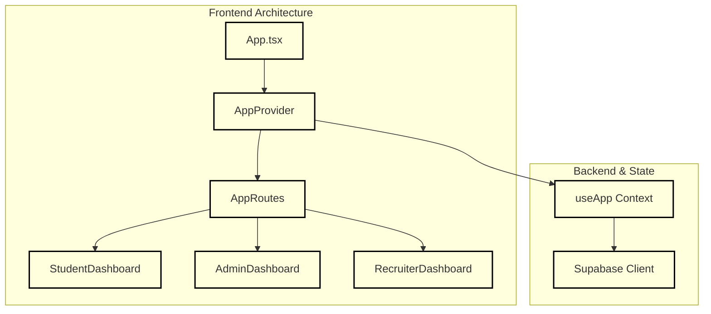
*Figure 1: High-level architectural mapping of the SPMS frontend entry points and context providers.*

Sources: `src/App.tsx:1-81`, `src/contexts/AppContext.ts:1-25`

---

## Core User Roles

The system enforces strict role-based separation (`UserRole`) defined in the TypeScript type definitions:

* **Student**: Explores active job drives, verifies eligibility based on CGPA and academic branches, applies for positions, takes timed technical assessments, and tracks placement offers [src/types/index.ts:1-29](https://github.com/shaik-irfan-cse/smart-placement-management-system/blob/8af656360da6ce567dd3bd200fe4c9f430e3ebf6/src/types/index.ts#L1-L29).
* **Admin**: Oversees system operations, reviews and approves recruiter accounts and head admin escalations, generates placement reports, and monitors campus-wide recruitment metrics [src/types/index.ts:31-40](https://github.com/shaik-irfan-cse/smart-placement-management-system/blob/8af656360da6ce567dd3bd200fe4c9f430e3ebf6/src/types/index.ts#L31-L40).
* **Recruiter**: Manages company profiles, creates and updates job drives, tracks applicants through interview pipelines, and reviews technical test submissions [src/types/index.ts:42-53](https://github.com/shaik-irfan-cse/smart-placement-management-system/blob/8af656360da6ce567dd3bd200fe4c9f430e3ebf6/src/types/index.ts#L42-L53) [src/types/index.ts:55-73](https://github.com/shaik-irfan-cse/smart-placement-management-system/blob/8af656360da6ce567dd3bd200fe4c9f430e3ebf6/src/types/index.ts#L55-L73).

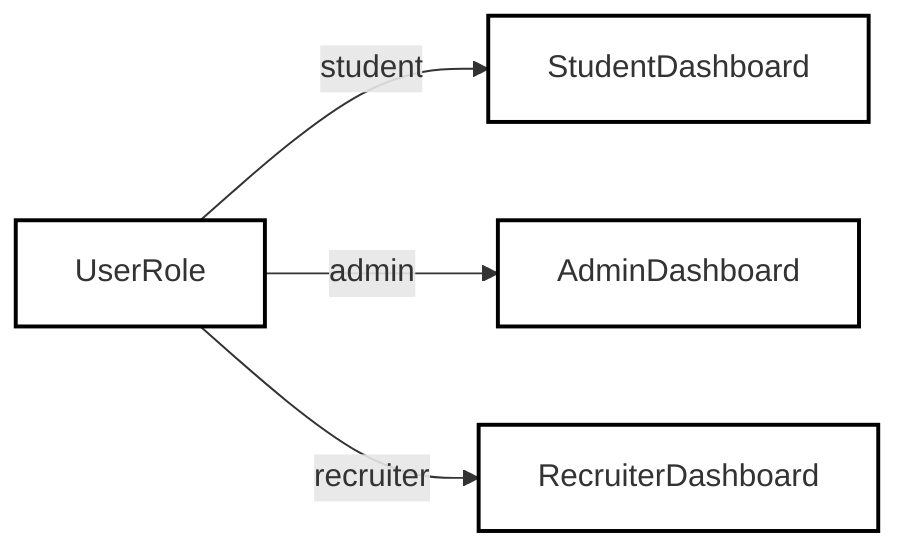
*Figure 2: Role-based routing dispatching users from authentication to their respective dashboards.*

Sources: `src/types/index.ts:1-53`, `src/App.tsx:48-70`

---

## Repository Layout

The codebase is organized into modular directories separating routing, state management, role-specific views, UI components, and domain types:

* `src/`: Root source code directory containing all frontend logic and entry points [src/App.tsx:1](https://github.com/shaik-irfan-cse/smart-placement-management-system/blob/8af656360da6ce567dd3bd200fe4c9f430e3ebf6/src/App.tsx#L1).
* `src/types/`: Global TypeScript interfaces and status enums (`UserRole`, `ApplicationStatus`, `JobDrive`, etc.) [src/types/index.ts:1-122](https://github.com/shaik-irfan-cse/smart-placement-management-system/blob/8af656360da6ce567dd3bd200fe4c9f430e3ebf6/src/types/index.ts#L1-L122).
* `src/contexts/`: Global application state and Supabase synchronization layer (`AppContext`) [src/App.tsx:3](https://github.com/shaik-irfan-cse/smart-placement-management-system/blob/8af656360da6ce567dd3bd200fe4c9f430e3ebf6/src/App.tsx#L3).
* `src/components/`: Shared UI primitives and layout wrappers (`DashboardLayout`, `Modal`, `ToastContainer`) [src/App.tsx:4] [src/components/DashboardLayout.tsx:1](https://github.com/shaik-irfan-cse/smart-placement-management-system/blob/8af656360da6ce567dd3bd200fe4c9f430e3ebf6/src/components/DashboardLayout.tsx#L1).
* `src/pages/`: Role-specific portals (`student/`, `admin/`, `recruiter/`) and authentication pages [src/App.tsx:5-9](https://github.com/shaik-irfan-cse/smart-placement-management-system/blob/8af656360da6ce567dd3bd200fe4c9f430e3ebf6/src/App.tsx#L5-L9).

Sources: `src/App.tsx:1-81`, `src/types/index.ts:1-123`, `src/components/DashboardLayout.tsx:1-40`

---

## Child Pages & Further Reading

* **[Getting Started & Local Setup](#11-getting-started--local-setup)** — Environment variables, Supabase client configuration, Vite/TypeScript compilation settings, and npm run scripts.
* **[Domain Model and Terminology](#12-domain-model-and-terminology)** — TypeScript domain types, status state machines, and relational database bindings used across the codebase.

Sources: `src/types/index.ts:1-123`, `src/App.tsx:1-81`


---

# 1.1 Getting Started & Local Setup

## Purpose and Scope
This document outlines the requirements, environment setup, configuration files, client initialization, and build workflows for the Smart Placement Management System. It details how the frontend client connects to Supabase, how environment variables are typed and consumed, and how the development server and production builds are structured via Vite and TypeScript.

Sources: [`README.md:1-3`](), [`package.json:1-9`](), [`src/lib/supabase.ts:1-14`](), [`src/vite-env.d.ts:1-11`]()

---

## Package Dependencies & Installation
The project relies on modern web technologies including React 18, Vite, Tailwind CSS (via `@tailwindcss/vite`), Supabase JS client (`@supabase/supabase-js`), React Router, Lucide icons, and DnD Kit [package.json:10-35](https://github.com/shaik-irfan-cse/smart-placement-management-system/blob/8af656360da6ce567dd3bd200fe4c9f430e3ebf6/package.json#L10-L35).

To install dependencies locally, run:
```bash
npm install
```

The key dependencies defined in `package.json` are:
- `react` / `react-dom`: UI rendering engine (`^18.2.0`) [package.json:17-20](https://github.com/shaik-irfan-cse/smart-placement-management-system/blob/8af656360da6ce567dd3bd200fe4c9f430e3ebf6/package.json#L17-L20)
- `@supabase/supabase-js`: Database communication and auth client (`^2.98.0`) [package.json:14](https://github.com/shaik-irfan-cse/smart-placement-management-system/blob/8af656360da6ce567dd3bd200fe4c9f430e3ebf6/package.json#L14)
- `react-router-dom`: Client-side routing (`^6.8.0`) [package.json:21](https://github.com/shaik-irfan-cse/smart-placement-management-system/blob/8af656360da6ce567dd3bd200fe4c9f430e3ebf6/package.json#L21)
- `vite` & `@vitejs/plugin-react`: Bundler and dev server (`^6.3.5`, `^4.3.4`) [package.json:29,34](https://github.com/shaik-irfan-cse/smart-placement-management-system/blob/8af656360da6ce567dd3bd200fe4c9f430e3ebf6/package.json#L29)

Sources: [`package.json:1-36`]()

---

## Environment Variables & Typing
The application expects environment variables prefixed with `VITE_` to be exposed to the client bundle. These are specified in a local `.env` file (which is ignored by git [.gitignore:6-8]()).

### Required Environment Variables
- `VITE_SUPABASE_URL`: The URL of the Supabase project instance [src/vite-env.d.ts:4](https://github.com/shaik-irfan-cse/smart-placement-management-system/blob/8af656360da6ce567dd3bd200fe4c9f430e3ebf6/src/vite-env.d.ts#L4)
- `VITE_SUPABASE_PUBLISHABLE_KEY`: The public anonymous or publishable API key for Supabase [src/vite-env.d.ts:5](https://github.com/shaik-irfan-cse/smart-placement-management-system/blob/8af656360da6ce567dd3bd200fe4c9f430e3ebf6/src/vite-env.d.ts#L5)

These variables are typed for TypeScript via `ImportMetaEnv` in [`src/vite-env.d.ts:3-6`]():

```typescript
interface ImportMetaEnv {
  readonly VITE_SUPABASE_URL: string;
  readonly VITE_SUPABASE_PUBLISHABLE_KEY: string;
}
```

Sources: [.gitignore:1-8](), [`src/vite-env.d.ts:1-11`]()

---

## Supabase Client Configuration
The singleton Supabase client is instantiated in [`src/lib/supabase.ts:10-13`]() using `@supabase/supabase-js`'s `createClient`. It pulls variables directly from `import.meta.env`. If variables are missing, it logs a warning and falls back to placeholder strings to prevent hard crashes during build time.

```typescript
import { createClient } from '@supabase/supabase-js';

const supabaseUrl = import.meta.env.VITE_SUPABASE_URL;
const supabasePublishableKey = import.meta.env.VITE_SUPABASE_PUBLISHABLE_KEY;

if (!supabaseUrl || !supabasePublishableKey) {
  console.warn('Supabase credentials not found. Please set VITE_SUPABASE_URL and VITE_SUPABASE_PUBLISHABLE_KEY environment variables.');
}

export const supabase = createClient(
  supabaseUrl || 'https://placeholder.supabase.co',
  supabasePublishableKey || 'placeholder-key'
);
```

### Environment Bootstrapping & Client Initialization
```mermaid
graph TD
    subgraph "Natural Language Space"
      A["Environment File (.env)"] --> B["Vite Environment Loader"]
      B --> C["Supabase Client Singleton"]
    end

    subgraph "Code Entity Space"
      A1[".env file"] -.->|Exposes| B1["import.meta.env.VITE_SUPABASE_URL"]
      A2[".env file"] -.->|Exposes| B2["import.meta.env.VITE_SUPABASE_PUBLISHABLE_KEY"]
      B1 --> C1["createClient() in src/lib/supabase.ts"]
      B2 --> C1
      C1 --> D1["Exported const supabase"]
    end

    Sources: ["src/lib/supabase.ts:1-14", "src/vite-env.d.ts:1-11"]
```
Sources: [`src/lib/supabase.ts:1-14`], [`src/vite-env.d.ts:1-11`]()

---

## Vite & TypeScript Build Configuration
The project uses Vite as its bundler and development server, configured via `vite.config.js`. It includes `@vitejs/plugin-react` and `@tailwindcss/vite` [vite.config.js:1-6](https://github.com/shaik-irfan-cse/smart-placement-management-system/blob/8af656360da6ce567dd3bd200fe4c9f430e3ebf6/vite.config.js#L1-L6).

```javascript
import { defineConfig } from "vite";
import react from "@vitejs/plugin-react";
import tailwindcss from "@tailwindcss/vite";

export default defineConfig({
  plugins: [react(), tailwindcss()],
  server: {
    host: "0.0.0.0",
    port: 3000,
    strictPort: true,
    hmr: {
      port: 3000,
    },
  },
});
```

TypeScript compiler options are specified in `tsconfig.json` with strict mode enabled, bundler module resolution, and React JSX support [tsconfig.json:1-16](https://github.com/shaik-irfan-cse/smart-placement-management-system/blob/8af656360da6ce567dd3bd200fe4c9f430e3ebf6/tsconfig.json#L1-L16):

```json
{
  "compilerOptions": {
    "target": "ES2020",
    "module": "ESNext",
    "lib": ["ES2020", "DOM", "DOM.Iterable"],
    "jsx": "react-jsx",
    "moduleResolution": "bundler",
    "strict": true,
    "skipLibCheck": true,
    "esModuleInterop": true,
    "isolatedModules": true,
    "noEmit": true,
    "allowImportingTsExtensions": true
  },
  "include": ["src"]
}
```

Sources: [`vite.config.js:1-15`], [`tsconfig.json:1-16`]()

---

## NPM Scripts & Execution Flow
The `package.json` file exposes core scripts for local development, production bundling, and type checking [package.json:5-9](https://github.com/shaik-irfan-cse/smart-placement-management-system/blob/8af656360da6ce567dd3bd200fe4c9f430e3ebf6/package.json#L5-L9):

```json
"scripts": {
  "dev": "vite",
  "build": "vite build",
  "typecheck": "tsc --noEmit"
}
```

- `npm run dev`: Starts the Vite development server on port `3000` bound to `0.0.0.0` [vite.config.js:7-14](https://github.com/shaik-irfan-cse/smart-placement-management-system/blob/8af656360da6ce567dd3bd200fe4c9f430e3ebf6/vite.config.js#L7-L14).
- `npm run build`: Bundles the React application for production output.
- `npm run typecheck`: Runs the TypeScript compiler (`tsc --noEmit`) to catch type errors without emitting output files [package.json:8](https://github.com/shaik-irfan-cse/smart-placement-management-system/blob/8af656360da6ce567dd3bd200fe4c9f430e3ebf6/package.json#L8).

### Build and Compilation Architecture
```mermaid
graph TD
    subgraph "Natural Language Space"
      E["Developer Command"] --> F["Vite Dev Server / Bundler"]
      F --> G["React Root Rendering"]
    end

    subgraph "Code Entity Space"
      E1["npm run dev"] --> F1["vite in vite.config.js"]
      E2["npm run typecheck"] --> F2["tsc --noEmit in tsconfig.json"]
      F1 --> G1["src/main.tsx DOM mounting"]
      G1 --> H1["App.tsx root component"]
    end

    Sources: ["package.json:5-9", "src/main.tsx:1-7", "vite.config.js:1-15"]
```
Sources: [`package.json:5-9`], [`src/main.tsx:1-7`], [`vite.config.js:1-15`], [`tsconfig.json:1-16`]()


---

# 1.2 Domain Model and Terminology

The domain model of the Smart Placement Management System defines the structural data contracts, role taxonomies, and lifecycle status enums used across the React frontend and Supabase backend. All core TypeScript interfaces and enums are centralized in `[src/types/index.ts](src/types/index.ts:1-123)`, providing a strongly-typed foundation for entity management, job drives, application workflows, and student placements.

---

## 1. Core Status Enums

The system relies on strict union types to govern permissions, approval gates, job lifecycles, and application pipelines (`[src/types/index.ts](src/types/index.ts:1-7)`):

*   `UserRole`: Determines access control boundaries (`'student' | 'admin' | 'recruiter'`).
*   `ApprovalStatus`: Manages verification and gating for recruiters and secondary admins (`'PENDING' | 'APPROVED' | 'REJECTED'`).
*   `ApplicationStatus`: Tracks a student's progression through a specific job drive (`'APPLIED' | 'TEST_PENDING' | 'TEST_COMPLETED' | 'PASSED' | 'FAILED' | 'UNDER_REVIEW' | 'SELECTED' | 'REJECTED'`).
*   `PlacementStatus`: Represents a student's overall placement standing (`'PLACED' | 'NOT_PLACED' | 'IN_PROCESS'`).
*   `DriveStatus`: Controls visibility and application availability for job listings (`'ACTIVE' | 'CLOSED' | 'EXPIRED'`).

```
Sources: [src/types/index.ts:1-7]()
```

---

## 2. Entity Interfaces and Data Contracts

The application domain models five primary actors/entities and several transactional data structures.

### Actors and Profiles
*   `User`: Base authentication record holding `id`, `email`, `role`, and `createdAt` (`[src/types/index.ts](src/types/index.ts:8-14)`).
*   `Student`: Academic profile linked via `userId`, capturing roll numbers, branches, CGPA, skills, resume references, and `placementStatus` (`[src/types/index.ts](src/types/index.ts:16-29)`).
*   `Admin`: Administrative staff profile containing `employeeId`, department, and flags for `isHeadAdmin` privileges and `approvalStatus` (`[src/types/index.ts](src/types/index.ts:31-40)`).
*   `Recruiter`: Company hiring representative profile storing company details, contact info, website, and verification `approvalStatus` (`[src/types/index.ts](src/types/index.ts:42-53)`).

### Transactions and Operational Data
*   `JobDrive`: Represents recruitment drives posted by recruiters, detailing package, location, eligibility thresholds (CGPA, branches, skills), deadlines, and test parameters (`[src/types/index.ts](src/types/index.ts:55-73)`).
*   `Application`: Junction entity linking a `studentId` and `jobDriveId` with a specific `ApplicationStatus` (`[src/types/index.ts](src/types/index.ts:75-82)`).
*   `TestQuestion` & `TestResult`: Structures for online technical assessments administered during job applications (`[src/types/index.ts](src/types/index.ts:84-101)`).
*   `Placement`: Final record created when a student is selected for a job drive, logging the company, role, package, and selection date (`[src/types/index.ts](src/types/index.ts:113-122)`).

```
Sources: [src/types/index.ts:8-122]()
```

---

## 3. Entity Relationship Mapping

The following diagram bridges natural language business concepts to their exact TypeScript interface definitions in `[src/types/index.ts](src/types/index.ts)`.

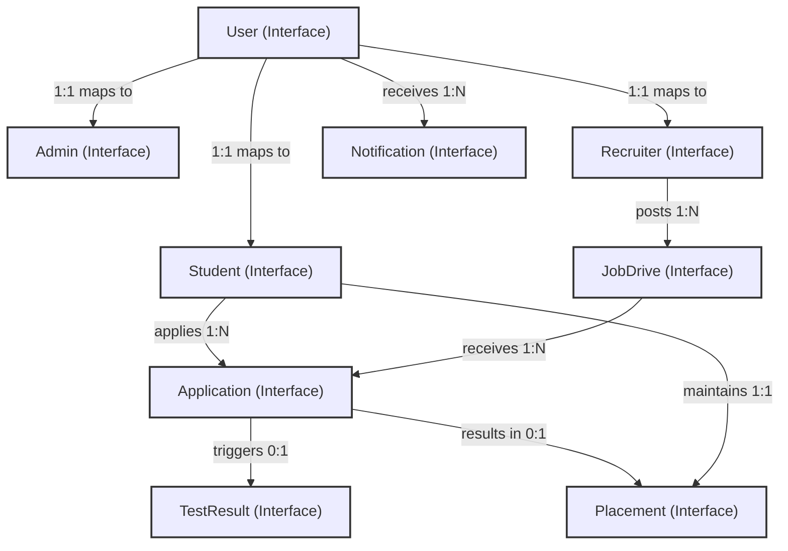

```
Sources: [src/types/index.ts:8-122](), [src/data/sampleData.ts:1-47]()
```

---

## 4. Application Status Machine and Pipeline

The application lifecycle transitions through distinct validation and assessment phases. When an application reaches the `SELECTED` state, a downstream `Placement` record is generated.

```mermaid
stateDiagram-v2
    [*] --> APPLIED: "Student applies to JobDrive"
    APPLIED --> TEST_PENDING: "Assessment assigned"
    TEST_PENDING --> TEST_COMPLETED: "Student submits test"
    TEST_COMPLETED --> PASSED: "Score >= testPassPercentage"
    TEST_COMPLETED --> FAILED: "Score < testPassPercentage"
    PASSED --> UNDER_REVIEW: "Recruiter reviews profile"
    UNDER_REVIEW --> SELECTED: "Recruiter offers position"
    UNDER_REVIEW --> REJECTED: "Application declined"
    
    SELECTED --> PLACED: "Placement record created"

    classDef default stroke:#333,stroke-width:1px;
```

```
Sources: [src/types/index.ts:4-5](), [src/types/index.ts:75-82](), [src/types/index.ts:113-122]()
```


---

# 2. Frontend Architecture

## Purpose and Scope
This page provides a high-level overview of the React Single Page Application (SPA) built for the Smart Placement Management System (SPMS). The frontend is built using React, Vite, TypeScript, Tailwind CSS, and Supabase client libraries, structured around protected route guards, role-based dashboards, and a centralized context state layer. 

For deep technical implementation details, refer to the following child pages:
- [Routing, Layout and UI Components](#21-routing-layout-and-ui-components)
- [Global State: AppContext](#22-global-state-appcontext)
- [Authentication and Signup Flows](#23-authentication-and-signup-flows)

---

## 2.1. Routing, Layout and UI Components

The application routing architecture is anchored by `src/App.tsx`, which wraps the view tree in a `BrowserRouter` and `AppProvider` [src/App.tsx:72-80](https://github.com/shaik-irfan-cse/smart-placement-management-system/blob/8af656360da6ce567dd3bd200fe4c9f430e3ebf6/src/App.tsx#L72-L80). Public and private routes are segregated using `GuestGuard` [src/App.tsx:30-46](https://github.com/shaik-irfan-cse/smart-placement-management-system/blob/8af656360da6ce567dd3bd200fe4c9f430e3ebf6/src/App.tsx#L30-L46) and `AuthGuard` [src/App.tsx:11-28](https://github.com/shaik-irfan-cse/smart-placement-management-system/blob/8af656360da6ce567dd3bd200fe4c9f430e3ebf6/src/App.tsx#L11-L28) components that check authentication states and user roles before rendering dashboards.

Layout structure for authenticated user roles (`student`, `admin`, `recruiter`) is standardized via `DashboardLayout` [src/components/DashboardLayout.tsx:20](https://github.com/shaik-irfan-cse/smart-placement-management-system/blob/8af656360da6ce567dd3bd200fe4c9f430e3ebf6/src/components/DashboardLayout.tsx#L20), which injects a responsive collapsible sidebar [src/components/DashboardLayout.tsx:45](https://github.com/shaik-irfan-cse/smart-placement-management-system/blob/8af656360da6ce567dd3bd200fe4c9f430e3ebf6/src/components/DashboardLayout.tsx#L45), a top navigation bar with notification dropdowns [src/components/DashboardLayout.tsx:97](https://github.com/shaik-irfan-cse/smart-placement-management-system/blob/8af656360da6ce567dd3bd200fe4c9f430e3ebf6/src/components/DashboardLayout.tsx#L97), and profile management hooks [src/components/DashboardLayout.tsx:138](https://github.com/shaik-irfan-cse/smart-placement-management-system/blob/8af656360da6ce567dd3bd200fe4c9f430e3ebf6/src/components/DashboardLayout.tsx#L138). Reusable UI components—such as `Toast`, `Modal`, `ConfirmDialog`, and `StatusBadge`—are centralized in `src/components/UI.tsx` [src/components/UI.tsx:1-182](https://github.com/shaik-irfan-cse/smart-placement-management-system/blob/8af656360da6ce567dd3bd200fe4c9f430e3ebf6/src/components/UI.tsx#L1-L182), adhering to a unified styling system defined in `src/index.css` [src/index.css:1-67](https://github.com/shaik-irfan-cse/smart-placement-management-system/blob/8af656360da6ce567dd3bd200fe4c9f430e3ebf6/src/index.css#L1-L67).

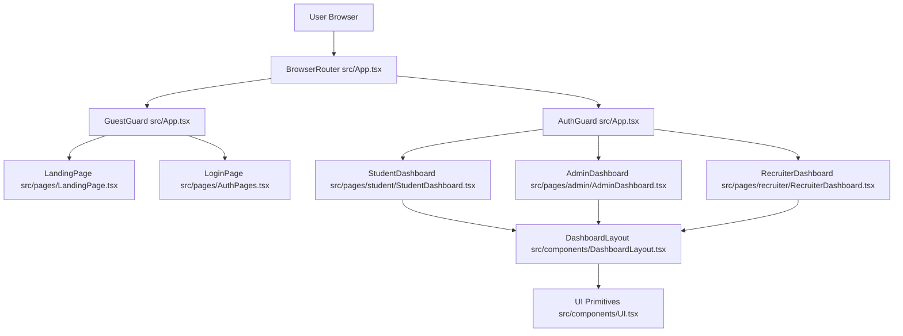
*Figure 2.1: Routing and Layout Component Hierarchy.*

Sources: `src/App.tsx:1-81`, `src/components/DashboardLayout.tsx:1-148`, `src/components/UI.tsx:1-182`, `src/index.css:1-67`, `src/pages/LandingPage.tsx:1-59`

For details, see [Routing, Layout and UI Components](#21-routing-layout-and-ui-components).

---

## 2.2. Global State: AppContext

Global state management is centralized within `src/contexts/AppContext.tsx` (detailed in child page 2.2). The `AppProvider` component manages session lifecycles, global lookup entities (jobs, applications, notifications, student profiles), and data synchronization with Supabase. 

State mutation functions and mapping layers abstract direct database queries into predictable frontend actions. Additionally, automated backfill synchronization effects run on state initialization to ensure consistency between user records and placement tracking tables.

For details, see [Global State: AppContext](#22-global-state-appcontext).

---

## 2.3. Authentication and Signup Flows

Authentication and role-based onboarding are managed through dedicated views for students, college admins, and recruiters. Session handling relies on Supabase Auth tokens mapped to internal user records. 

Role-based portals implement strict validation rules, including approval gating where admin and recruiter accounts require head-admin authorization before gaining full dashboard access.

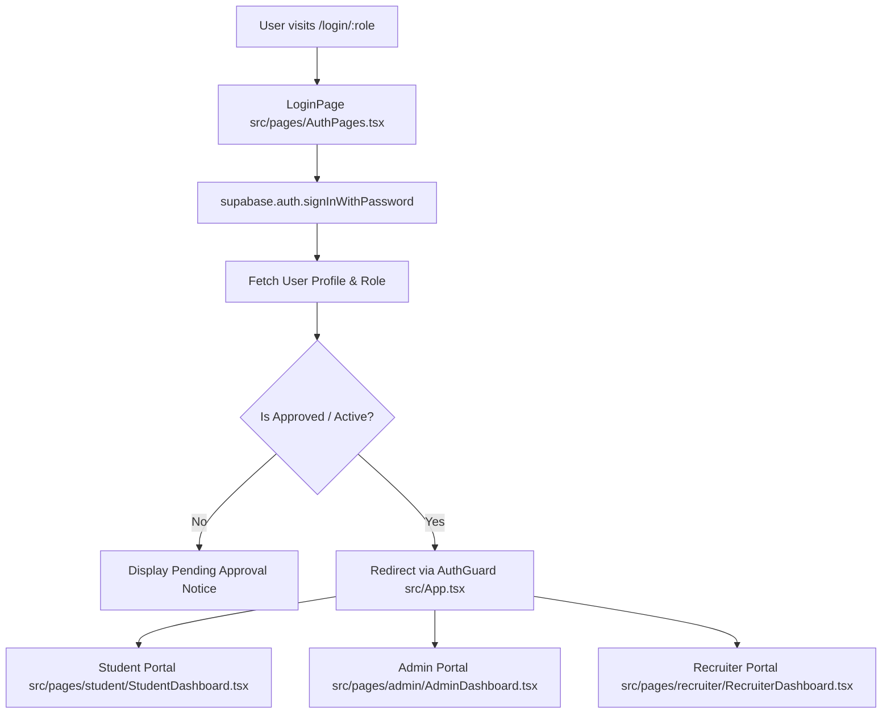
*Figure 2.2: Authentication and Role-Based Portal Routing.*

Sources: `src/App.tsx:11-70`, `src/components/DashboardLayout.tsx:20-41`

For details, see [Authentication and Signup Flows](#23-authentication-and-signup-flows).


---

# 2.1 Routing, Layout and UI Components

This page documents the routing architecture, layout templates, shared UI primitives, styling system, and the public landing page of the Smart Placement Management System (SPMS). It covers implementation details in `src/App.tsx`, `src/components/DashboardLayout.tsx`, `src/components/UI.tsx`, `src/index.css`, and `src/pages/LandingPage.tsx`.

---

## 1. Route Tree and Navigation Guards (`src/App.tsx`)

The root application component wraps the component tree with `BrowserRouter` from `react-router-dom` and `AppProvider` from `src/contexts/AppContext` [src/App.tsx:72-81](https://github.com/shaik-irfan-cse/smart-placement-management-system/blob/8af656360da6ce567dd3bd200fe4c9f430e3ebf6/src/App.tsx#L72-L81). 

### Route Guard Architecture

Navigation and authorization are governed by two higher-order wrapper components:
1. `AuthGuard`: Restricts access to authenticated users matching a specified role (`student`, `admin`, `recruiter`). If `authLoading` is true, it displays a `LoadingSpinner` [src/App.tsx:11-23](https://github.com/shaik-irfan-cse/smart-placement-management-system/blob/8af656360da6ce567dd3bd200fe4c9f430e3ebf6/src/App.tsx#L11-L23). If `currentUser` is unauthenticated, it redirects to `/login`. If the role does not match, it redirects to the user's correct dashboard path `/${currentUser.role}/dashboard` [src/App.tsx:25-27](https://github.com/shaik-irfan-cse/smart-placement-management-system/blob/8af656360da6ce567dd3bd200fe4c9f430e3ebf6/src/App.tsx#L25-L27).
2. `GuestGuard`: Restricts access to unauthenticated guests (e.g., login, signup, landing pages). If the user is already logged in, they are redirected to their corresponding role dashboard [src/App.tsx:30-46](https://github.com/shaik-irfan-cse/smart-placement-management-system/blob/8af656360da6ce567dd3bd200fe4c9f430e3ebf6/src/App.tsx#L30-L46).

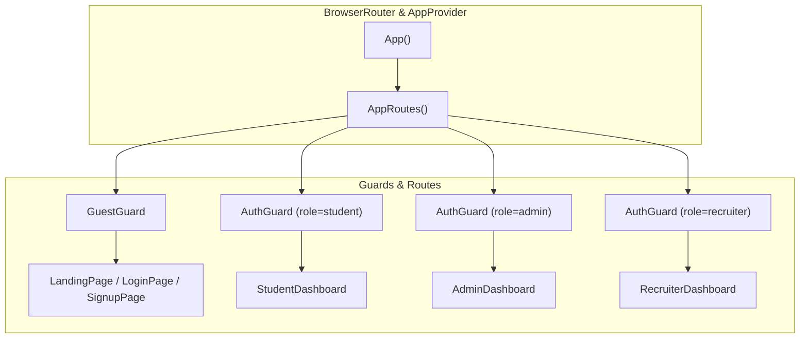
*Sources: [src/App.tsx:11-81](https://github.com/shaik-irfan-cse/smart-placement-management-system/blob/8af656360da6ce567dd3bd200fe4c9f430e3ebf6/src/App.tsx#L11-L81)*

---

## 2. Dashboard Layout and Navigation (`src/components/DashboardLayout.tsx`)

The `DashboardLayout` component provides a consistent responsive shell for all three user portals (`student`, `admin`, `recruiter`). It accepts `navItems`, `role`, `userName`, and `children` [src/components/DashboardLayout.tsx:13-20](https://github.com/shaik-irfan-cse/smart-placement-management-system/blob/8af656360da6ce567dd3bd200fe4c9f430e3ebf6/src/components/DashboardLayout.tsx#L13-L20).

### Key Features
- **Responsive Sidebar**: Fixed-position sidebar on large screens (`lg:translate-x-0`), sliding drawer overlay on mobile (`sidebarOpen`) [src/components/DashboardLayout.tsx:45-87](https://github.com/shaik-irfan-cse/smart-placement-management-system/blob/8af656360da6ce567dd3bd200fe4c9f430e3ebf6/src/components/DashboardLayout.tsx#L45-L87) [src/components/DashboardLayout.tsx:90-92](https://github.com/shaik-irfan-cse/smart-placement-management-system/blob/8af656360da6ce567dd3bd200fe4c9f430e3ebf6/src/components/DashboardLayout.tsx#L90-L92).
- **Role-Based Styling**: Dynamic background colors mapped via `roleColors` (`student: indigo`, `admin: blue`, `recruiter: purple`) [src/components/DashboardLayout.tsx:31-35](https://github.com/shaik-irfan-cse/smart-placement-management-system/blob/8af656360da6ce567dd3bd200fe4c9f430e3ebf6/src/components/DashboardLayout.tsx#L31-L35) [src/components/DashboardLayout.tsx:48](https://github.com/shaik-irfan-cse/smart-placement-management-system/blob/8af656360da6ce567dd3bd200fe4c9f430e3ebf6/src/components/DashboardLayout.tsx#L48).
- **Top Navbar**: Includes a mobile menu toggle, real-time notification dropdown (`notifOpen`) showing unread items via `getUnreadCount()`, and a user profile dropdown (`profileOpen`) with session termination handlers (`handleLogout`) [src/components/DashboardLayout.tsx:95-148](https://github.com/shaik-irfan-cse/smart-placement-management-system/blob/8af656360da6ce567dd3bd200fe4c9f430e3ebf6/src/components/DashboardLayout.tsx#L95-L148).

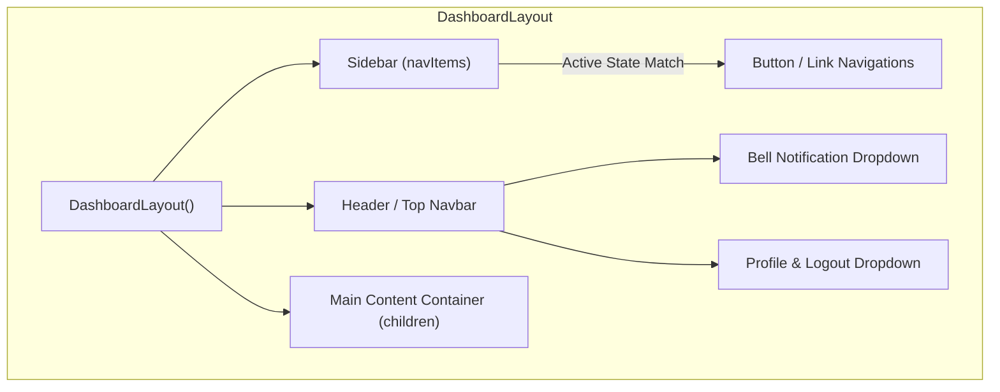
*Sources: [src/components/DashboardLayout.tsx:7-148](https://github.com/shaik-irfan-cse/smart-placement-management-system/blob/8af656360da6ce567dd3bd200fe4c9f430e3ebf6/src/components/DashboardLayout.tsx#L7-L148)*

---

## 3. Shared UI Primitives (`src/components/UI.tsx`)

The codebase exports reusable UI components in `src/components/UI.tsx` to maintain visual consistency across all portals:

- **`Toast` & `ToastContainer`**: Floating alert notifications supporting `success`, `error`, `info`, and `warning` variants with auto-dismissal timers [src/components/UI.tsx:11-70](https://github.com/shaik-irfan-cse/smart-placement-management-system/blob/8af656360da6ce567dd3bd200fe4c9f430e3ebf6/src/components/UI.tsx#L11-L70).
- **`Modal`**: Backdrop-blurred modal dialog supporting multiple sizes (`sm`, `md`, `lg`) [src/components/UI.tsx:73-100](https://github.com/shaik-irfan-cse/smart-placement-management-system/blob/8af656360da6ce567dd3bd200fe4c9f430e3ebf6/src/components/UI.tsx#L73-L100).
- **`ConfirmDialog`**: Specialized modal confirmation prompt for destructive actions [src/components/UI.tsx:103-131](https://github.com/shaik-irfan-cse/smart-placement-management-system/blob/8af656360da6ce567dd3bd200fe4c9f430e3ebf6/src/components/UI.tsx#L103-L131).
- **`StatusBadge`**: Status badge renderer mapping domain enums (`PENDING`, `APPROVED`, `APPLIED`, `SELECTED`, `PLACED`, etc.) to distinct Tailwind color classes and human-readable labels [src/components/UI.tsx:134-182](https://github.com/shaik-irfan-cse/smart-placement-management-system/blob/8af656360da6ce567dd3bd200fe4c9f430e3ebf6/src/components/UI.tsx#L134-L182).
- **`StatsCard`**: Metric display card incorporating icon containers and color themes [src/components/UI.tsx:185-206](https://github.com/shaik-irfan-cse/smart-placement-management-system/blob/8af656360da6ce567dd3bd200fe4c9f430e3ebf6/src/components/UI.tsx#L185-L206).

Sources: `[src/components/UI.tsx:1-206]()`

---

## 4. Styling System & Tailwind Configuration (`src/index.css`)

Styling is built on Tailwind CSS v4 (`@import "tailwindcss";`) [src/index.css:1](https://github.com/shaik-irfan-cse/smart-placement-management-system/blob/8af656360da6ce567dd3bd200fe4c9f430e3ebf6/src/index.css#L1). Custom CSS variables and component utility classes are defined within layers:

- **Base Variables**: `--primary`, `--primary-light`, `--primary-dark` [src/index.css:4-8](https://github.com/shaik-irfan-cse/smart-placement-management-system/blob/8af656360da6ce567dd3bd200fe4c9f430e3ebf6/src/index.css#L4-L8).
- **Component Classes**: Pre-composed classes such as `.btn-primary`, `.btn-secondary`, `.btn-danger`, `.card`, `.input-field`, and `.badge` [src/index.css:20-48](https://github.com/shaik-irfan-cse/smart-placement-management-system/blob/8af656360da6ce567dd3bd200fe4c9f430e3ebf6/src/index.css#L20-L48).
- **Utilities**: Custom scrollbar styling (`.scrollbar-thin`) for overflow containers [src/index.css:50-67](https://github.com/shaik-irfan-cse/smart-placement-management-system/blob/8af656360da6ce567dd3bd200fe4c9f430e3ebf6/src/index.css#L50-L67).

Sources: `[src/index.css:1-67]()`

---

## 5. Public Landing Page (`src/pages/LandingPage.tsx`)

The `LandingPage` serves as the primary entry point for unauthenticated visitors [src/pages/LandingPage.tsx:5](https://github.com/shaik-irfan-cse/smart-placement-management-system/blob/8af656360da6ce567dd3bd200fe4c9f430e3ebf6/src/pages/LandingPage.tsx#L5).

### Sections Included
- **Sticky Navbar**: SPMS logo, section anchor links, and action buttons (`Login`, `Get Started`) [src/pages/LandingPage.tsx:11-29](https://github.com/shaik-irfan-cse/smart-placement-management-system/blob/8af656360da6ce567dd3bd200fe4c9f430e3ebf6/src/pages/LandingPage.tsx#L11-L29).
- **Hero Section**: Value proposition ("Campus Placement Made Simple") with quick navigation links into role-specific login routes [src/pages/LandingPage.tsx:31-59](https://github.com/shaik-irfan-cse/smart-placement-management-system/blob/8af656360da6ce567dd3bd200fe4c9f430e3ebf6/src/pages/LandingPage.tsx#L31-L59).
- **Role Cards Grid**: Dedicated feature highlights and direct login actions for **Student**, **College Admin**, and **Recruiter / HR** portals [src/pages/LandingPage.tsx:61-118](https://github.com/shaik-irfan-cse/smart-placement-management-system/blob/8af656360da6ce567dd3bd200fe4c9f430e3ebf6/src/pages/LandingPage.tsx#L61-L118).

Sources: `[src/pages/LandingPage.tsx:1-118]()`


---

# 2.2 Global State: AppContext

## Purpose and Scope
Section 2.2 details the frontend global state management layer of the Smart Placement Management System via `src/contexts/AppContext.tsx`. The `AppContext` provides a unified React context (`AppProvider`) that holds application-wide state—including entity collections (students, admins, recruiters, job drives, applications, test results, and placements), authentication metadata, session status, and transactional mutation helpers. It also implements a critical database-to-frontend mapping layer that converts PostgreSQL `snake_case` table rows into camelCase TypeScript domain models.

Sources: [`src/contexts/AppContext.tsx:1-193]()`

---

## 1. State Shape and TypeScript Interfaces
The global state is bifurcated into two primary TypeScript interfaces: `AppState`, which encapsulates raw entity collections fetched from Supabase, and `AppContextType`, which extends `AppState` with active user context, authentication flags, and operational mutation/fetch methods [src/contexts/AppContext.tsx:5-42](https://github.com/shaik-irfan-cse/smart-placement-management-system/blob/8af656360da6ce567dd3bd200fe4c9f430e3ebf6/src/contexts/AppContext.tsx#L5-L42).

```
+-------------------------------------------------------------+
              AppState (Entity Collections)
+-------------------------------------------------------------+
| students: Student[]         | testResults: TestResult[]     |
| admins: Admin[]             | testQuestions: TestQuestion[] |
| recruiters: Recruiter[]     | notifications: Notification[] |
| jobDrives: JobDrive[]       | placements: Placement[]       |
| applications: Application[] |                               |
+-------------------------------------------------------------+
                           ▲
                           │ extends
                           ▼
+-------------------------------------------------------------+
              AppContextType (State + Actions)
+-------------------------------------------------------------+
| currentUser: User | null    | login(...)                    |
| currentStudent: Student|null| logout(...)                   |
| currentAdmin: Admin | null  | signup(...)                   |
| currentRecruiter: Recruiter | refreshData()                 |
| loading: boolean            | addApplication(...)           |
| authLoading: boolean        | updateApplicationStatus(...)  |
+-------------------------------------------------------------+
```
*Figure 1: Architectural relationship between `AppState` and `AppContextType`.*

Sources: [`src/contexts/AppContext.tsx:5-42]()`

---

## 2. Supabase Mapping Layer
Because PostgreSQL schemas use `snake_case` conventions (e.g., `user_id`, `company_name`, `eligibility_cgpa`), the context defines deterministic mapping functions before committing rows into camelCase TypeScript interfaces. 

| Mapping Function | Source Schema Fields (`snake_case`) | Target Interface (`camelCase`) | Code Pointer |
| :--- | :--- | :--- | :--- |
| `mapStudent` | `user_id`, `roll_number`, `resume_url`, `placement_status` | `Student` | [`src/contexts/AppContext.tsx:47-62]()` |
| `mapAdmin` | `user_id`, `employee_id`, `is_head_admin`, `approval_status` | `Admin` | [`src/contexts/AppContext.tsx:64-75]()` |
| `mapRecruiter` | `user_id`, `company_name`, `recruiter_name`, `approval_status` | `Recruiter` | [`src/contexts/AppContext.tsx:77-89]()` |
| `mapJobDrive` | `recruiter_id`, `job_description`, `eligibility_cgpa`, `eligible_branches` | `JobDrive` | [`src/contexts/AppContext.tsx:91-111]()` |
| `mapApplication` | `student_id`, `job_drive_id`, `applied_at`, `updated_at` | `Application` | [`src/contexts/AppContext.tsx:113-122]()` |
| `mapTestQuestion`| `correct_answer`, `options` | `TestQuestion` | [`src/contexts/AppContext.tsx:124-131]()` |
| `mapTestResult` | `application_id`, `student_id`, `total_questions`, `submitted_at` | `TestResult` | [`src/contexts/AppContext.tsx:133-145]()` |
| `mapNotification`| `user_id`, `created_at`, `type` | `Notification` | [`src/contexts/AppContext.tsx:147-157]()` |
| `mapPlacement` | `student_id`, `job_drive_id`, `company_name`, `selection_date` | `Placement` | [`src/contexts/AppContext.tsx:159-170]()` |

```mermaid
graph TD
    sub5["Supabase Database Tables"]
    sub5 -->| "students table" | mapS["mapStudent(row)"]
    sub5 -->| "admins table" | mapA["mapAdmin(row)"]
    sub5 -->| "job_drives table" | mapJ["mapJobDrive(row)"]
    
    mapS -->| "snake_case to camelCase" | StState["state.students"]
    mapA -->| "snake_case to camelCase" | AdState["state.admins"]
    mapJ -->| "snake_case to camelCase" | JdState["state.jobDrives"]
    
    StState --> AppProv["AppProvider Context"]
    AdState --> AppProv
    JdState --> AppProv
```
*Figure 2: Data transformation flow from Supabase relational tables to `AppProvider` collections.*

Sources: [`src/contexts/AppContext.tsx:47-170]()`

---

## 3. Data Synchronization: `refreshData`
The `refreshData` callback coordinates state hydration by executing concurrent queries across all primary Supabase relations using `Promise.all` [src/contexts/AppContext.tsx:189-193](https://github.com/shaik-irfan-cse/smart-placement-management-system/blob/8af656360da6ce567dd3bd200fe4c9f430e3ebf6/src/contexts/AppContext.tsx#L189-L193).

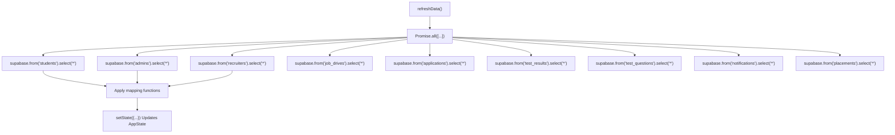
*Figure 3: Concurrent fetch execution path within `refreshData`.*

Sources: [`src/contexts/AppContext.tsx:189-193]()`

---

## 4. Context Provider Lifecycle and Mutations
The `AppProvider` component wraps the React component hierarchy, maintaining local React state for entity collections, authentication state, and async operations. 

- **State Initialization**: Declares React `useState` hooks for `students`, `admins`, `recruiters`, `jobDrives`, `applications`, `testResults`, `testQuestions`, `notifications`, and `placements` [src/contexts/AppContext.tsx:173-183](https://github.com/shaik-irfan-cse/smart-placement-management-system/blob/8af656360da6ce567dd3bd200fe4c9f430e3ebf6/src/contexts/AppContext.tsx#L173-L183).
- **Authentication State Hooks**: Manages `currentUser`, `loading`, and `authLoading` flags to gate portal access [src/contexts/AppContext.tsx:184-186](https://github.com/shaik-irfan-cse/smart-placement-management-system/blob/8af656360da6ce567dd3bd200fe4c9f430e3ebf6/src/contexts/AppContext.tsx#L184-L186).
- **Mutation API**: Exposes specialized async functions (e.g., `addApplication`, `updateApplicationStatus`, `addJobDrive`, `updateJobDrive`, `deleteJobDrive`, `updateRecruiterApproval`, `updateStudentProfile`, `addPlacement`, `addNotification`, `markNotificationRead`) that execute write operations against Supabase tables and trigger immediate state synchronization via `refreshData` [src/contexts/AppContext.tsx:24-41](https://github.com/shaik-irfan-cse/smart-placement-management-system/blob/8af656360da6ce567dd3bd200fe4c9f430e3ebf6/src/contexts/AppContext.tsx#L24-L41).

Sources: [`src/contexts/AppContext.tsx:172-187]()`


---

# 2.3 Authentication and Signup Flows

## Purpose and Scope
This document details the authentication, user registration, session management, and approval gating mechanisms implemented within the Smart Placement Management System (SPMS). It covers the React component layer (`[src/pages/AuthPages.tsx]()`), the global context mutation and state management layer (`[src/contexts/AppContext.tsx]()`), Supabase client interactions (`[src/lib/supabase.ts]()`), and database-level Row Level Security (RLS) policies governing user creation and access control.

Sources:
- `[src/pages/AuthPages.tsx:1-308]()`
- `[src/contexts/AppContext.tsx:1-1358]()`
- `[src/lib/supabase.ts:1-13]()`

---

## Login Architecture and Execution Flow

Authentication for the three distinct system roles (`student`, `admin`, `recruiter`) is managed centrally via `LoginPage` in `[src/pages/AuthPages.tsx:8-126]()`, which delegates authentication logic to the `login` method exposed by `AppProvider` in `[src/contexts/AppContext.tsx:24]()`.

When a user submits credentials, the client executes `supabase.auth.signInWithPassword()` through the Supabase client initialized in `[src/lib/supabase.ts:10-13]().` Upon successful token generation, the application queries the `profiles` table to verify that the retrieved user's role matches the target authentication portal (`student`, `admin`, or `recruiter`).

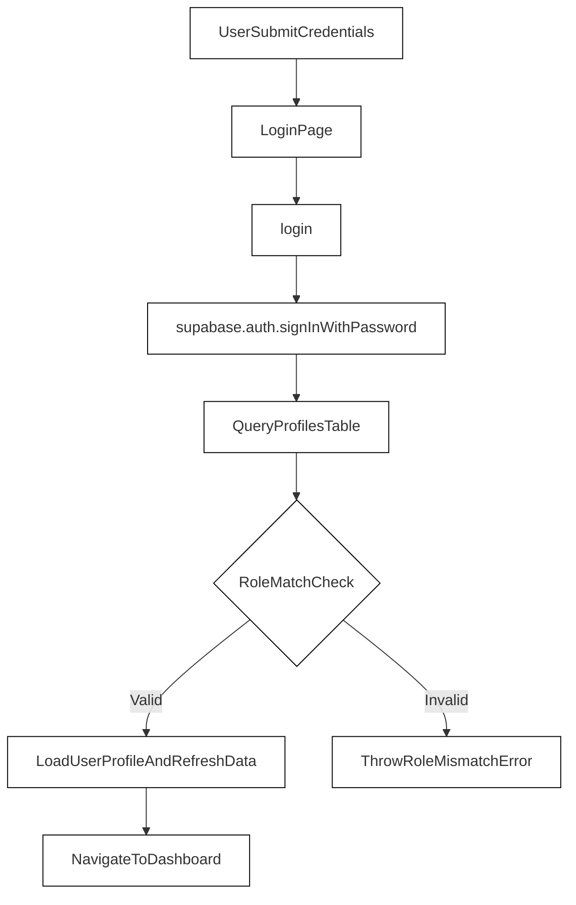
*Figure 1: Login flow mapping natural language actions to code entities.*

Sources:
- `[src/pages/AuthPages.tsx:26-41]()`
- `[src/contexts/AppContext.tsx:24]()`
- `[src/lib/supabase.ts:10-13]()`

---

## Signup and Role-Specific Provisioning

User registration is handled by `SignupPage` (`[src/pages/AuthPages.tsx:128-308]()`) and processed by the `signup` asynchronous function in `[src/contexts/AppContext.tsx:26]()`. The signup workflow handles multi-table provisioning across Supabase Auth (`auth.users`), the general `profiles` table, and role-specific tables (`students`, `recruiters`, or `admins`).

To address edge cases involving RLS validation and missing relational attributes during registration (documented in `[FINAL_REGISTRATION_FIX_REPORT.md:1-222]()` and `[REGISTRATION_FIX_SUMMARY.md:1-326]()`), the flow explicitly verifies session stabilization, includes the mandatory `email` field when inserting role-specific records, and executes a database verification query before returning success.

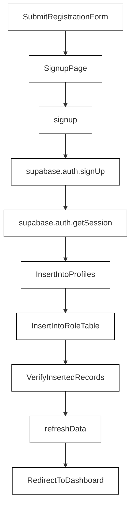
*Figure 2: Signup and multi-table provisioning flow.*

Sources:
- `[src/pages/AuthPages.tsx:128-308]()`
- `[src/contexts/AppContext.tsx:26]()`
- `[FINAL_REGISTRATION_FIX_REPORT.md:1-222]()`
- `[REGISTRATION_FIX_SUMMARY.md:1-326]()`

---

## Session Handling and State Hydration

Once authenticated, user session data is maintained via Supabase Auth token storage. The `AppProvider` component manages session lifecycles and pulls relational records via `refreshData` (`[src/contexts/AppContext.tsx:189-234]()`). 

Data fetching relies on helper mapper functions (`mapStudent`, `mapAdmin`, `mapRecruiter`, etc.) defined in `[src/contexts/AppContext.tsx:47-170]()` to translate snake_case database rows into strongly typed TypeScript domain interfaces (`[src/types.ts]()`). Row Level Security (RLS) policies enforce that users can only read or write records matching their authenticated `auth.uid()`, securing personal student profiles, recruiter drives, and admin operations.

Sources:
- `[src/contexts/AppContext.tsx:47-234]()`
- `[REGISTRATION_FIX_SUMMARY.md:106-130]()`

---

## Approval Gating and Role Enforcement

Certain roles require administrative approval before full portal capabilities are unlocked. Specifically:
- **Recruiters**: Newly registered recruiter accounts start with an `approvalStatus` of `PENDING` (`[src/contexts/AppContext.tsx:87]()`), restricting drive creation until approved by an administrator via `updateRecruiterApproval` (`[src/contexts/AppContext.tsx:35]()`).
- **Admins**: Handled through approval gating flags (`approvalStatus` and `isHeadAdmin`), protected by database-level policies and head-admin privileges (`[src/contexts/AppContext.tsx:41,40]()`).

Sources:
- `[src/contexts/AppContext.tsx:35-42]()`
- `[src/contexts/AppContext.tsx:72-87]()`


---

# 3. User Portals

The Smart Placement Management System implements a role-segmented single-page application architecture where users are directed to dedicated portals depending on their authenticated role: Student, Administrator, or Recruiter. Each portal wraps its views in a standardized `DashboardLayout` component (`src/components/DashboardLayout.tsx`) and consumes global state via `useApp()` from `src/contexts/AppContext.tsx` [src/pages/student/StudentDashboard.swift:4-5](https://github.com/shaik-irfan-cse/smart-placement-management-system/blob/8af656360da6ce567dd3bd200fe4c9f430e3ebf6/src/pages/student/StudentDashboard.swift#L4-L5), [src/pages/admin/AdminDashboard.tsx:4-5](https://github.com/shaik-irfan-cse/smart-placement-management-system/blob/8af656360da6ce567dd3bd200fe4c9f430e3ebf6/src/pages/admin/AdminDashboard.tsx#L4-L5), [src/pages/recruiter/RecruiterDashboard.tsx:4-5](https://github.com/shaik-irfan-cse/smart-placement-management-system/blob/8af656360da6ce567dd3bd200fe4c9f430e3ebf6/src/pages/recruiter/RecruiterDashboard.tsx#L4-L5).

This parent page provides a high-level overview of the three role-based dashboards. For in-depth technical breakdowns, refer to the respective child pages:
- [Student Portal](#31-student-portal)
- [Admin Portal](#32-admin-portal)
- [Recruiter Portal](#33-recruiter-portal)

---

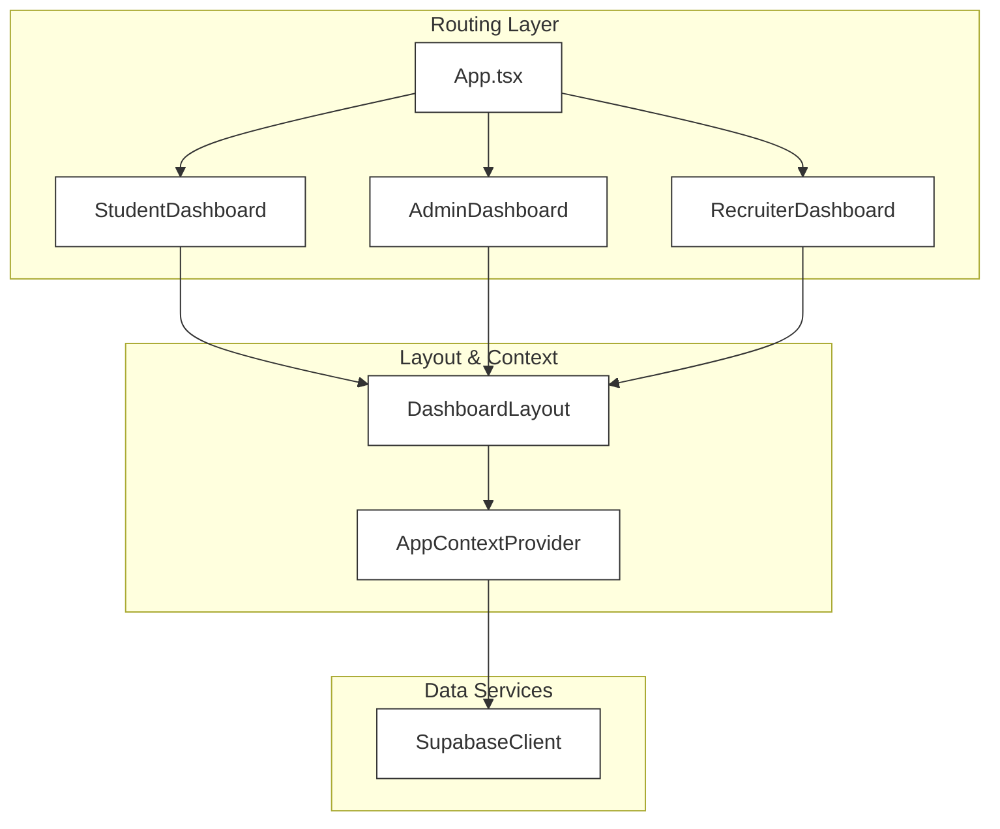
*Figure 3.1: Portal Routing and Layout Architecture mapping application entry points to `DashboardLayout` and `AppContext`.*

**Sources:** `src/pages/student/StudentDashboard.tsx:1-99`, `src/pages/admin/AdminDashboard.tsx:1-135`, `src/pages/recruiter/RecruiterDashboard.tsx:1-101`

---

## 3.1 Student Portal

The Student Portal, managed by `StudentDashboard` (`src/pages/student/StudentDashboard.tsx`), provides students with tools to discover job drives, verify GPA and branch eligibility, submit applications, execute timed technical tests, and review placement results [src/pages/student/StudentDashboard.tsx:9-16, 84-92](https://github.com/shaik-irfan-cse/smart-placement-management-system/blob/8af656360da6ce567dd3bd200fe4c9f430e3ebf6/src/pages/student/StudentDashboard.tsx#L9-L16). 

The portal validates active student records upon loading. If an authenticated user lacks a corresponding row in the `students` table, an error recovery view is rendered with retry and logout handles [src/pages/student/StudentDashboard.tsx:39-82](https://github.com/shaik-irfan-cse/smart-placement-management-system/blob/8af656360da6ce567dd3bd200fe4c9f430e3ebf6/src/pages/student/StudentDashboard.tsx#L39-L82).

For detailed views on job discovery, eligibility checking logic, application flows, the technical test assessment runner, and profile management, see [Student Portal](#31-student-portal).

**Sources:** `src/pages/student/StudentDashboard.tsx:1-1075`

---

## 3.2 Admin Portal

The Admin Portal, hosted in `AdminDashboard` (`src/pages/admin/AdminDashboard.tsx`), grants placement officers and head administrators control over student records, company approvals, job drives, reporting analytics, and placement records [src/pages/admin/AdminDashboard.tsx:106-116](https://github.com/shaik-irfan-cse/smart-placement-management-system/blob/8af656360da6ce567dd3bd200fe4c9f430e3ebf6/src/pages/admin/AdminDashboard.tsx#L106-L116). 

A strict access-control and approval-gating mechanism runs inside `AdminDashboard` via `useEffect()`. Non-head administrators whose `approvalStatus` is `PENDING` or `REJECTED` are intercepted, blocked from rendering the dashboard layout, and automatically signed out [src/pages/admin/AdminDashboard.tsx:16-25](https://github.com/shaik-irfan-cse/smart-placement-management-system/blob/8af656360da6ce567dd3bd200fe4c9f430e3ebf6/src/pages/admin/AdminDashboard.tsx#L16-L25).

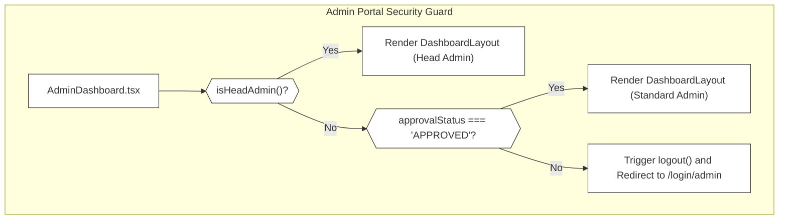
*Figure 3.2: Admin Access-Control Verification Flow in `AdminDashboard.tsx` illustrating approval status gating and transition handling.*

For full details on head admin privileges, admin registration approval lifecycles, and database triggers guarding escalation, see [Admin Portal](#32-admin-portal).

**Sources:** `src/pages/admin/AdminDashboard.tsx:1-135`, `ADMIN_ACCESS_CONTROL_FIX.md:1-207`, `ADMIN_ACCESS_CONTROL_HARDENING.md:1-243`

---

## 3.3 Recruiter Portal

The Recruiter Portal (`src/pages/recruiter/RecruiterDashboard.tsx`) enables corporate partners to maintain company profiles, publish and manage job drives, track applicants, evaluate candidate performance, and inspect technical test results [src/pages/recruiter/RecruiterDashboard.tsx:9-17](https://github.com/shaik-irfan-cse/smart-placement-management-system/blob/8af656360da6ce567dd3bd200fe4c9f430e3ebf6/src/pages/recruiter/RecruiterDashboard.tsx#L9-L17).

The portal implements robust state guards and error boundaries to prevent blank screens when recruiter records are missing or pending admin approval [src/pages/recruiter/RecruiterDashboard.tsx:38-84](https://github.com/shaik-irfan-cse/smart-placement-management-system/blob/8af656360da6ce567dd3bd200fe4c9f430e3ebf6/src/pages/recruiter/RecruiterDashboard.tsx#L38-L84). Company metadata and associated job drives drive the applicant pipeline views.

For complete coverage of company profile management, drive CRUD operations, and candidate tracking workflows, see [Recruiter Portal](#33-recruiter-portal).

**Sources:** `src/pages/recruiter/RecruiterDashboard.tsx:1-101`, `COMPLETE_FIX_REPORT.md:1-186`


---

# 3.1 Student Portal

## Purpose and Scope
The Student Portal is a core module of the Smart Placement Management System, implemented as a set of sub-views within `src/pages/student/StudentDashboard.tsx`. It provides authenticated students with end-to-end placement capabilities: job discovery, automated eligibility evaluation, application tracking, online technical assessments, result analysis, notification handling, and profile management. 

This page serves as a high-level parent guide to the student portal architecture. For deep technical details regarding the assessment runner and scoring engine, see [Technical Test Workflow](#311-technical-test-workflow).

Sources: `src/pages/student/StudentDashboard.tsx:1-99`

---

## 1. Sub-Views and Navigation Architecture

The student dashboard is rendered through `StudentDashboard` (`src/pages/student/StudentDashboard.tsx`), which intercepts route matching under `/student/*` and presents corresponding sub-views within a unified `DashboardLayout` container `[src/pages/student/StudentDashboard.tsx:9-17]`. 

Navigation items and their mapped operational components include:
- **Dashboard (`/student/dashboard`)**: Renders `DashboardHome`, summarizing application metrics, eligible drives, pending tests, and selection stats `[src/pages/student/StudentDashboard.tsx:10, 101-149]`.
- **Job Drives (`/student/jobs`)**: Renders `JobDrivesPage` for discovering active postings, filtering by branch/CGPA, and initiating applications.
- **My Applications (`/student/applications`)**: Renders `ApplicationsPage` to track historical progression from `APPLIED` through `TEST_PENDING` to `SELECTED` or `REJECTED`.
- **Technical Tests (`/student/tests`)**: Renders `TestsPage` for executing timed coding or multiple-choice assessments.
- **Results (`/student/results`)**: Renders `ResultsPage` to view past scores and pass/fail thresholds.
- **Notifications (`/student/notifications`)**: Renders `NotificationsPage` for real-time alerts.
- **Profile (`/student/profile`)**: Renders `ProfilePage` for updating personal academic records.

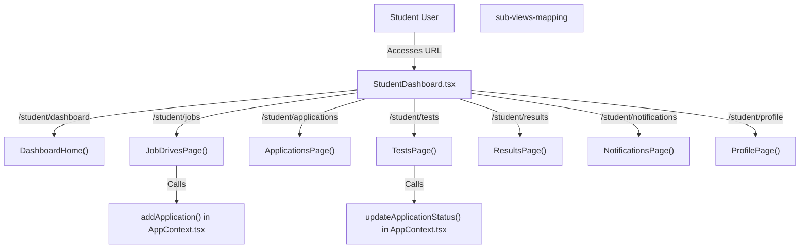
*Figure 1: Student Portal Route Mapping and Component Hierarchy linking URLs to dashboard sub-components and global mutations.*

Sources: `src/pages/student/StudentDashboard.tsx:9-99`, `src/contexts/AppContext.tsx:822-872`

---

## 2. Job Discovery and Application Lifecycle

Students evaluate placement opportunities against their academic profile. The system filters job drives dynamically inside `DashboardHome` and `JobDrivesPage` by checking matching branch constraints (`eligibleBranches`) and minimum CGPA thresholds (`eligibilityCGPA`) against the `currentStudent` object `[src/pages/student/StudentDashboard.tsx:125-129]`.

When a student applies to a drive, `handleApply()` executes validation checks before invoking `addApplication()` defined in `src/contexts/AppContext.tsx`.

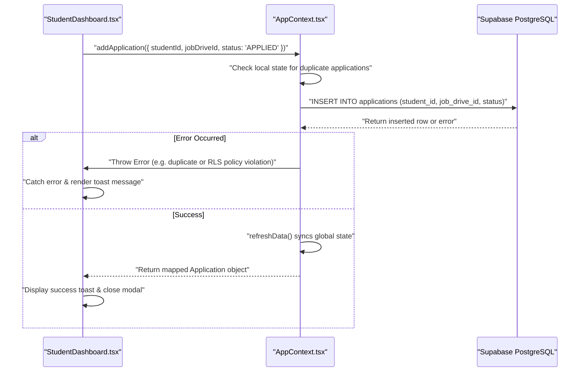
*Figure 2: Application submission sequence from StudentDashboard UI interaction through AppContext mutation to Supabase persistence.*

Sources: `src/pages/student/StudentDashboard.tsx:125-156`, `APPLICATION_FIX_REPORT.md:31-82`

---

## 3. Technical Test Workflow and State Transitions

Once an application enters the pipeline, students complete required technical assessments. The assessment runner handles timed logic, question rendering, score calculation, and transition updates. 

For complete implementation details on assessment seeding, timers, scoring algorithms, and pass/fail updates, see [Technical Test Workflow](#311-technical-test-workflow).

When a test finishes, `submitTest()` records results and triggers an application status update:

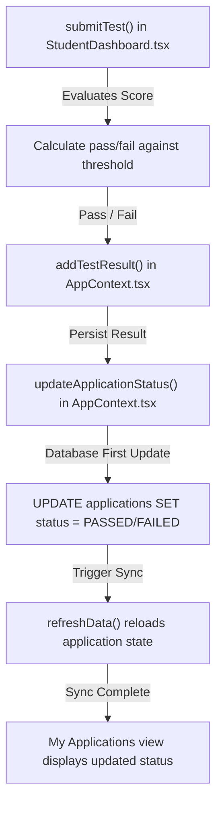
*Figure 3: Execution pipeline connecting test submission to database-first application status reconciliation.*

Sources: `src/pages/student/StudentDashboard.tsx:135-150`, `APPLICATION_STATUS_UPDATE_FIX.md:58-107`


---

# 3.1.1 Technical Test Workflow

The Technical Test Workflow manages the lifecycle of timed student assessments within the Smart Placement Management System. This leaf page details question seeding via PostgreSQL scripts, conditional status assignment (`APPLIED` versus `TEST_PENDING`), the assessment runner logic, scoring thresholds, and the asynchronous persistence fixes that ensure reliable status transitions upon test submission.

---

## 1. Question Seeding and Schema Model

The system evaluates technical aptitude using questions stored in the `test_questions` table [seed-test-questions.sql:1-22]. The database schema uses a PostgreSQL `TEXT[]` array for options and an integer for the 0-indexed correct answer [TEST_QUESTIONS_SEED_DOCUMENTATION.md:13-30].

```sql
CREATE TABLE IF NOT EXISTS test_questions (
  id UUID PRIMARY KEY DEFAULT gen_random_uuid(),
  question TEXT NOT NULL,
  options TEXT[] NOT NULL,
  correct_answer INTEGER NOT NULL,
  created_at TIMESTAMPTZ DEFAULT NOW()
);
```

The script `seed-test-questions.sql` provides an idempotent mechanism that inspects the existing row count before inserting 20 default B.Tech CSE placement questions [seed-test-questions.sql:1-16].

### Table Structure and Grading Mapping

| Column | Type | Description |
| :--- | :--- | :--- |
| `id` | `UUID` | Primary key generated via `gen_random_uuid()` [TEST_QUESTIONS_SEED_DOCUMENTATION.md:17] |
| `question` | `TEXT` | Prompt text for the assessment question [TEST_QUESTIONS_SEED_DOCUMENTATION.md:18] |
| `options` | `TEXT[]` | Array containing four choices (0-indexed) [seed-test-questions.sql:18-20] |
| `correct_answer` | `INTEGER` | 0-based index matching the correct option in `options` [seed-test-questions.sql:20] |
| `created_at` | `TIMESTAMPTZ` | Insertion timestamp [TEST_QUESTIONS_SEED_DOCUMENTATION.md:21] |

Sources: [seed-test-questions.sql:1-164](https://github.com/shaik-irfan-cse/smart-placement-management-system/blob/8af656360da6ce567dd3bd200fe4c9f430e3ebf6/seed-test-questions.sql#L1-L164), [TEST_QUESTIONS_SEED_DOCUMENTATION.md:1-229](https://github.com/shaik-irfan-cse/smart-placement-management-system/blob/8af656360da6ce567dd3bd200fe4c9f430e3ebf6/TEST_QUESTIONS_SEED_DOCUMENTATION.md#L1-L229)

---

## 2. Assessment Initialization & Status Transition (`APPLIED` → `TEST_PENDING`)

When a student initiates an application on the job discovery interface [IMPLEMENTATION_SUMMARY.md:34-44], the component inspects the selected job drive configuration and available questions to determine whether a technical test is required.

```
Title: "Application Status Determination Flow"
graph TD
    A["JobDrivesPage Application Click"] --> B["Check selectedDrive.testDuration > 0"]
    B --> C["Check selectedDrive.testPassPercentage > 0"]
    C --> D["Check testQuestions.length > 0"]
    D -->|All Conditions True| E["initialStatus = 'TEST_PENDING'"]
    D -->|Conditions Unmet| F["initialStatus = 'APPLIED'"]
    E --> G["addApplication with initialStatus"]
    F --> G
```

As documented in implementation summaries, the conditional logic evaluates three distinct runtime variables [IMPLEMENTATION_SUMMARY.md:16-21]:
- `hasTestConfig`: `selectedDrive.testDuration > 0 && selectedDrive.testPassPercentage > 0`
- `hasQuestions`: `testQuestions.length > 0`
- `initialStatus`: Evaluates to `'TEST_PENDING'` if both flags are true; otherwise falls back to `'APPLIED'` [IMPLEMENTATION_SUMMARY.md:17-21].

Sources: [IMPLEMENTATION_SUMMARY.md:1-193](https://github.com/shaik-irfan-cse/smart-placement-management-system/blob/8af656360da6ce567dd3bd200fe4c9f430e3ebf6/IMPLEMENTATION_SUMMARY.md#L1-L193), [TECHNICAL_TEST_WORKFLOW_IMPLEMENTATION.md:1-197](https://github.com/shaik-irfan-cse/smart-placement-management-system/blob/8af656360da6ce567dd3bd200fe4c9f430e3ebf6/TECHNICAL_TEST_WORKFLOW_IMPLEMENTATION.md#L1-L197)

---

## 3. Timed Assessment Runner and Scoring Engine

Once an application enters the `TEST_PENDING` state, the assessment runner becomes active in the student portal. The runner enforces the configured duration and calculates scores upon submission [TEST_SUBMISSION_STATUS_FIX.md:1-60].

### Scoring Logic
The grading algorithm iterates through the test questions, comparing the student's selected option index stored in the `answers` dictionary against the `correctAnswer` index retrieved from the database [TEST_QUESTIONS_SEED_DOCUMENTATION.md:32-45]:

```typescript
let score = 0;
questions.forEach((q: any) => {
  if (answers[q.id] === q.correctAnswer) score++;
});
const percentage = (score / questions.length) * 100;
const passed = percentage >= selectedDrive.testPassPercentage;
```

If the countdown timer (`timeLeft === 0`) expires before manual submission, an auto-submit trigger invokes the evaluation pipeline with built-in error handling [TEST_SUBMISSION_STATUS_FIX.md:91-104].

Sources: [TEST_SUBMISSION_STATUS_FIX.md:1-328](https://github.com/shaik-irfan-cse/smart-placement-management-system/blob/8af656360da6ce567dd3bd200fe4c9f430e3ebf6/TEST_SUBMISSION_STATUS_FIX.md#L1-L328), [TEST_QUESTIONS_SEED_DOCUMENTATION.md:32-57](https://github.com/shaik-irfan-cse/smart-placement-management-system/blob/8af656360da6ce567dd3bd200fe4c9f430e3ebf6/TEST_QUESTIONS_SEED_DOCUMENTATION.md#L32-L57)

---

## 4. Race Condition Fix: Database Persistence Guarantee

Earlier iterations of the codebase suffered from a defect where submitting a test left applications stuck in `TEST_PENDING` within the UI, despite correct test result records being generated [TEST_SUBMISSION_STATUS_FIX.md:4-8].

### Root Cause and Resolution
The `submitTest()` function was originally synchronous, dispatching asynchronous database routines (`addTestResult`, `updateApplicationStatus`, `addNotification`) without `await` operators [TEST_SUBMISSION_STATUS_FIX.md:11-37]. This created race conditions where UI state updates executed before Supabase transactions finalized [FIX_SUMMARY.md:7-8].

```
Title: "Test Submission Execution Flow"
graph TD
    A["Student clicks Submit Test"] --> B["submitTest() async execution"]
    B --> C["await addTestResult()"]
    C --> D["await updateApplicationStatus(id, PASSED/FAILED)"]
    D --> E["await addNotification()"]
    E --> F["setTestSubmitted(true)"]
    F --> G["UI and My Applications reflect PASSED or FAILED"]
```

The fix refactored `submitTest()` into an `async` handler, guaranteeing sequential resolution across all persistence layers [TEST_SUBMISSION_STATUS_FIX.md:40-53]:

1. **`await addTestResult({ ... })`**: Inserts scores, percentage, and pass status into `test_results` and triggers state synchronization [TEST_SUBMISSION_STATUS_FIX.md:115-119].
2. **`await updateApplicationStatus(...)`**: Updates the parent application tuple in the `applications` table to either `'PASSED'` or `'FAILED'` [TEST_SUBMISSION_STATUS_FIX.md:120-124].
3. **`await addNotification(...)`**: Dispatches system notifications to the student [TEST_SUBMISSION_STATUS_FIX.md:126-130].

Sources: [TEST_SUBMISSION_STATUS_FIX.md:1-328](https://github.com/shaik-irfan-cse/smart-placement-management-system/blob/8af656360da6ce567dd3bd200fe4c9f430e3ebf6/TEST_SUBMISSION_STATUS_FIX.md#L1-L328), [FIX_SUMMARY.md:1-170](https://github.com/shaik-irfan-cse/smart-placement-management-system/blob/8af656360da6ce567dd3bd200fe4c9f430e3ebf6/FIX_SUMMARY.md#L1-L170)


---

# 3.2 Admin Portal

The Admin Portal provides institutional oversight for the Smart Placement Management System. It allows administrators to manage students, registered companies, job drives, student applications, placement records, generate analytics reports, and handle administrative privilege escalations. 

The entire administrative interface is built around `src/pages/admin/AdminDashboard.tsx` [src/pages/admin/AdminDashboard.tsx:1-135](https://github.com/shaik-irfan-cse/smart-placement-management-system/blob/8af656360da6ce567dd3bd200fe4c9f430e3ebf6/src/pages/admin/AdminDashboard.tsx#L1-L135), acting as a secure container router that dynamically renders sub-views based on URL paths and authorization status.

---

## 1. Overview of Admin Portal Views and Navigation

The `AdminDashboard` component establishes a dynamic navigation hierarchy depending on the administrator's role (`isHeadAdmin()`) and their approval status. The sidebar navigation exposes distinct sub-modules for managing platform entities: Dashboard Home, Students, Companies, Job Drives, Applications, Placements, Reports, Notifications, and—exclusively for head admins—Admin Requests.

### Diagram: Admin Portal Component Routing & Code Mapping

```mermaid
graph TD
    sub5[""AdminDashboard Router (src/pages/admin/AdminDashboard.tsx)""]
    sub5 -->|"/admin/dashboard"| sub1[""DashboardHome (Stats & Charts)""]
    sub5 -->|"/admin/students"| sub2[""StudentsPage""]
    sub5 -->|"/admin/companies"| sub3[""CompaniesPage""]
    sub5 -->|"/admin/drives"| sub4[""DrivesPage""]
    sub5 -->|"/admin/applications"| sub6[""ApplicationsPage""]
    sub5 -->|"/admin/placements"| sub7[""PlacementsPage (w/ Backfill)""]
    sub5 -->|"/admin/reports"| sub8[""ReportsPage""]
    sub5 -->|"/admin/requests"| sub9[""AdminRequestsPage (Head Admin Only)""]

    style sub5 fill:#fff,stroke:#333,stroke-width:2px
```

*Sources: `src/pages/admin/AdminDashboard.tsx:1-135`*

---

## 2. Access-Control Hardening and Authentication Guards

To ensure robust security, the admin portal implements multi-layered access control. Regular admins must possess an `approvalStatus` of `'APPROVED'`, while head admins bypass this check. 

As detailed in `ADMIN_ACCESS_CONTROL_FIX.md` and `ADMIN_ACCESS_CONTROL_HARDENING.md`, an initial vulnerability allowed pending or rejected admins to view dashboard layouts during asynchronous logout transitions. This was hardened by introducing a strict null check and blocking UI states inside `src/pages/admin/AdminDashboard.tsx` [src/pages/admin/AdminDashboard.tsx:16-103](https://github.com/shaik-irfan-cse/smart-placement-management-system/blob/8af656360da6ce567dd3bd200fe4c9f430e3ebf6/src/pages/admin/AdminDashboard.tsx#L16-L103).

### Diagram: Admin Access Control Decision Tree

```mermaid
graph TD
    start[("User Accesses /admin/dashboard")] --> checkNull{"is currentAdmin null?"}
    checkNull -->|"Yes (during logout)"| retNull[""return null (Prevent Flash)""]
    checkNull -->|"No"| checkHead{"isHeadAdmin()?"}
    checkHead -->|"Yes"| renderLayout[""Render DashboardLayout (Full Access)""]
    checkHead -->|"No"| checkApproval{"currentAdmin.approvalStatus"}
    
    checkApproval -->|"PENDING"| blockPending[""Render Yellow Blocking UI & Logout Trigger""]
    checkApproval -->|"REJECTED"| blockRejected[""Render Red Blocking UI & Logout Trigger""]
    checkApproval -->|"APPROVED"| renderLayout
    
    style start fill:#fff,stroke:#333,stroke-width:1px
    style renderLayout fill:#fff,stroke:#333,stroke-width:1px
    style blockPending fill:#fff,stroke:#333,stroke-width:1px
    style blockRejected fill:#fff,stroke:#333,stroke-width:1px
```

*Sources: `src/pages/admin/AdminDashboard.tsx:16-103`, `ADMIN_ACCESS_CONTROL_FIX.md:1-207`, `ADMIN_ACCESS_CONTROL_HARDENING.md:1-243`*

---

## 3. Approvals and Registration Workflow

Administrative accounts created via self-registration do not receive immediate operational privileges. Instead, they enter a `PENDING` state that requires authorization by a Head Administrator. 

For full technical specifications on head admin privileges, the admin registration approval lifecycle, and PostgreSQL security triggers that prevent unauthorized privilege escalation, refer to the child page:
- **For details, see [Head Admin Approval Workflow](#321-head-admin-approval-workflow)**

*Sources: `ADMIN_ACCESS_CONTROL_FIX.md:164-182`*

---

## 4. Placements and Automated Backfill Routine

The Placements view manages successfully placed candidates and tracks selection metrics across companies. As documented in `ADMIN_PLACEMENTS_FIX.md`, historical applications marked as `SELECTED` prior to automated placement triggers lacked corresponding records in the placement table. 

To resolve this, an idempotent automated backfill routine was embedded into the `PlacementsPage` component inside `src/pages/admin/AdminDashboard.tsx`.

| Step | Action | Code Logic / Validation |
| :--- | :--- | :--- |
| **1. Detection** | Find `SELECTED` applications | `applications.filter(app => app.status === 'SELECTED')` |
| **2. Verification** | Check existing placement records | `placements.find(p => p.studentId === app.studentId && p.jobDriveId === app.jobDriveId)` |
| **3. Backfill Execution** | Generate missing placement entry | `addPlacement({ studentId, jobDriveId, companyName, jobRole, package, status: 'PLACED' })` |
| **4. Idempotency** | Prevent duplicate records | Checked per student and job drive combination |

*Sources: `ADMIN_PLACEMENTS_FIX.md:1-193`, `src/pages/admin/AdminDashboard.tsx`*


---

# 3.2.1 Head Admin Approval Workflow

## Purpose and Scope

This page documents the technical implementation of the Head Admin Approval Workflow within the Smart Placement Management System. The workflow secures administrative access by ensuring that newly registered administrators undergo explicit review and approval by a designated Head Admin before gaining entry to the Admin Portal (`src/pages/admin/AdminDashboard.tsx`). It covers database-level hardening via PostgreSQL triggers, `SECURITY DEFINER` helper functions, Row Level Security (RLS) policies (`supabase-migrations/002_admin_approval_workflow.sql`), and frontend state integration (`src/contexts/AppContext.tsx`).

---

## Database Schema Extensions and Migration

To support the approval workflow, the `public.admins` table is altered to introduce two mandatory attributes: `is_head_admin` and `approval_status` [supabase-migrations/002_admin_approval_workflow.sql:11-13](https://github.com/shaik-irfan-cse/smart-placement-management-system/blob/8af656360da6ce567dd3bd200fe4c9f430e3ebf6/supabase-migrations/002_admin_approval_workflow.sql#L11-L13). 

### Schema Modifications
* `is_head_admin`: A boolean flag defaulting to `false` [supabase-migrations/002_admin_approval_workflow.sql:11](https://github.com/shaik-irfan-cse/smart-placement-management-system/blob/8af656360da6ce567dd3bd200fe4c9f430e3ebf6/supabase-migrations/002_admin_approval_workflow.sql#L11).
* `approval_status`: A text field constrained to `('PENDING', 'APPROVED', 'REJECTED')`, defaulting to `'PENDING'` [supabase-migrations/002_admin_approval_workflow.sql:12-13](https://github.com/shaik-irfan-cse/smart-placement-management-system/blob/8af656360da6ce567dd3bd200fe4c9f430e3ebf6/supabase-migrations/002_admin_approval_workflow.sql#L12-L13).

Existing admin records are migrated to an `'APPROVED'` status [supabase-migrations/002_admin_approval_workflow.sql:19-21](https://github.com/shaik-irfan-cse/smart-placement-management-system/blob/8af656360da6ce567dd3bd200fe4c9f430e3ebf6/supabase-migrations/002_admin_approval_workflow.sql#L19-L21), while a specific bootstrap account (`mabusubhani@gmail.com`) is designated as the Head Admin by joining through `auth.users` [supabase-migrations/002_admin_approval_workflow.sql:23-30](https://github.com/shaik-irfan-cse/smart-placement-management-system/blob/8af656360da6ce567dd3bd200fe4c9f430e3ebf6/supabase-migrations/002_admin_approval_workflow.sql#L23-L30).

```mermaid
graph TD
    subgraph "Database Schema Layer"
        A["public.admins Table"] -->|Add Column| B["is_head_admin (BOOLEAN)"]
        A -->|Add Column| C["approval_status (TEXT)"]
        C -->|Check Constraint| D["'PENDING' | 'APPROVED' | 'REJECTED'"]
    end
    
    subgraph "Bootstrap Migration"
        E["auth.users Table"] -->|Email Match: mabusubhani@gmail.com| F["public.is_head_admin()"]
        F -->|Sets Flag| G["is_head_admin = true"]
    end
```
*Sources: [supabase-migrations/002_admin_approval_workflow.sql:11-30](https://github.com/shaik-irfan-cse/smart-placement-management-system/blob/8af656360da6ce567dd3bd200fe4c9f430e3ebf6/supabase-migrations/002_admin_approval_workflow.sql#L11-L30)*

---

## Security Definer Functions and Privilege Escalation Guards

To prevent unauthorized privilege escalation (where a normal admin tries to promote themselves or approve other pending accounts), the database uses `SECURITY DEFINER` functions and a `BEFORE UPDATE` trigger [supabase-migrations/002_admin_approval_workflow.sql:58-119](https://github.com/shaik-irfan-cse/smart-placement-management-system/blob/8af656360da6ce567dd3bd200fe4c9f430e3ebf6/supabase-migrations/002_admin_approval_workflow.sql#L58-L119).

### Helper Functions
* `public.is_head_admin()`: Evaluates whether `auth.uid()` belongs to an approved administrator with `is_head_admin = true` [supabase-migrations/002_admin_approval_workflow.sql:58-71](https://github.com/shaik-irfan-cse/smart-placement-management-system/blob/8af656360da6ce567dd3bd200fe4c9f430e3ebf6/supabase-migrations/002_admin_approval_workflow.sql#L58-L71).
* `public.is_approved_admin()`: Checks if `auth.uid()` belongs to any approved admin [supabase-migrations/002_admin_approval_workflow.sql:74-86](https://github.com/shaik-irfan-cse/smart-placement-management-system/blob/8af656360da6ce567dd3bd200fe4c9f430e3ebf6/supabase-migrations/002_admin_approval_workflow.sql#L74-L86).

### Trigger Guard
The function `public.protect_admin_approval_fields()` intercepts any update to `public.admins`. If the executing user is not authenticated as the head admin (`NOT public.is_head_admin()`), any modifications to `approval_status` or `is_head_admin` are programmatically reverted to their `OLD` database values [supabase-migrations/002_admin_approval_workflow.sql:92-108](https://github.com/shaik-irfan-cse/smart-placement-management-system/blob/8af656360da6ce567dd3bd200fe4c9f430e3ebf6/supabase-migrations/002_admin_approval_workflow.sql#L92-L108).

```mermaid
graph TD
    subgraph "Code Entity Space: Database Triggers & Functions"
        U["Client UPDATE Request"] -->|Fires| T["protect_admin_approval_fields_trigger"]
        T -->|Executes Function| F["public.protect_admin_approval_fields()"]
        F -->|Evaluates| H{"public.is_head_admin() == true?"}
        H -->|Yes| Y["Allow Changes to approval_status & is_head_admin"]
        H -->|No| N["Revert NEW values to OLD values"]
    end
```
*Sources: [supabase-migrations/002_admin_approval_workflow.sql:58-119](https://github.com/shaik-irfan-cse/smart-placement-management-system/blob/8af656360da6ce567dd3bd200fe4c9f430e3ebf6/supabase-migrations/002_admin_approval_workflow.sql#L58-L119)*

---

## Row Level Security (RLS) Policies

Row Level Security on `public.admins` is configured to restrict visibility and mutations based on approval states and head admin credentials [supabase-migrations/002_admin_approval_workflow.sql:125-170](https://github.com/shaik-irfan-cse/smart-placement-management-system/blob/8af656360da6ce567dd3bd200fe4c9f430e3ebf6/supabase-migrations/002_admin_approval_workflow.sql#L125-L170).

| Policy Name | Target Operation | Target Role | Expression / Definition |
| :--- | :--- | :--- | :--- |
| `Admins can insert own record` | `INSERT` | `authenticated` | `user_id = auth.uid() AND is_head_admin = false AND approval_status = 'PENDING'` [supabase-migrations/002_admin_approval_workflow.sql:135-141](https://github.com/shaik-irfan-cse/smart-placement-management-system/blob/8af656360da6ce567dd3bd200fe4c9f430e3ebf6/supabase-migrations/002_admin_approval_workflow.sql#L135-L141) |
| `Admins can update own record` | `UPDATE` | `authenticated` | `user_id = auth.uid()` (protected fields guarded by trigger) [supabase-migrations/002_admin_approval_workflow.sql:146-149](https://github.com/shaik-irfan-cse/smart-placement-management-system/blob/8af656360da6ce567dd3bd200fe4c9f430e3ebf6/supabase-migrations/002_admin_approval_workflow.sql#L146-L149) |
| `Head admins can update admin approval status` | `UPDATE` | `authenticated` | `public.is_head_admin()` [supabase-migrations/002_admin_approval_workflow.sql:153-156](https://github.com/shaik-irfan-cse/smart-placement-management-system/blob/8af656360da6ce567dd3bd200fe4c9f430e3ebf6/supabase-migrations/002_admin_approval_workflow.sql#L153-L156) |
| `Head admins can view all admins` | `SELECT` | `authenticated` | `public.is_head_admin()` [supabase-migrations/002_admin_approval_workflow.sql:161-163](https://github.com/shaik-irfan-cse/smart-placement-management-system/blob/8af656360da6ce567dd3bd200fe4c9f430e3ebf6/supabase-migrations/002_admin_approval_workflow.sql#L161-L163) |
| `Admins can view own record` | `SELECT` | `authenticated` | `user_id = auth.uid()` [supabase-migrations/002_admin_approval_workflow.sql:167-169](https://github.com/shaik-irfan-cse/smart-placement-management-system/blob/8af656360da6ce567dd3bd200fe4c9f430e3ebf6/supabase-migrations/002_admin_approval_workflow.sql#L167-L169) |

*Sources: [supabase-migrations/002_admin_approval_workflow.sql:125-170](https://github.com/shaik-irfan-cse/smart-placement-management-system/blob/8af656360da6ce567dd3bd200fe4c9f430e3ebf6/supabase-migrations/002_admin_approval_workflow.sql#L125-L170)*

---

## Frontend Integration and Application State

The frontend interacts with the approval workflow via `src/contexts/AppContext.tsx` and renders management UI inside `src/pages/admin/AdminDashboard.tsx` [HEAD_ADMIN_APPROVAL_WORKFLOW.md:17-38](https://github.com/shaik-irfan-cse/smart-placement-management-system/blob/8af656360da6ce567dd3bd200fe4c9f430e3ebf6/HEAD_ADMIN_APPROVAL_WORKFLOW.md#L17-L38).

### Registration and Login Gating
1. **Registration**: When a new administrator signs up, `mapAdmin` sets `approval_status` to `'PENDING'` and `is_head_admin` to `false` [HEAD_ADMIN_APPROVAL_WORKFLOW.md:21-23](https://github.com/shaik-irfan-cse/smart-placement-management-system/blob/8af656360da6ce567dd3bd200fe4c9f430e3ebf6/HEAD_ADMIN_APPROVAL_WORKFLOW.md#L21-L23).
2. **Login Filtering**: During the login authentication check for the admin role, `AppContext.tsx` inspects the `approval_status`. If the status is `'PENDING'` or `'REJECTED'`, login is blocked and an explanatory message is displayed [HEAD_ADMIN_APPROVAL_WORKFLOW.md:24](https://github.com/shaik-irfan-cse/smart-placement-management-system/blob/8af656360da6ce567dd3bd200fe4c9f430e3ebf6/HEAD_ADMIN_APPROVAL_WORKFLOW.md#L24).
3. **Head Admin Management**: Head admins gain access to the `AdminRequestsPage` component within `AdminDashboard.tsx`, allowing them to execute `updateAdminApproval()` mutations to approve or reject pending requests [HEAD_ADMIN_APPROVAL_WORKFLOW.md:25-36](https://github.com/shaik-irfan-cse/smart-placement-management-system/blob/8af656360da6ce567dd3bd200fe4c9f430e3ebf6/HEAD_ADMIN_APPROVAL_WORKFLOW.md#L25-L36).

```mermaid
graph TD
    subgraph "Code Entity Space: Frontend Runtime Flow"
        R["Admin Signup Form"] -->|Calls Context| AC["src/contexts/AppContext.tsx"]
        AC -->|Inserts DB Record| DB[(Supabase Database)]
        
        L["Admin Login Attempt"] -->|Validates Status| CK{"approval_status == 'APPROVED'?"}
        CK -->|Pending / Rejected| BLK["Block Access & Display Warning"]
        CK -->|Approved| ACC["Grant Access to AdminDashboard.tsx"]
        
        HA["Head Admin Action"] -->|Triggers UI| AR["AdminRequestsPage in AdminDashboard.tsx"]
        AR -->|Executes Mutation| UAA["updateAdminApproval() in AppContext.tsx"]
        UAA -->|Updates Row| DB
    end
```
*Sources: [HEAD_ADMIN_APPROVAL_WORKFLOW.md:17-38](https://github.com/shaik-irfan-cse/smart-placement-management-system/blob/8af656360da6ce567dd3bd200fe4c9f430e3ebf6/HEAD_ADMIN_APPROVAL_WORKFLOW.md#L17-L38), [QUICK_SUMMARY.md:17-21](https://github.com/shaik-irfan-cse/smart-placement-management-system/blob/8af656360da6ce567dd3bd200fe4c9f430e3ebf6/QUICK_SUMMARY.md#L17-L21)*


---

# 3.3 Recruiter Portal

## Purpose and Scope
The Recruiter Portal provides enterprise and corporate partners with tools to manage job placement drives, inspect candidate profiles, track applicant pipelines through various stages, and evaluate technical assessment results. Built as part of the React Single Page Application (SPA), the Recruiter Portal interacts directly with the global `AppContext` state layer and enforces role-based access control and approval gating.

---

## 1. Dashboard Navigation and View Dispatch

The entry point for all recruiter operations is `RecruiterDashboard` [src/pages/recruiter/RecruiterDashboard.tsx:19-101](https://github.com/shaik-irfan-cse/smart-placement-management-system/blob/8af656360da6ce567dd3bd200fe4c9f430e3ebf6/src/pages/recruiter/RecruiterDashboard.tsx#L19-L101). It initializes session hooks, verifies the existence of the recruiter record associated with the authenticated user, and renders a sidebar navigation layout via `DashboardLayout` [src/pages/recruiter/RecruiterDashboard.tsx:27](https://github.com/shaik-irfan-cse/smart-placement-management-system/blob/8af656360da6ce567dd3bd200fe4c9f430e3ebf6/src/pages/recruiter/RecruiterDashboard.tsx#L27).

The portal is partitioned into specialized sub-views accessed via client-side routing paths:
- **Dashboard Home**: Overview metrics and quick drive status summaries (`DashboardHome` [src/pages/recruiter/RecruiterDashboard.tsx:103](https://github.com/shaik-irfan-cse/smart-placement-management-system/blob/8af656360da6ce567dd3bd200fe4c9f430e3ebf6/src/pages/recruiter/RecruiterDashboard.tsx#L103)).
- **Company Profile**: Corporate identity details and approval status badges (`CompanyProfilePage`).
- **Job Drives**: CRUD interface for creation and management of placement drives (`JobDrivesPage`).
- **Applications**: Applicant tracking system (ATS) interface (`ApplicationsPage`).
- **Candidates**: Eligible student search and profile inspection (`CandidatesPage`).
- **Test Results**: Assessment score tracking (`TestResultsPage`).
- **Notifications**: System alerts (`NotificationsPage`).

```mermaid
graph TD
  A["UserAuthSession"] --> B["RecruiterDashboard.tsx"]
  B --> C{"Check loading or missing record"}
  C -->|Loading| D["SpinningLoaderView"]
  C -->|Missing Record| E["ErrorStateWithRetryAndLogout"]
  C -->|Authenticated| F["DashboardLayout"]
  F --> G{"Route Path Matcher"}
  G -->|"/recruiter/dashboard"| H["DashboardHome"]
  G -->|"/recruiter/profile"| I["CompanyProfilePage"]
  G -->|"/recruiter/drives"| J["JobDrivesPage"]
  G -->|"/recruiter/applications"| K["ApplicationsPage"]
  G -->|"/recruiter/candidates"| L["CandidatesPage"]
  G -->|"/recruiter/tests"| M["TestResultsPage"]
  G -->|"/recruiter/notifications"| N["NotificationsPage"]

  sub-views: [B, H, I, J, K, L, M, N]
```
*Sources: `src/pages/recruiter/RecruiterDashboard.tsx`*

---

## 2. Company Profile Management & Approval Gating

Recruiters registering on the platform must be approved by the head admin before posting drives. The `DashboardHome` and `CompanyProfilePage` evaluate `currentRecruiter.approvalStatus` [src/pages/recruiter/RecruiterDashboard.tsx:141-150](https://github.com/shaik-irfan-cse/smart-placement-management-system/blob/8af656360da6ce567dd3bd200fe4c9f430e3ebf6/src/pages/recruiter/RecruiterDashboard.tsx#L141-L150). If the status is `PENDING` or rejected, administrative action warnings are rendered, restricting drive creation workflows.

Because the production `recruiters` table does not contain an `email` column [RECRUITER_FIX_FINAL.md:4-7](https://github.com/shaik-irfan-cse/smart-placement-management-system/blob/8af656360da6ce567dd3bd200fe4c9f430e3ebf6/RECRUITER_FIX_FINAL.md#L4-L7), email rendering inside `CompanyProfilePage` retrieves the value securely from the authenticated user profile (`currentUser.email`) rather than the recruiter entity [RECRUITER_FIX_FINAL.md:46-59](https://github.com/shaik-irfan-cse/smart-placement-management-system/blob/8af656360da6ce567dd3bd200fe4c9f430e3ebf6/RECRUITER_FIX_FINAL.md#L46-L59) [RECRUITER_EMAIL_FIX.md:135-152](https://github.com/shaik-irfan-cse/smart-placement-management-system/blob/8af656360da6ce567dd3bd200fe4c9f430e3ebf6/RECRUITER_EMAIL_FIX.md#L135-L152).

```mermaid
graph TD
  A["CompanyProfilePage"] --> B["useApp Hook"]
  B --> C["currentRecruiter Entity"]
  B --> D["currentUser Profile"]
  C --> E{"approvalStatus == APPROVED?"}
  E -->|No| F["ShowPendingOrRejectedBanner"]
  E -->|Yes| G["EnableDriveManagement"]
  D --> H["RenderEmailFromProfilesTable"]

  sub-views: [A, B, C, D, E, F, G, H]
```
*Sources: `src/pages/recruiter/RecruiterDashboard.tsx`, `RECRUITER_FIX_FINAL.md`, `RECRUITER_EMAIL_FIX.md`*

---

## 3. Job Drive CRUD and Applicant Tracking

Recruiters utilize `JobDrivesPage` to create, modify, or delete placement drives targeting specific student batches. Each job drive record links to the recruiter's unique identifier (`recruiterId`). 

The `ApplicationsPage` sub-view queries all applications where `jobDriveId` matches drives owned by the logged-in recruiter [src/pages/recruiter/RecruiterDashboard.tsx:128-130](https://github.com/shaik-irfan-cse/smart-placement-management-system/blob/8af656360da6ce567dd3bd200fe4c9f430e3ebf6/src/pages/recruiter/RecruiterDashboard.tsx#L128-L130). Recruiters can advance applicant statuses across defined state transitions (`APPLIED`, `SHORTLISTED`, `SELECTED`, `REJECTED`).

```mermaid
graph TD
  A["JobDrivesPage"] -->|Create/Edit| B["JobDrive Record"]
  B --> C["Database Table job_drives"]
  D["ApplicationsPage"] -->|Filter By Drive ID| E["Application Records"]
  E --> F["Status Transition Engine"]
  F --> G["APPLIED"]
  F --> H["SHORTLISTED"]
  F --> I["SELECTED"]
  F --> J["REJECTED"]

  sub-views: [A, B, C, D, E, F, G, H, I, J]
```
*Sources: `src/pages/recruiter/RecruiterDashboard.tsx`*

---

## 4. Candidate Directory and Test Results

The `CandidatesPage` and `TestResultsPage` components aggregate data across the broader student body and assessment tables. 
- `CandidatesPage` enables recruiters to filter eligible candidates based on CGPA, branch, and test qualification criteria.
- `TestResultsPage` parses entries from the `test_results` relation filtered by the recruiter's active drive IDs [src/pages/recruiter/RecruiterDashboard.tsx:131-133](https://github.com/shaik-irfan-cse/smart-placement-management-system/blob/8af656360da6ce567dd3bd200fe4c9f430e3ebf6/src/pages/recruiter/RecruiterDashboard.tsx#L131-L133), rendering pass/fail metrics and scores.

Robust error handling ensures that if database fetching delays occur or data is missing, fallback states and spinner components prevent blank-page rendering bugs [COMPLETE_FIX_REPORT.md:9-36](https://github.com/shaik-irfan-cse/smart-placement-management-system/blob/8af656360da6ce567dd3bd200fe4c9f430e3ebf6/COMPLETE_FIX_REPORT.md#L9-L36).

```mermaid
graph TD
  A["RecruiterDashboard State"] --> B["jobDrives Filter"]
  B --> C["myDriveIds Array"]
  C --> D["testResults Filter"]
  D --> E["TestResultsPage Display"]
  C --> F["Applications Filter"]
  F --> G["CandidatesPage Discovery"]

  sub-views: [A, B, C, D, E, F, G]
```
*Sources: `src/pages/recruiter/RecruiterDashboard.tsx`, `COMPLETE_FIX_REPORT.md`*

---

## 5. Registration Pipeline & Schema Alignment

Recruiter onboarding requires passing role-specific metadata into Supabase Auth (`supabase.auth.signUp`) [RECRUITER_REGISTRATION_FIX_REPORT.md:5-7](https://github.com/shaik-irfan-cse/smart-placement-management-system/blob/8af656360da6ce567dd3bd200fe4c9f430e3ebf6/RECRUITER_REGISTRATION_FIX_REPORT.md#L5-L7). 

Key technical adjustments implemented for recruiter registration include:
1. **Role-Aware Metadata Building**: Ensuring metadata payloads include company attributes (`companyName`, `recruiterName`, `phone`, `website`, `description`) instead of defaulting to student-only fields [RECRUITER_REGISTRATION_FIX_REPORT.md:76-118](https://github.com/shaik-irfan-cse/smart-placement-management-system/blob/8af656360da6ce567dd3bd200fe4c9f430e3ebf6/RECRUITER_REGISTRATION_FIX_REPORT.md#L76-L118).
2. **Schema Separation**: Omitting the `email` field during inserts to the `recruiters` table to prevent `PGRST204` schema cache errors, referencing user emails via `profiles` instead [RECRUITER_FIX_FINAL.md:4-10](https://github.com/shaik-irfan-cse/smart-placement-management-system/blob/8af656360da6ce567dd3bd200fe4c9f430e3ebf6/RECRUITER_FIX_FINAL.md#L4-L10).

```mermaid
graph TD
  A["RecruiterSignupForm"] --> B["AppContext.signup()"]
  B --> C["Build Role-Aware Metadata"]
  C --> D["supabase.auth.signUp()"]
  D --> E["Create profiles Row"]
  E --> F["Insert recruiters Table w/o Email"]
  F --> G["Verification Query check"]
  G --> H["Redirect to RecruiterDashboard"]

  sub-views: [A, B, C, D, E, F, G, H]
```
*Sources: `RECRUITER_FIX_FINAL.md`, `RECRUITER_REGISTRATION_FIX_REPORT.md`*


---

# 4. Data Layer and Supabase Backend

## Purpose and Scope

This section outlines the architectural foundation of the data layer and backend infrastructure for the Smart Placement Management System. Powered by PostgreSQL and Supabase, the backend enforces a robust relational model, granular Row Level Security (RLS) policies, and strict cascading data integrity rules across all user roles (students, admins, recruiters). 

This is a parent page. For comprehensive technical deep-dives, consult the following child pages:
- Database Schema details: [Database Schema](#41-database-schema)
- Security and RLS configuration: [Row Level Security Policies](#42-row-level-security-policies)
- Test fixtures and initial datasets: [Seed Data and Fixtures](#43-seed-data-and-fixtures)

---

## PostgreSQL Schema Overview

The database schema is designed to represent the complete lifecycle of placement management, from user authentication mapping to job drives, applications, online test execution, and final placement records. All tables utilize UUID primary keys linked directly to Supabase Auth handles via foreign key constraints with cascading deletes `[supabase-schema.sql:9-155]()`.

### Core Entities

1. **`profiles`**: Acts as the central bridge between Supabase `auth.users` and application-specific roles (`student`, `admin`, `recruiter`) `[supabase-schema.sql:9-14]()`.
2. **`students`**, **`admins`**, and **`recruiters`**: Role-specific profile extensions storing domain attributes such as CGPA, branch, employee IDs, and approval statuses `[supabase-schema.sql:19-65]()`.
3. **`job_drives`**: Managed by recruiters, defining eligibility criteria (`eligibility_cgpa`, `eligible_branches`, `required_skills`) and test parameters `[supabase-schema.sql:70-88]()`.
4. **`applications`** and **`test_results`**: Track student candidature progression, test scores, and pass/fail states through strict database-level status enums `[supabase-schema.sql:93-127]()`.
5. **`placements`**: Records final selection data upon successful completion of the application pipeline `[supabase-schema.sql:145-155]()`.

Title: Database Entity Relationship Overview
```mermaid
graph TD
    auth["auth.users"] -->|FK onDeleteCascade| prof["profiles"]
    prof -->|FK onDeleteCascade| stud["students"]
    prof -->|FK onDeleteCascade| adm["admins"]
    prof -->|FK onDeleteCascade| rec["recruiters"]
    rec -->|FK onDeleteCascade| job["job_drives"]
    stud -->|FK onDeleteCascade| app["applications"]
    job -->|FK onDeleteCascade| app
    app -->|FK onDeleteCascade| res["test_results"]
    stud -->|FK onDeleteCascade| res
    job -->|FK onDeleteCascade| res
    stud -->|FK onDeleteCascade| plac["placements"]
    job -->|FK onDeleteCascade| plac
```
Sources: `[supabase-schema.sql:9-155]()`

For a complete breakdown of column definitions, data types, uniqueness constraints, and cascade relationships, see [Database Schema](#41-database-schema).

---

## Security Model and Row Level Security (RLS)

The Supabase backend relies on PostgreSQL Row Level Security (RLS) to enforce data isolation and multi-tenant access control directly at the database layer. RLS is explicitly enabled across all core tables to prevent unauthorized data access or privilege escalation `[supabase-schema.sql:161-170]`.

### Security Architecture

- **Role Helper Functions**: Custom PostgreSQL functions (`is_admin()`, `is_head_admin()`) evaluate user roles securely from the `profiles` and `admins` tables during query execution.
- **Granular Policies**: Restrictive policies govern read, insert, update, and delete actions based on whether the authenticated user is a student viewing their own applications, a recruiter managing their company's job drives, or an admin overseeing platform approvals.

Title: RLS Security Evaluation Flow
```mermaid
graph TD
    client["ClientQuery"] -->|JWTAuthToken| supabase["SupabaseAPI"]
    supabase -->|EvaluatesSession| rls["RowLevelSecurity"]
    rls -->|InvokesHelper| fn["is_admin_or_head_admin"]
    fn -->|QueriesTable| db["PostgreSQLTables"]
```
Sources: `[supabase-schema.sql:158-170]()`

For detailed policy definitions, hardening history, and troubleshooting guides for RLS query failures, see [Row Level Security Policies](#42-row-level-security-policies) and [Diagnosing RLS Failures](#421-diagnosing-rls-failures).

---

## Seed Data and Fixtures

To bootstrap local development environments and test evaluation workflows, the application relies on predefined fixture sets. These include assessment test questions with multiple-choice options, correct answer indices, and sample institutional datasets.

For initialization scripts and test question sets, see [Seed Data and Fixtures](#43-seed-data-and-fixtures).


---

# 4.1 Database Schema

## Purpose and Scope

This page details the PostgreSQL database schema for the Smart Placement Management System as defined in `supabase-schema.sql` and refined in `FINAL_SCHEMA_FIX_REPORT.md`. It documents the foundational tables, primary/foreign key constraints, cascading deletions, column check constraints, and relational mappings used by the Supabase backend and accessed through `src/contexts/AppContext.tsx`.

Sources: [supabase-schema.sql:1-171](https://github.com/shaik-irfan-cse/smart-placement-management-system/blob/8af656360da6ce567dd3bd200fe4c9f430e3ebf6/supabase-schema.sql#L1-L171), [FINAL_SCHEMA_FIX_REPORT.md:1-47](https://github.com/shaik-irfan-cse/smart-placement-management-system/blob/8af656360da6ce567dd3bd200fe4c9f430e3ebf6/FINAL_SCHEMA_FIX_REPORT.md#L1-L47)

---

## Core Tables & Entity Layout

The database is structured around user profiles, role-specific extension tables, recruitment operations, assessment modules, and placement records. Every authenticated user links to a core `profiles` record, which branches into specialized entity tables.

### 1. User & Role Tables

*   **`profiles`**: Bridges Supabase Auth (`auth.users`) to application roles (`student`, `admin`, `recruiter`) [supabase-schema.sql:9-14](https://github.com/shaik-irfan-cse/smart-placement-management-system/blob/8af656360da6ce567dd3bd200fe4c9f430e3ebf6/supabase-schema.sql#L9-L14).
*   **`students`**: Stores student academic profiles, roll numbers, branches, CGPA, and placement statuses [supabase-schema.sql:19-33](https://github.com/shaik-irfan-cse/smart-placement-management-system/blob/8af656360da6ce567dd3bd200fe4c9f430e3ebf6/supabase-schema.sql#L19-L33). Note that student email addresses reside in `profiles` and `auth.users` rather than duplicating within the `students` table [FINAL_SCHEMA_FIX_REPORT.md:34-47](https://github.com/shaik-irfan-cse/smart-placement-management-system/blob/8af656360da6ce567dd3bd200fe4c9f430e3ebf6/FINAL_SCHEMA_FIX_REPORT.md#L34-L47).
*   **`admins`**: Stores administrative credentials, employee IDs, department affiliations, head admin flags (`is_head_admin`), and approval states (`approval_status`) [supabase-schema.sql:38-48](https://github.com/shaik-irfan-cse/smart-placement-management-system/blob/8af656360da6ce567dd3bd200fe4c9f430e3ebf6/supabase-schema.sql#L38-L48).
*   **`recruiters`**: Stores corporate partner details, company names, contact markers, and recruiter approval workflows [supabase-schema.sql:53-65](https://github.com/shaik-irfan-cse/smart-placement-management-system/blob/8af656360da6ce567dd3bd200fe4c9f430e3ebf6/supabase-schema.sql#L53-L65).

### 2. Recruitment & Operations Tables

*   **`job_drives`**: Defines recruitment drives created by recruiters, specifying job roles, packages, eligibility thresholds (`eligibility_cgpa`, `eligible_branches`, `required_skills`), test parameters, and drive lifecycle status [supabase-schema.sql:70-88](https://github.com/shaik-irfan-cse/smart-placement-management-system/blob/8af656360da6ce567dd3bd200fe4c9f430e3ebf6/supabase-schema.sql#L70-L88).
*   **`applications`**: Tracks student submissions to specific job drives, enforcing a unique constraint on `(student_id, job_drive_id)` and maintaining granular workflow states (`APPLIED`, `TEST_PENDING`, `SELECTED`, etc.) [supabase-schema.sql:93-101](https://github.com/shaik-irfan-cse/smart-placement-management-system/blob/8af656360da6ce567dd3bd200fe4c9f430e3ebf6/supabase-schema.sql#L93-L101).
*   **`test_questions`**: Houses multiple-choice assessment questions, options array, and correct answer indexes [supabase-schema.sql:106-112](https://github.com/shaik-irfan-cse/smart-placement-management-system/blob/8af656360da6ce567dd3bd200fe4c9f430e3ebf6/supabase-schema.sql#L106-L112).
*   **`test_results`**: Records student assessment scores, total questions, percentage thresholds, and pass/fail determinations tied to an application [supabase-schema.sql:117-127](https://github.com/shaik-irfan-cse/smart-placement-management-system/blob/8af656360da6ce567dd3bd200fe4c9f430e3ebf6/supabase-schema.sql#L117-L127).
*   **`notifications`**: Dispatches system alerts and notifications to user profiles with type indicators (`info`, `success`, `warning`, `error`) [supabase-schema.sql:132-140](https://github.com/shaik-irfan-cse/smart-placement-management-system/blob/8af656360da6ce567dd3bd200fe4c9f430e3ebf6/supabase-schema.sql#L132-L140).
*   **`placements`**: Logs finalized selection data when a student successfully completes the placement cycle [supabase-schema.sql:143-155](https://github.com/shaik-irfan-cse/smart-placement-management-system/blob/8af656360da6ce567dd3bd200fe4c9f430e3ebf6/supabase-schema.sql#L143-L155).

Sources: [supabase-schema.sql:9-155](https://github.com/shaik-irfan-cse/smart-placement-management-system/blob/8af656360da6ce567dd3bd200fe4c9f430e3ebf6/supabase-schema.sql#L9-L155), [FINAL_SCHEMA_FIX_REPORT.md:34-47](https://github.com/shaik-irfan-cse/smart-placement-management-system/blob/8af656360da6ce567dd3bd200fe4c9f430e3ebf6/FINAL_SCHEMA_FIX_REPORT.md#L34-L47)

---

## Entity Relationship Architecture

The following diagram maps the database tables defined in `supabase-schema.sql` and illustrates their primary foreign key relationships and cascading deletion rules.

```mermaid
erDiagram
    "auth.users" {
        UUID id PK
        TEXT email
    }
    profiles {
        UUID id PK "REFERENCES auth.users(id) ON DELETE CASCADE"
        TEXT email
        TEXT role
        TIMESTAMPTZ created_at
    }
    students {
        UUID id PK
        UUID user_id FK "REFERENCES profiles(id) ON DELETE CASCADE"
        TEXT name
        TEXT roll_number
        TEXT branch
        REAL cgpa
        TEXT placement_status
    }
    admins {
        UUID id PK
        UUID user_id FK "REFERENCES profiles(id) ON DELETE CASCADE"
        TEXT name
        BOOLEAN is_head_admin
        TEXT approval_status
    }
    recruiters {
        UUID id PK
        UUID user_id FK "REFERENCES profiles(id) ON DELETE CASCADE"
        TEXT company_name
        TEXT approval_status
    }
    job_drives {
        UUID id PK
        UUID recruiter_id FK "REFERENCES recruiters(id) ON DELETE CASCADE"
        TEXT company_name
        TEXT job_role
        TEXT status
    }
    applications {
        UUID id PK
        UUID student_id FK "REFERENCES students(id) ON DELETE CASCADE"
        UUID job_drive_id FK "REFERENCES job_drives(id) ON DELETE CASCADE"
        TEXT status
    }
    test_results {
        UUID id PK
        UUID application_id FK "REFERENCES applications(id) ON DELETE CASCADE"
        UUID student_id FK "REFERENCES students(id) ON DELETE CASCADE"
        UUID job_drive_id FK "REFERENCES job_drives(id) ON DELETE CASCADE"
        INTEGER score
        BOOLEAN passed
    }
    placements {
        UUID id PK
        UUID student_id FK "REFERENCES students(id) ON DELETE CASCADE"
        UUID job_drive_id FK "REFERENCES job_drives(id) ON DELETE CASCADE"
        TEXT company_name
        TEXT status
    }

    "auth.users" ||--o{ profiles : "links_to"
    profiles ||--o| students : "extends_as"
    profiles ||--o| admins : "extends_as"
    profiles ||--o| recruiters : "extends_as"
    recruiters ||--o{ job_drives : "posts"
    students ||--o{ applications : "submits"
    job_drives ||--o{ applications : "receives"
    applications ||--o| test_results : "generates"
    students ||--o{ placements : "achieves"
    job_drives ||--o{ placements : "results_in"
```

Sources: [supabase-schema.sql:9-155](https://github.com/shaik-irfan-cse/smart-placement-management-system/blob/8af656360da6ce567dd3bd200fe4c9f430e3ebf6/supabase-schema.sql#L9-L155)

---

## Authentication-to-Entity Mapping Flow

To bridge the natural language concepts of user onboarding with the physical codebase implementation, the architecture separates Supabase Auth identity management from application role records (`profiles`, `students`, `admins`, `recruiters`).

```mermaid
graph TD
    A["auth.users (Supabase Auth)"] -->|"id (UUID)"| B["profiles table (supabase-schema.sql)"]
    B -->|"role = 'student'"| C["students table (supabase-schema.sql)"]
    B -->|"role = 'admin'"| D["admins table (supabase-schema.sql)"]
    B -->|"role = 'recruiter'"| E["recruiters table (supabase-schema.sql)"]
    
    subcode ["Code Integration Layer"]
    C -->|"Queried via src/contexts/AppContext.tsx"| F["currentStudent State"]
    D -->|"Queried via src/contexts/AppContext.tsx"| G["currentAdmin State"]
    E -->|"Queried via src/contexts/AppContext.tsx"| H["currentRecruiter State"]
    end
```

Sources: [supabase-schema.sql:9-65](https://github.com/shaik-irfan-cse/smart-placement-management-system/blob/8af656360da6ce567dd3bd200fe4c9f430e3ebf6/supabase-schema.sql#L9-L65), [FINAL_SCHEMA_FIX_REPORT.md:146-190](https://github.com/shaik-irfan-cse/smart-placement-management-system/blob/8af656360da6ce567dd3bd200fe4c9f430e3ebf6/FINAL_SCHEMA_FIX_REPORT.md#L146-L190)

---

## Constraints, Cascades, and Validation Rules

The schema enforces strict referential integrity and valid domain states using PostgreSQL check constraints and foreign key cascade rules:

1.  **Cascading Deletions (`ON DELETE CASCADE`)**:
    *   Deleting an `auth.users` record cascades to delete its matching `profiles` row [supabase-schema.sql:10](https://github.com/shaik-irfan-cse/smart-placement-management-system/blob/8af656360da6ce567dd3bd200fe4c9f430e3ebf6/supabase-schema.sql#L10).
    *   Deleting a `profiles` record cascades to delete its corresponding `students`, `admins`, or `recruiters` record [supabase-schema.sql:21, 40, 55](https://github.com/shaik-irfan-cse/smart-placement-management-system/blob/8af656360da6ce567dd3bd200fe4c9f430e3ebf6/supabase-schema.sql#L21).
    *   Removing a recruiter cascades to delete their associated `job_drives` [supabase-schema.sql:72](https://github.com/shaik-irfan-cse/smart-placement-management-system/blob/8af656360da6ce567dd3bd200fe4c9f430e3ebf6/supabase-schema.sql#L72).
    *   Removing a student or job drive cascades to delete dependent `applications`, `test_results`, and `placements` [supabase-schema.sql:95-96, 119-121, 147-148](https://github.com/shaik-irfan-cse/smart-placement-management-system/blob/8af656360da6ce567dd3bd200fe4c9f430e3ebf6/supabase-schema.sql#L95-L96).

2.  **Check Constraints & Enumerated Validations**:
    *   `profiles.role`: Checked against `('student', 'admin', 'recruiter')` [supabase-schema.sql:12](https://github.com/shaik-irfan-cse/smart-placement-management-system/blob/8af656360da6ce567dd3bd200fe4c9f430e3ebf6/supabase-schema.sql#L12).
    *   `students.placement_status`: Checked against `('PLACED', 'NOT_PLACED', 'IN_PROCESS')` (default `'NOT_PLACED'`) [supabase-schema.sql:31](https://github.com/shaik-irfan-cse/smart-placement-management-system/blob/8af656360da6ce567dd3bd200fe4c9f430e3ebf6/supabase-schema.sql#L31).
    *   `admins.approval_status`: Checked against `('PENDING', 'APPROVED', 'REJECTED')` (default `'APPROVED'`) [supabase-schema.sql:46](https://github.com/shaik-irfan-cse/smart-placement-management-system/blob/8af656360da6ce567dd3bd200fe4c9f430e3ebf6/supabase-schema.sql#L46).
    *   `recruiters.approval_status`: Checked against `('PENDING', 'APPROVED', 'REJECTED')` (default `'PENDING'`) [supabase-schema.sql:63](https://github.com/shaik-irfan-cse/smart-placement-management-system/blob/8af656360da6ce567dd3bd200fe4c9f430e3ebf6/supabase-schema.sql#L63).
    *   `job_drives.status`: Checked against `('ACTIVE', 'CLOSED', 'EXPIRED')` (default `'ACTIVE'`) [supabase-schema.sql:86](https://github.com/shaik-irfan-cse/smart-placement-management-system/blob/8af656360da6ce567dd3bd200fe4c9f430e3ebf6/supabase-schema.sql#L86).
    *   `applications.status`: Checked against `('APPLIED', 'TEST_PENDING', 'TEST_COMPLETED', 'PASSED', 'FAILED', 'UNDER_REVIEW', 'SELECTED', 'REJECTED')` [supabase-schema.sql:97](https://github.com/shaik-irfan-cse/smart-placement-management-system/blob/8af656360da6ce567dd3bd200fe4c9f430e3ebf6/supabase-schema.sql#L97).
    *   `notifications.type`: Checked against `('info', 'success', 'warning', 'error')` [supabase-schema.sql:138](https://github.com/shaik-irfan-cse/smart-placement-management-system/blob/8af656360da6ce567dd3bd200fe4c9f430e3ebf6/supabase-schema.sql#L138).

3.  **Unique Constraints**:
    *   `applications`: Enforces `UNIQUE(student_id, job_drive_id)` to prevent duplicate applications for the same job drive by a single student [supabase-schema.sql:100](https://github.com/shaik-irfan-cse/smart-placement-management-system/blob/8af656360da6ce567dd3bd200fe4c9f430e3ebf6/supabase-schema.sql#L100).

Sources: [supabase-schema.sql:9-155](https://github.com/shaik-irfan-cse/smart-placement-management-system/blob/8af656360da6ce567dd3bd200fe4c9f430e3ebf6/supabase-schema.sql#L9-L155)

---

## Row Level Security (RLS) Enablement

Row Level Security is enabled across all ten core tables to restrict row visibility and mutation rights according to user roles and authentication contexts [supabase-schema.sql:159-170](https://github.com/shaik-irfan-cse/smart-placement-management-system/blob/8af656360da6ce567dd3bd200fe4c9f430e3ebf6/supabase-schema.sql#L159-L170). 

```sql
ALTER TABLE profiles ENABLE ROW LEVEL SECURITY;
ALTER TABLE students ENABLE ROW LEVEL SECURITY;
ALTER TABLE admins ENABLE ROW LEVEL SECURITY;
ALTER TABLE recruiters ENABLE ROW LEVEL SECURITY;
ALTER TABLE job_drives ENABLE ROW LEVEL SECURITY;
ALTER TABLE applications ENABLE ROW LEVEL SECURITY;
ALTER TABLE test_questions ENABLE ROW LEVEL SECURITY;
ALTER TABLE test_results ENABLE ROW LEVEL SECURITY;
ALTER TABLE notifications ENABLE ROW LEVEL SECURITY;
ALTER TABLE placements ENABLE ROW LEVEL SECURITY;
```

Sources: [supabase-schema.sql:159-170](https://github.com/shaik-irfan-cse/smart-placement-management-system/blob/8af656360da6ce567dd3bd200fe4c9f430e3ebf6/supabase-schema.sql#L159-L170)


---

# 4.2 Row Level Security Policies

## Purpose and Scope
This section provides a high-level overview of the Row Level Security (RLS) architecture implemented in the Smart Placement Management System. RLS enforces strict data isolation at the PostgreSQL database level, ensuring that users can only access records they are authorized to see based on their role (`student`, `admin`, or `recruiter`). 

This parent page summarizes the comprehensive RLS migration strategy, the `is_admin()` helper function designed to prevent infinite recursion, per-table policy breakdowns, and the hardening history. For deep technical traces, read-only diagnostic SQL scripts, and step-by-date failure analysis, refer to [Diagnosing RLS Failures](#421-diagnosing-rls-failures).

Sources: `supabase-migrations/001_comprehensive_rls_policies.sql:1-20`(), `RLS_MIGRATION_CLEANUP_SUMMARY.md:1-5`()

---

## Helper Functions and Recursion Prevention
To streamline authorization checks and prevent recursive policy evaluation, the backend uses a dedicated database helper function: `is_admin()`. When policies on tables like `profiles` or `students` check if the executing user is an administrator, querying the `profiles` table directly inside a policy can trigger RLS on `profiles` recursively. 

To bypass this, `is_admin()` is defined as a `SECURITY DEFINER` function with the `STABLE` optimization attribute. This executes with the privileges of the function owner and avoids recursion loops during query planning.

```mermaid
graph TD
    Title["Admin Authorization Check Flow via is_admin()"]
    ClientRequest["Client Request auth.uid()"] --> TablePolicy["Per-Table RLS Policy USING (public.is_admin())"]
    TablePolicy --> HelperFunc["public.is_admin() SECURITY DEFINER"]
    HelperFunc --> ProfilesQuery["SELECT 1 FROM public.profiles WHERE id = auth.uid() AND role = 'admin'"]
    ProfilesQuery --> AuthResult["Returns BOOLEAN Status"]
```
*Sources: `supabase-migrations/001_comprehensive_rls_policies.sql:9-20`(), `FINAL_RLS_UPDATE_SUMMARY.md:9-33`()*

Sources: `supabase-migrations/001_comprehensive_rls_policies.sql:9-20`(), `FINAL_RLS_UPDATE_SUMMARY.md:9-33`()

---

## Per-Table Policy Architecture
The database schema defines 37 precise policies distributed across 10 core tables. Rather than relying on broad table-level permissions, every operation (`SELECT`, `INSERT`, `UPDATE`, `DELETE`) is guarded by explicit role and ownership constraints.

| Table Name | Policy Count | Primary Enforcement Logic |
| :--- | :--- | :--- |
| `profiles` | 4 | Users view/edit own profile (`auth.uid() = id`); admins view all via `is_admin()` |
| `students` | 4 | Students manage own record (`user_id = auth.uid()`); admins view all |
| `admins` | 4 | Admins manage own record and view all via `is_admin()` |
| `recruiters` | 5 | Recruiters manage own record; admins view and update all |
| `job_drives` | 3 | Students view `ACTIVE` drives only; recruiters manage own drives; admins manage all |
| `applications` | 6 | Students view/create/update own applications; recruiters manage drive applications; admins manage all |
| `test_questions` | 1 | Authenticated users can view test questions |
| `test_results` | 4 | Students view/insert own results; recruiters view; admins manage all |
| `notifications` | 3 | Users view/update own notifications; authenticated users can insert cross-user notifications |
| `placements` | 3 | Students/recruiters view relevant placements; admins manage all insertions and updates |

Sources: `RLS_MIGRATION_CLEANUP_SUMMARY.md:68-95`()

---

## Hardening History and Common Failure Modes
The RLS configuration underwent several security hardening phases to eliminate overly broad permissions and resolve circular subquery dependencies.

### 1. Eliminating Overly Broad Policies
Early migrations contained overly permissive rules, such as `"Anyone can view job drives"` (`USING (true)`) and `"Authenticated users can insert placements"` (`WITH CHECK (auth.role() = 'authenticated')`). These were replaced with strict role-checked rules:
- Students are restricted to viewing only `ACTIVE` job drives (`supabase-migrations/001_comprehensive_rls_policies.sql:132-141`()).
- Placements insertion is restricted strictly to administrators (`RLS_MIGRATION_CLEANUP_SUMMARY.md:38-60`()).

### 2. Resolving Subquery Circular Dependencies in Applications
A critical failure mode occurred when students attempted to submit job applications (`fix-application-rls.sql:1-32`()). The `applications` table `INSERT` policy relies on a subquery to verify the student's ID against the `students` table:

```mermaid
graph TD
    Title["Student Application INSERT Subquery Architecture"]
    AppInsert["applications INSERT Request"] --> InsertPolicy["Students can create own applications POLICY"]
    InsertPolicy --> SubqueryCheck["Subquery: SELECT id FROM students WHERE user_id = auth.uid()"]
    SubqueryCheck --> StudentsPolicy["students table SELECT Policy"]
    StudentsPolicy --> AuthCheck["Allows read for user_id = auth.uid()"]
    AuthCheck --> ValidationPass["Validation Succeeds & INSERT Commits"]
```
*Sources: `fix-application-rls.sql:57-80`(), `APPLICATION_RLS_FIX_REPORT.md:13-32`()*

If the `students` table `SELECT` policy is missing or misconfigured with `TO authenticated`, the subquery fails to evaluate, resulting in a `"Permission denied"` error. The migration fixes this by ensuring the `students` table has explicit `TO authenticated` read permissions (`fix-application-rls.sql:19-24`()).

Similarly, recruiter registration issues were resolved by explicitly validating `user_id = auth.uid()` on `INSERT` policies for the `recruiters` table (`fix-recruiter-rls.sql:9-14`()).

For detailed diagnostic queries, troubleshooting steps, and source-code traces regarding RLS failures, see [Diagnosing RLS Failures](#421-diagnosing-rls-failures).

Sources: `fix-application-rls.sql:57-80`(), `fix-recruiter-rls.sql:9-14`(), `RLS_MIGRATION_CLEANUP_SUMMARY.md:38-60`(), `APPLICATION_RLS_FIX_REPORT.md:13-32`()


---

# 4.2.1 Diagnosing RLS Failures

## Purpose and Scope
This page details the diagnostic methodology, failure modes, source code trace, and read-only SQL scripts used to resolve Row Level Security (RLS) policy failures in the Smart Placement Management System. Specifically, it focuses on the `applications` table INSERT workflow where students encounter the error `"Permission denied. Please check your eligibility and try again."` due to cross-table subquery restrictions or policy evaluation misalignments.

Sources: `[RLS_READ_ONLY_ANALYSIS.md:1-25](), [RLS_DIAGNOSTIC_REPORT.md:1-12]()`

---

## Source Code Trace: Application INSERT Flow

To understand why an RLS failure occurs during student application submissions, we trace the identifier mapping from Supabase Auth (`auth.uid()`) to the internal primary key (`students.id`) used in the `applications` table.

### Code Entity Trace
1. **Trigger Action:** The student clicks the Apply button in `[src/pages/student/StudentDashboard.tsx:306]()` (`handleApply`), which invokes `addApplication()` with `currentStudent.id`.
2. **State Resolution:** `[src/contexts/AppContext.tsx:293]()` resolves `currentStudent` by matching `state.students` records where `students.user_id === auth.uid()`.
3. **Database Insertion:** `[src/contexts/AppContext.tsx:836-844]()` (`addApplication`) performs a Supabase client insert, mapping `student_id: app.studentId` (which is `students.id`, *not* `auth.uid()`).

```mermaid
graph TD
    subgraph "Frontend Code Entity Space"
        A["StudentDashboard.tsx:handleApply()"] --> B["AppContext.tsx:currentStudent"]
        B --> C["AppContext.tsx:addApplication()"]
        C --> D["Supabase Client .from('applications').insert()"]
    end

    subgraph "Database Schema Space"
        D --> E["applications table (student_id = students.id)"]
        E --> F["RLS Policy WITH CHECK subquery"]
        F --> G["students table (user_id = auth.uid())"]
    end

    style A fill:#fff,stroke:#000,stroke-width:1px
    style D fill:#fff,stroke:#000,stroke-width:1px
    style E fill:#fff,stroke:#000,stroke-width:1px
    style G fill:#fff,stroke:#000,stroke-width:1px
```
*Diagram 1: Natural Language to Code Entity Space for Application Insertion.*

Sources: `[SOURCE_CODE_TRACE.md:13-147](), [RLS_DIAGNOSTIC_SUMMARY.md:9-51]()`

---

## RLS Failure Modes and Policy Architecture

The database enforces strict RLS policies on the `students`, `applications`, and `job_drives` tables. 

### Current Policy Definitions
- **Students SELECT Policy:** `[RLS_DIAGNOSTIC_REPORT.md:65-68]()` ensures authenticated users can read their own record (`user_id = auth.uid()`).
- **Applications INSERT Policy:** `[RLS_DIAGNOSTIC_REPORT.md:86-95]()` verifies that the incoming `student_id` belongs to the authenticated user via a subquery:
  ```sql
  WITH CHECK (
    student_id IN (
      SELECT id 
      FROM students 
      WHERE user_id = auth.uid()
    )
  )
  ```

### Failure Modes

1. **Subquery Resolution Failure:** When the INSERT policy evaluates `WITH CHECK`, it executes an internal SELECT against the `students` table. If `auth.uid()` does not match any `students.user_id`, or if the `students` table RLS restricts this subquery lookup, the check fails and throws a permission error.
2. **Circular Dependencies and Policy Ordering:** If the subquery triggering the lookup on `students` encounters secondary evaluation rules or missing policies, PostgreSQL blocks the transaction.
3. **Client-Side vs. Database Identifier Mismatches:** Passing `auth.uid()` directly instead of `students.id` into `applications.student_id` triggers foreign key and RLS policy violations.

```mermaid
graph TD
    subgraph "Policy Evaluation Flow"
        H["Client executes .insert({ student_id: students.id })"] --> I["PostgreSQL evaluates applications INSERT policy"]
        I --> J["WITH CHECK Subquery: SELECT id FROM students WHERE user_id = auth.uid()"]
        J --> K{"Match found in students?"}
        K -- "Yes" --> L["INSERT Succeeds & Triggers .select()"]
        K -- "No / RLS Block" --> M["Throws Permission Denied Error"]
    end

    style H fill:#fff,stroke:#000,stroke-width:1px
    style J fill:#fff,stroke:#000,stroke-width:1px
    style K fill:#fff,stroke:#000,stroke-width:1px
    style M fill:#fff,stroke:#000,stroke-width:1px
```
*Diagram 2: Code Entity and Policy Evaluation Pipeline.*

Sources: `[RLS_DIAGNOSTIC_REPORT.md:60-146](), [RLS_READ_ONLY_ANALYSIS.md:144-190]()`

---

## Read-Only Diagnostic SQL Scripts

To debug RLS issues without mutating database state, a read-only diagnostic script (`diagnose-application-rls-readonly.sql`) inspects table security flags, active policies, and subquery resolution.

### Key Diagnostic Steps in `diagnose-application-rls-readonly.sql`

| Step | Target Table / Operation | Purpose | Code Reference |
| :--- | :--- | :--- | :--- |
| **Step 1-4** | `pg_tables`, `pg_policies` | Check RLS status (`rowsecurity = true`) and list all policies for `students`, `applications`, and `job_drives`. | `[diagnose-application-rls-readonly.sql:8-66]()` |
| **Step 5-6** | Policy Inspection | Scan for duplicate or conflicting policies on the same operation. | `[diagnose-application-rls-readonly.sql:70-95]()` |
| **Step 7** | `public.students` | Verify that the target student record exists and matches the expected `user_id`. | `[diagnose-application-rls-readonly.sql:100-112]()` |
| **Step 9** | `public.applications` | List existing applications linked to the student UUID. | `[diagnose-application-rls-readonly.sql:132-146]()` |
| **Step 12** | Subquery Test | Execute the exact subquery used in the INSERT policy to ensure it resolves the correct student primary key. | `[diagnose-application-rls-readonly.sql:176-186]()` |

Sources: `[diagnose-application-rls-readonly.sql:1-211](), [RLS_DIAGNOSTIC_SUMMARY.md:54-118]()`

---

## Active Diagnostic & Simulation Script

For environments where simulated transactions are required, `diagnose-application-rls.sql` provides an isolated `DO` block to test insertions.

```sql
-- Simulated INSERT block structure [diagnose-application-rls.sql:117-151]
DO $$
DECLARE
  v_student_id UUID;
  v_job_drive_id UUID;
BEGIN
  SELECT id INTO v_student_id FROM students WHERE user_id = auth.uid() LIMIT 1;
  SELECT id INTO v_job_drive_id FROM job_drives WHERE status = 'ACTIVE' LIMIT 1;
  
  BEGIN
    INSERT INTO applications (student_id, job_drive_id, status)
    VALUES (v_student_id, v_job_drive_id, 'APPLIED')
    RETURNING id;
    RAISE NOTICE '✓ INSERT succeeded';
  EXCEPTION WHEN OTHERS THEN
    RAISE NOTICE '✗ INSERT failed: %', SQLERRM;
  END;
END $$;
```

Sources: `[diagnose-application-rls.sql:117-151](), [RLS_DIAGNOSTIC_REPORT.md:154-196]()`


---

# 4.3 Seed Data and Fixtures

## Purpose and Scope

This page documents the seed data scripts and sample fixtures used within the Smart Placement Management System. It covers both the frontend mock data fixtures defined in `[src/data/sampleData.ts:1-47]()` for local development and offline state, and the backend SQL migration/seed scripts (`[seed-test-questions.sql:1-145]()`) used to populate PostgreSQL database tables with technical assessment questions.

---

## 1. Frontend Sample Fixtures (`src/data/sampleData.ts`)

The frontend application uses a comprehensive set of mock data fixtures to bootstrap the React state when running in offline mode or during initial local development. These fixtures map directly to the TypeScript domain models defined in the application.

### Entity Collections
The fixture file exports collections representing each primary domain actor and entity:
- **`sampleUsers`**: Authentication credentials and role mappings for students, admins, and recruiters (`[src/data/sampleData.ts:3-15]()`).
- **`sampleStudents`**: Academic profiles, CGPA, branch affiliations, and placement statuses for student accounts (`[src/data/sampleData.ts:17-23]()`).
- **`sampleAdmins`**: Administrative staff records linking to user IDs (`[src/data/sampleData.ts:25-27]()`).
- **`sampleRecruiters`**: Company representatives, corporate profiles, and approval states (`[src/data/sampleData.ts:29-35]()`).
- **`sampleJobDrives`**: Placement drives containing eligibility criteria, packages, locations, and test parameters (`[src/data/sampleData.ts:37-44]()`).
- **`sampleApplications`**: Mapping entities connecting students to specific job drives with workflow states (`[src/data/sampleData.ts:46-47]()`).

```mermaid
graph TD
    subgraph "Sample Data Module"
        SD[("sampleData.ts")]
        SU["sampleUsers"]
        SS["sampleStudents"]
        SR["sampleRecruiters"]
        SJD["sampleJobDrives"]
        SAPP["sampleApplications"]
    end

    subgraph "React Context Layer"
        AC["AppContext.tsx"]
    end

    SD --> SU
    SD --> SS
    SD --> SR
    SD --> SJD
    SD --> SAPP
    
    SU --> AC
    SS --> AC
    SR --> AC
    SJD --> AC
    SAPP --> AC

    classDef default stroke:#000,fill:none;
```
*Sources: [src/data/sampleData.ts:1-47](https://github.com/shaik-irfan-cse/smart-placement-management-system/blob/8af656360da6ce567dd3bd200fe4c9f430e3ebf6/src/data/sampleData.ts#L1-L47), [TEST_QUESTIONS_SEED_DOCUMENTATION.md:1-50](https://github.com/shaik-irfan-cse/smart-placement-management-system/blob/8af656360da6ce567dd3bd200fe4c9f430e3ebf6/TEST_QUESTIONS_SEED_DOCUMENTATION.md#L1-L50)*

---

## 2. Backend Test Question Seeding (`seed-test-questions.sql`)

For technical assessments during job applications, the PostgreSQL database relies on the `test_questions` table. The `[seed-test-questions.sql:1-145]()` script populates this table with 20 technical aptitude questions tailored for B.Tech Computer Science and Engineering (CSE) placement tests.

### Database Schema Contract
The target table schema defined in the core migrations expects the following structure (`[TEST_QUESTIONS_SEED_DOCUMENTATION.md:16-23]()`):

```sql
CREATE TABLE IF NOT EXISTS test_questions (
  id UUID PRIMARY KEY DEFAULT gen_random_uuid(),
  question TEXT NOT NULL,
  options TEXT[] NOT NULL,
  correct_answer INTEGER NOT NULL,
  created_at TIMESTAMPTZ DEFAULT NOW()
);
```

- **`options`**: Stored as a PostgreSQL native `TEXT[]` array containing 4 possible answer choices.
- **`correct_answer`**: Stored as an `INTEGER` representing the 0-indexed position of the correct option within the `options` array (`[TEST_QUESTIONS_SEED_DOCUMENTATION.md:25-30]()`).

### Idempotent PL/pgSQL Execution Wrapper
To prevent duplicate key errors or redundant data insertion when executing migration scripts multiple times, the seeding script wraps operations in an idempotent PostgreSQL block (`[seed-test-questions.sql:6-16]()`):

```sql
DO $$
DECLARE
    question_count INTEGER;
BEGIN
    SELECT COUNT(*) INTO question_count FROM public.test_questions;
    RAISE NOTICE 'Current test_questions count: %', question_count;
    
    IF question_count > 0 THEN
        RAISE NOTICE 'Table already has % questions. Skipping insertion.', question_count;
        RETURN;
    END IF;
    
    -- Bulk INSERT statement follows...
END $$;
```
*Sources: [seed-test-questions.sql:1-145](https://github.com/shaik-irfan-cse/smart-placement-management-system/blob/8af656360da6ce567dd3bd200fe4c9f430e3ebf6/seed-test-questions.sql#L1-L145), [TEST_QUESTIONS_SEED_DOCUMENTATION.md:58-85](https://github.com/shaik-irfan-cse/smart-placement-management-system/blob/8af656360da6ce567dd3bd200fe4c9f430e3ebf6/TEST_QUESTIONS_SEED_DOCUMENTATION.md#L58-L85)*

---

## 3. Assessment Grading & Workflow Integration

The seeded test questions directly drive the student technical test workflow. When a student takes an assessment during a job application, the frontend fetches questions and grades them against the database-stored indices (`[TEST_QUESTIONS_SEED_DOCUMENTATION.md:32-44]()`):

```typescript
// Evaluation logic in StudentDashboard.tsx
questions.forEach((q: any) => {
  if (answers[q.id] === q.correctAnswer) score++;
});
```

```mermaid
graph TD
    subgraph "Database Layer"
        SQL["seed-test-questions.sql"] --> TQ["test_questions table"]
    end

    subgraph "Application Layer"
        TQ -->|Fetch Questions| SD["StudentDashboard.tsx"]
        SD -->|Student Answers| EVAL["Score Evaluation Logic"]
        EVAL -->|Compare answers[q.id] === q.correctAnswer| PASS["Pass / Fail Determination"]
        PASS -->|Threshold Met| TRANS["Status Transition: APPLIED -> TEST_PASSED"]
    end

    classDef default stroke:#000,fill:none;
```
*Sources: [seed-test-questions.sql:1-145](https://github.com/shaik-irfan-cse/smart-placement-management-system/blob/8af656360da6ce567dd3bd200fe4c9f430e3ebf6/seed-test-questions.sql#L1-L145), [TEST_QUESTIONS_SEED_DOCUMENTATION.md:32-57](https://github.com/shaik-irfan-cse/smart-placement-management-system/blob/8af656360da6ce567dd3bd200fe4c9f430e3ebf6/TEST_QUESTIONS_SEED_DOCUMENTATION.md#L32-L57)*

### Question Topic Distribution
The 20 seeded questions span across fundamental engineering domains (`[TEST_QUESTIONS_SEED_DOCUMENTATION.md:86-150]()`):

| Topic Category | Question Count | Example Concepts |
| :--- | :--- | :--- |
| **Data Structures** | 4 | Binary search time complexity, Stacks, BST traversals, LIFO |
| **Algorithms** | 3 | Sorting algorithms, Quicksort worst-case, Dijkstra's algorithm |
| **Programming Concepts** | 4 | OOP principles, Recursion, Java class definitions, Primitive sizes |
| **Database Systems** | 3 | SQL definition, NoSQL characteristics, `SELECT` commands |
| **Operating Systems** | 2 | Deadlocks, CPU scheduling algorithms |
| **Computer Networks** | 2 | HTTPS protocols, HTTP default ports |
| **Web & Architecture** | 2 | HTML acronyms, CPU architecture |

*Sources: [TEST_QUESTIONS_SEED_DOCUMENTATION.md:86-150](https://github.com/shaik-irfan-cse/smart-placement-management-system/blob/8af656360da6ce567dd3bd200fe4c9f430e3ebf6/TEST_QUESTIONS_SEED_DOCUMENTATION.md#L86-L150)*


---

# 5. Placement Lifecycle

The Placement Lifecycle module governs the complete student journey from initial job application submission through technical assessment, recruiter evaluation, final status transitions, and the automatic generation of official placement records. 

This is a parent page providing a architectural overview of the placement pipeline. For deep technical breakdowns, consult the child pages:
- [Application Pipeline and Status Transitions](#51-application-pipeline-and-status-transitions) — Detailed state machine, database consistency patterns, and transition guards.
- [Placement Records and Backfill](#52-placement-records-and-backfill) — Automated placement generation, student record updates, and duplicate prevention logic.

---

## 5.1 Application Pipeline and Status Transitions

The application pipeline tracks a student's engagement with a specific `JobDrive` [src/contexts/AppContext.tsx:91-111] via the `Application` interface [src/contexts/AppContext.tsx:113-122]. Applications transition through multiple states managed by the `updateApplicationStatus()` function [src/contexts/AppContext.tsx:30-30].

For comprehensive details on allowed transitions, database constraints, and validation fixes, see [Application Pipeline and Status Transitions](#51-application-pipeline-and-status-transitions).

### Application State Flow

```mermaid
graph TD
    sub0["Application Lifecycle State Machine"]
    A["InitialApplication"] --> B["Status: APPLIED"]
    B --> C["TechnicalTestExecution"]
    C --> D{"Score >= Threshold?"}
    D -- Yes --> E["Status: PASSED"]
    D -- No --> F["Status: REJECTED"]
    E --> G["RecruiterReview"]
    G --> H["updateApplicationStatus()"]
    H --> I["Status: SELECTED"]
    H --> J["Status: REJECTED"]
```

Sources: [src/contexts/AppContext.tsx:30-30](https://github.com/shaik-irfan-cse/smart-placement-management-system/blob/8af656360da6ce567dd3bd200fe4c9f430e3ebf6/src/contexts/AppContext.tsx#L30-L30), [src/contexts/AppContext.tsx:113-122](https://github.com/shaik-irfan-cse/smart-placement-management-system/blob/8af656360da6ce567dd3bd200fe4c9f430e3ebf6/src/contexts/AppContext.tsx#L113-L122)

---

## 5.2 Placement Records and Backfill

When an application's status is escalated to `SELECTED`, the system executes an automated workflow to initialize a formal `Placement` entry [PLACEMENT_CREATION_FIX.md:9-16]. This ensures that administrative views (`Admin → Placements`) immediately reflect successful selections without manual data entry.

The core logic resides inside `updateApplicationStatus()` [src/contexts/AppContext.tsx:30-30], which cross-references `JobDrive` and `Student` records before performing insertions into the `placements` table [PLACEMENT_CREATION_FIX.md:30-43].

For complete details on duplicate prevention, error handling, and backfill execution, see [Placement Records and Backfill](#52-placement-records-and-backfill).

### Placement Creation Flow

```mermaid
graph TD
    sub1["Placement Generation Workflow"]
    W["updateApplicationStatus(id, SELECTED)"] --> X["FetchApplicationDetails"]
    X --> Y["supabase.from('applications').update()"]
    Y --> Z["CheckExistingPlacement()"]
    Z -- NotExists --> AA["supabase.from('placements').insert()"]
    AA --> AB["supabase.from('students').update(placement_status: PLACED)"]
    Z -- Exists --> AC["LogDuplicateWarning"]
```

Sources: [src/contexts/AppContext.tsx:30-30](https://github.com/shaik-irfan-cse/smart-placement-management-system/blob/8af656360da6ce567dd3bd200fe4c9f430e3ebf6/src/contexts/AppContext.tsx#L30-L30), [PLACEMENT_CREATION_FIX.md:1-100](https://github.com/shaik-irfan-cse/smart-placement-management-system/blob/8af656360da6ce567dd3bd200fe4c9f430e3ebf6/PLACEMENT_CREATION_FIX.md#L1-L100)


---

# 5.1 Application Pipeline and Status Transitions

## Purpose and Scope
This page documents the end-to-end application lifecycle within the Smart Placement Management System, tracking candidate states from initial submission (`APPLIED`) through technical testing (`TEST_PENDING`, `PASSED`, `FAILED`), recruiter shortlisting (`SHORTLISTED`), and final outcome (`SELECTED` or `REJECTED`). It details the database-first consistency pattern, architectural fixes for race conditions during test submissions, and error handling mechanisms implemented across the React frontend and Supabase PostgreSQL backend.

---

## 1. Application Status State Machine

The application lifecycle is modeled as a directed state machine governing candidate progress through a job drive. Each transition requires strict adherence to database constraints and role-based permissions (Student, Recruiter, Admin).

```mermaid
stateDiagram-v2
    [*] --> APPLIED: "handleApply()"
    APPLIED --> TEST_PENDING: "Drive Requires Test"
    APPLIED --> SHORTLISTED: "Direct Shortlist"
    TEST_PENDING --> PASSED: "submitTest() >= Threshold"
    TEST_PENDING --> FAILED: "submitTest() < Threshold"
    PASSED --> SHORTLISTED: "Recruiter Review"
    SHORTLISTED --> SELECTED: "Final Selection"
    SHORTLISTED --> REJECTED: "Recruiter Rejection"
    PASSED --> REJECTED: "Direct Rejection"
    FAILED --> REJECTED: "Automatic Rejection"
    SELECTED --> [*]
    REJECTED --> [*]
```

### State Definitions
* **`APPLIED`**: Initial state created when a student submits an application via `addApplication()` [APPLICATION_FIX_REPORT.md:41-82](https://github.com/shaik-irfan-cse/smart-placement-management-system/blob/8af656360da6ce567dd3bd200fe4c9f430e3ebf6/APPLICATION_FIX_REPORT.md#L41-L82).
* **`TEST_PENDING`**: Assigned when a job drive mandates a technical assessment.
* **`PASSED` / `FAILED`**: Resulting states after evaluation of candidate scores against the job drive's pass percentage threshold [TEST_SUBMISSION_STATUS_FIX.md:162-178](https://github.com/shaik-irfan-cse/smart-placement-management-system/blob/8af656360da6ce567dd3bd200fe4c9f430e3ebf6/TEST_SUBMISSION_STATUS_FIX.md#L162-L178).
* **`SHORTLISTED`**: Recruiter-reviewed state indicating qualification for interviews or final rounds.
* **`SELECTED` / `REJECTED`**: Terminal states determining placement outcomes. Placement selection triggers automated backfill routines (see Section 5.2).

Sources: `APPLICATION_FIX_REPORT.md`, `TEST_SUBMISSION_STATUS_FIX.md`

---

## 2. Database-First Consistency Pattern

Earlier iterations of the codebase relied on naive optimistic UI updates, modifying React state immediately before or concurrently with asynchronous database operations. This caused silent failures when Row Level Security (RLS) policies or network errors occurred, leaving the UI out of sync with Supabase.

To guarantee state consistency, mutations follow a **Database-First Consistency Pattern**:
1. Execute the Supabase database operation (`INSERT`, `UPDATE`) and capture both `data` and `error` objects [APPLICATION_STATUS_UPDATE_FIX.md:78-85](https://github.com/shaik-irfan-cse/smart-placement-management-system/blob/8af656360da6ce567dd3bd200fe4c9f430e3ebf6/APPLICATION_STATUS_UPDATE_FIX.md#L78-L85).
2. Explicitly evaluate the `error` response; log and throw upon failure rather than failing silently [APPLICATION_STATUS_UPDATE_FIX.md:86-95](https://github.com/shaik-irfan-cse/smart-placement-management-system/blob/8af656360da6ce567dd3bd200fe4c9f430e3ebf6/APPLICATION_STATUS_UPDATE_FIX.md#L86-L95).
3. Update local React state (`setState`) only after successful database persistence [APPLICATION_STATUS_UPDATE_FIX.md:99-103](https://github.com/shaik-irfan-cse/smart-placement-management-system/blob/8af656360da6ce567dd3bd200fe4c9f430e3ebf6/APPLICATION_STATUS_UPDATE_FIX.md#L99-L103).
4. Trigger `refreshData()` to synchronize global application context [APPLICATION_STATUS_UPDATE_FIX.md:105](https://github.com/shaik-irfan-cse/smart-placement-management-system/blob/8af656360da6ce567dd3bd200fe4c9f430e3ebf6/APPLICATION_STATUS_UPDATE_FIX.md#L105).

```typescript
// Example from updateApplicationStatus() in src/contexts/AppContext.tsx
const updateApplicationStatus = async (id: string, status: Application['status']) => {
  const { data, error } = await supabase
    .from('applications')
    .update({ status, updated_at: new Date().toISOString() })
    .eq('id', id)
    .select()
    .single();
  
  if (error) {
    console.error('❌ Failed to update application status in database:', error);
    throw error;
  }
  
  setState(prev => ({
    ...prev,
    applications: prev.applications.log ? ... : prev.applications.map(a => a.id === id ? { ...a, status, updatedAt: new Date().toISOString() } : a),
  }));
  await refreshData();
};
```

Sources: `APPLICATION_STATUS_UPDATE_FIX.md`

---

## 3. Technical Test Workflow and Status Synchronization Fixes

A critical bug previously affected candidate test submissions: while test scores were accurately recorded in the `test_results` table, application statuses remained stuck at `TEST_PENDING` on the My Applications view [TEST_SUBMISSION_STATUS_FIX.md:3-7](https://github.com/shaik-irfan-cse/smart-placement-management-system/blob/8af656360da6ce567dd3bd200fe4c9f430e3ebf6/TEST_SUBMISSION_STATUS_FIX.md#L3-L7).

### Root Cause
The `submitTest()` function in `src/pages/student/StudentDashboard.tsx` was originally written as a synchronous block calling asynchronous functions (`addTestResult`, `updateApplicationStatus`, `addNotification`) without `await` [TEST_SUBMISSION_STATUS_FIX.md:17-27](https://github.com/shaik-irfan-cse/smart-placement-management-system/blob/8af656360da6ce567dd3bd200fe4c9f430e3ebf6/TEST_SUBMISSION_STATUS_FIX.md#L17-L27). Consequently, background database updates raced against immediate UI navigation (`setTestSubmitted(true)`), causing dropped updates when components unmounted or re-rendered [TEST_SUBMISSION_STATUS_FIX.md:30-37](https://github.com/shaik-irfan-cse/smart-placement-management-system/blob/8af656360da6ce567dd3bd200fe4c9f430e3ebf6/TEST_SUBMISSION_STATUS_FIX.md#L30-L37).

### Execution Flow: Natural Language to Code Entity Space

```mermaid
sequenceDiagram
    autonumber
    actor Student as "Student"
    participant UI as "StudentDashboard.tsx:<br/>submitTest()"
    participant Ctx as "AppContext.tsx:<br/>updateApplicationStatus()"
    participant DB as "Supabase PostgreSQL:<br/>applications table"

    Student->>UI: Click "Submit Test"
    UI->>UI: Calculate Score & Pass/Fail
    UI->>Ctx: await addTestResult()
    Ctx->>DB: INSERT INTO test_results
    DB-->>Ctx: Return inserted row
    UI->>Ctx: await updateApplicationStatus(id, status)
    Ctx->>DB: UPDATE applications SET status = ...
    DB-->>Ctx: Return updated row {data, error}
    alt Database Error
        Ctx-->>UI: Throw Error
        UI-->>Student: Show Error Toast
    else Database Success
        Ctx-->>UI: Confirm Persistence
        UI->>Ctx: await addNotification()
        UI->>UI: setTestSubmitted(true)
        UI-->>Student: Render Result & Correct Status
    end
```

Sources: `src/pages/student/StudentDashboard.tsx`, `TEST_SUBMISSION_STATUS_FIX.md`, `APPLICATION_STATUS_UPDATE_FIX.md`

---

## 4. Error Handling and Diagnostic Validation

To prevent opaque error messages during job applications and status transitions, input validations and detailed exception catching were implemented across `handleApply()` and `addApplication()` [APPLICATION_FIX_REPORT.md:37-156](https://github.com/shaik-irfan-cse/smart-placement-management-system/blob/8af656360da6ce567dd3bd200fe4c9f430e3ebf6/APPLICATION_FIX_REPORT.md#L37-L156).

### Common Failure Modes & Handlers
* **Duplicate Applications**: Local state and unique database constraints check for existing `student_id` + `job_drive_id` pairs, surfacing a user-friendly toast (`"You have already applied for this position."`) [APPLICATION_FIX_REPORT.md:48-53, 146-147](https://github.com/shaik-irfan-cse/smart-placement-management-system/blob/8af656360da6ce567dd3bd200fe4c9f430e3ebf6/APPLICATION_FIX_REPORT.md#L48-L53).
* **RLS Permission Denials**: Errors containing `policy` or `permission` trigger checks against `public.students.user_id` mapping to `auth.uid()` [APPLICATION_FIX_REPORT.md:148-149](https://github.com/shaik-irfan-cse/smart-placement-management-system/blob/8af656360da6ce567dd3bd200fe4c9f430e3ebf6/APPLICATION_FIX_REPORT.md#L148-L149).
* **Foreign Key Violations**: Handled by prompting users to refresh profile synchronization if `student_id` references fail [APPLICATION_FIX_REPORT.md:150-151](https://github.com/shaik-irfan-cse/smart-placement-management-system/blob/8af656360da6ce567dd3bd200fe4c9f430e3ebf6/APPLICATION_FIX_REPORT.md#L150-L151).

Sources: `APPLICATION_FIX_REPORT.md`


---

# 5.2 Placement Records and Backfill

This page details the implementation of automatic placement record creation when candidate applications are marked as `SELECTED`, as well as the automated backfill routine designed to reconcile historical applications selected prior to the deployment of the automated creation logic.

---

## 1. Purpose and Scope

In the Smart Placement Management System, when a recruiter accepts an applicant (transitioning the application status to `SELECTED`), the system must ensure that a corresponding record is generated in the `placements` table and the student's profile status is updated to `PLACED`. 

This page covers:
- The real-time placement generation routine triggered during status updates [PLACEMENT_CREATION_FIX.md:1-22](https://github.com/shaik-irfan-cse/smart-placement-management-system/blob/8af656360da6ce567dd3bd200fe4c9f430e3ebf6/PLACEMENT_CREATION_FIX.md#L1-L22).
- The asynchronous backfill mechanism that resolves missing placement entries on initialization [PLACEMENT_BACKFILL.md:16-35](https://github.com/shaik-irfan-cse/smart-placement-management-system/blob/8af656360da6ce567dd3bd200fe4c9f430e3ebf6/PLACEMENT_BACKFILL.md#L16-L35).
- Idempotency guarantees, duplicate prevention logic, and error-handling strategies [PLACEMENT_BACKFILL.md:30-35](https://github.com/shaik-irfan-cse/smart-placement-management-system/blob/8af656360da6ce567dd3bd200fe4c9f430e3ebf6/PLACEMENT_BACKFILL.md#L30-L35).

---

## 2. Automatic Placement Creation on Selection

When an application's status changes to `SELECTED`, the core state management layer intercepts the update to synchronize the `applications`, `placements`, and `students` tables [FINAL_IMPLEMENTATION_SUMMARY.md:9-18](https://github.com/shaik-irfan-cse/smart-placement-management-system/blob/8af656360da6ce567dd3bd200fe4c9f430e3ebf6/FINAL_IMPLEMENTATION_SUMMARY.md#L9-L18).

The primary mutation function responsible for this is `updateApplicationStatus()` in `src/contexts/AppContext.tsx` [PLACEMENT_CREATION_FIX.md:9-21](https://github.com/shaik-irfan-cse/smart-placement-management-system/blob/8af656360da6ce567dd3bd200fe4c9f430e3ebf6/PLACEMENT_CREATION_FIX.md#L9-L21).

### Workflow Steps
1. **Fetch Application & Target State**: The function accepts the application ID and new status, validating the record against the database [PLACEMENT_CREATION_FIX.md:26-32](https://github.com/shaik-irfan-cse/smart-placement-management-system/blob/8af656360da6ce567dd3bd200fe4c9f430e3ebf6/PLACEMENT_CREATION_FIX.md#L26-L32).
2. **Database Status Update**: Updates the `status` field in the `applications` table [PLACEMENT_CREATION_FIX.md:32](https://github.com/shaik-irfan-cse/smart-placement-management-system/blob/8af656360da6ce567dd3bd200fe4c9f430e3ebf6/PLACEMENT_CREATION_FIX.md#L32).
3. **Conditional Placement Generation**: If the status evaluates to `SELECTED`:
   - Fetches the associated `job_drives` record to retrieve `company_name`, `job_role`, and `package` [PLACEMENT_CREATION_FIX.md:34-36](https://github.com/shaik-irfan-cse/smart-placement-management-system/blob/8af656360da6ce567dd3bd200fe4c9f430e3ebf6/PLACEMENT_CREATION_FIX.md#L34-L36).
   - Queries the `placements` table using a composite key (`student_id` + `job_drive_id`) to check for pre-existing records [PLACEMENT_CREATION_FIX.md:56-62](https://github.com/shaik-irfan-cse/smart-placement-management-system/blob/8af656360da6ce567dd3bd200fe4c9f430e3ebf6/PLACEMENT_CREATION_FIX.md#L56-L62).
   - Inserts a new record into `placements` with `status: 'PLACED'` if none exists [PLACEMENT_CREATION_FIX.md:37-40, 89-100](https://github.com/shaik-irfan-cse/smart-placement-management-system/blob/8af656360da6ce567dd3bd200fe4c9f430e3ebf6/PLACEMENT_CREATION_FIX.md#L37-L40).
   - Updates the student's `placement_status` to `'PLACED'` in the `students` table [PLACEMENT_CREATION_FIX.md:39](https://github.com/shaik-irfan-cse/smart-placement-management-system/blob/8af656360da6ce567dd3bd200fe4c9f430e3ebf6/PLACEMENT_CREATION_FIX.md#L39).

```mermaid
sequenceDiagram
    participant UI as "RecruiterPortal"
    participant AC as "AppContext:updateApplicationStatus"
    participant SB as "SupabaseDB"
    
    UI->>AC: "updateApplicationStatus(id, 'SELECTED')"
    AC->>SB: "UPDATE applications SET status = 'SELECTED'"
    SB-->>AC: "Success"
    
    alt status === 'SELECTED'
        AC->>SB: "SELECT * FROM job_drives WHERE id = job_drive_id"
        SB-->>AC: "jobDrive details"
        AC->>SB: "SELECT id FROM placements WHERE student_id AND job_drive_id"
        SB-->>AC: "existingPlacement check"
        
        opt no existing placement
            AC->>SB: "INSERT INTO placements (student_id, job_drive_id, ...)"
            AC->>SB: "UPDATE students SET placement_status = 'PLACED'"
        end
    end
    AC->>AC: "refreshData()"
```
*Sources: [PLACEMENT_CREATION_FIX.md:26-50](https://github.com/shaik-irfan-cse/smart-placement-management-system/blob/8af656360da6ce567dd3bd200fe4c9f430e3ebf6/PLACEMENT_CREATION_FIX.md#L26-L50), [FINAL_IMPLEMENTATION_SUMMARY.md:9-18](https://github.com/shaik-irfan-cse/smart-placement-management-system/blob/8af656360da6ce567dd3bd200fe4c9f430e3ebf6/FINAL_IMPLEMENTATION_SUMMARY.md#L9-L18) *

---

## 3. Automated Backfill Routine

Because historical selections predated the automatic creation logic, an automated backfill routine was implemented to scan and generate missing placement records [PLACEMENT_BACKFILL.md:5-13](https://github.com/shaik-irfan-cse/smart-placement-management-system/blob/8af656360da6ce567dd3bd200fe4c9f430e3ebf6/PLACEMENT_BACKFILL.md#L5-L13).

### Implementation Mechanics
The backfill logic is executed via a `useEffect` hook inside global state or admin views (`src/contexts/AppContext.tsx` and `src/pages/admin/AdminDashboard.tsx`) [PLACEMENT_BACKFILL.md:16-26](https://github.com/shaik-irfan-cse/smart-placement-management-system/blob/8af656360da6ce567dd3bd200fe4c9f430e3ebf6/PLACEMENT_BACKFILL.md#L16-L26), [ADMIN_PLACEMENTS_FIX.md:19-30](https://github.com/shaik-irfan-cse/smart-placement-management-system/blob/8af656360da6ce567dd3bd200fe4c9f430e3ebf6/ADMIN_PLACEMENTS_FIX.md#L19-L30):
- **Trigger Condition**: Executes asynchronously after initial authentication and data hydration complete (`!loading && !authLoading`) [PLACEMENT_BACKFILL.md:39-42](https://github.com/shaik-irfan-cse/smart-placement-management-system/blob/8af656360da6ce567dd3bd200fe4c9f430e3ebf6/PLACEMENT_BACKFILL.md#L39-L42).
- **Filtering**: Filters local state arrays for applications matching `status === 'SELECTED'` [PLACEMENT_BACKFILL.md:44-45](https://github.com/shaik-irfan-cse/smart-placement-management-system/blob/8af656360da6ce567dd3bd200fe4c9f430e3ebf6/PLACEMENT_BACKFILL.md#L44-L45).
- **Validation Check**: For each selected application, cross-references existing entries in `placements` by `studentId` and `jobDriveId` [PLACEMENT_BACKFILL.md:47-49](https://github.com/shaik-irfan-cse/smart-placement-management-system/blob/8af656360da6ce567dd3bd200fe4c9f430e3ebf6/PLACEMENT_BACKFILL.md#L47-L49).
- **Remediation**: If a placement is absent, it calls `addPlacement()` or executes an direct insert using job drive details, updating the student's status accordingly [PLACEMENT_BACKFILL.md:51-60](https://github.com/shaik-irfan-cse/smart-placement-management-system/blob/8af656360da6ce567dd3bd200fe4c9f430e3ebf6/PLACEMENT_BACKFILL.md#L51-L60), [ADMIN_PLACEMENTS_FIX.md:43-59](https://github.com/shaik-irfan-cse/smart-placement-management-system/blob/8af656360da6ce567dd3bd200fe4c9f430e3ebf6/ADMIN_PLACEMENTS_FIX.md#L43-L59).

```mermaid
graph TD
    A["Initial App Load"] --> B["useEffect triggered in AppContext.tsx"]
    B --> C{{"loading || authLoading?"}}
    C -- Yes --> D["Wait for Hydration"]
    C -- No --> E["Filter state.applications for status === 'SELECTED'"]
    E --> F["Iterate over selectedApplications"]
    F --> G["Check existing placement via studentId & jobDriveId"]
    G --> H{{"Placement Exists?"}}
    H -- Yes --> I["Log 'Placement already exists' & Continue"]
    H -- No --> J["Fetch job drive details"]
    J --> K["Insert record into placements table"]
    K --> L["Update students table placement_status to 'PLACED'"]
    L --> M["Call refreshData()"]
    I --> F
    M --> F
```
*Sources: [PLACEMENT_BACKFILL.md:39-69](https://github.com/shaik-irfan-cse/smart-placement-management-system/blob/8af656360da6ce567dd3bd200fe4c9f430e3ebf6/PLACEMENT_BACKFILL.md#L39-L69), [ADMIN_PLACEMENTS_FIX.md:28-70](https://github.com/shaik-irfan-cse/smart-placement-management-system/blob/8af656360da6ce567dd3bd200fe4c9f430e3ebf6/ADMIN_PLACEMENTS_FIX.md#L28-L70) *

---

## 4. Duplicate Prevention and Idempotency

To ensure that running the backfill routine or repeatedly triggering recruiter selection actions never results in database constraint violations or duplicate records, strict validation checks are enforced [PLACEMENT_BACKFILL.md:30, 71-91](https://github.com/shaik-irfan-cse/smart-placement-management-system/blob/8af656360da6ce567dd3bd200fe4c9f430e3ebf6/PLACEMENT_BACKFILL.md#L30).

### Composite Uniqueness Check
Before inserting any record into the `placements` table, the codebase performs a lookup query using the student and drive relationship [PLACEMENT_BACKFILL.md:75-80](https://github.com/shaik-irfan-cse/smart-placement-management-system/blob/8af656360da6ce567dd3bd200fe4c9f430e3ebf6/PLACEMENT_BACKFILL.md#L75-L80):

```typescript
const { data: existingPlacement } = await supabase
  .from('placements')
  .select('id')
  .eq('student_id', app.studentId)
  .eq('job_drive_id', app.jobDriveId)
  .maybeSingle();

if (existingPlacement) {
  console.log(`✅ Placement already exists for application ${app.id}`);
  continue;
}
```
*Sources: [PLACEMENT_BACKFILL.md:75-86](https://github.com/shaik-irfan-cse/smart-placement-management-system/blob/8af656360da6ce567dd3bd200fe4c9f430e3ebf6/PLACEMENT_BACKFILL.md#L75-L86) *

This design guarantees:
- **Idempotency**: The backfill routine can be re-run safely on every page refresh without creating redundant data [PLACEMENT_BACKFILL.md:30](https://github.com/shaik-irfan-cse/smart-placement-management-system/blob/8af656360da6ce567dd3bd200fe4c9f430e3ebf6/PLACEMENT_BACKFILL.md#L30).
- **Constraint Safety**: Respects the underlying PostgreSQL unique index on `(student_id, job_drive_id)` [PLACEMENT_BACKFILL.md:91](https://github.com/shaik-irfan-cse/smart-placement-management-system/blob/8af656360da6ce567dd3bd200fe4c9f430e3ebf6/PLACEMENT_BACKFILL.md#L91).

---

## 5. Error Handling and Resilience

Because backfill scripts and background mutation routines process multiple records asynchronously, individual failures must not block the overall execution lifecycle [PLACEMENT_BACKFILL.md:32, 93-105](https://github.com/shaik-irfan-cse/smart-placement-management-system/blob/8af656360da6ce567dd3bd200fe4c9f430e3ebf6/PLACEMENT_BACKFILL.md#L32).

- **Isolated Try-Catch Blocks**: Each application iteration within the backfill loop is wrapped in its own error boundary [PLACEMENT_BACKFILL.md:95-103](https://github.com/shaik-irfan-cse/smart-placement-management-system/blob/8af656360da6ce567dd3bd200fe4c9f430e3ebf6/PLACEMENT_BACKFILL.md#L95-L103). If an individual record insertion fails due to network degradation or permission constraints, the error is logged to the console, and the loop safely proceeds to the next application [PLACEMENT_BACKFILL.md:100-103](https://github.com/shaik-irfan-cse/smart-placement-management-system/blob/8af656360da6ce567dd3bd200fe4c9f430e3ebf6/PLACEMENT_BACKFILL.md#L100-L103).
- **Granular Logging**: Detailed success and warning logs are emitted to the browser console to simplify production debugging and trace state mutations [PLACEMENT_BACKFILL.md:33, 115-125](https://github.com/shaik-irfan-cse/smart-placement-management-system/blob/8af656360da6ce567dd3bd200fe4c9f430e3ebf6/PLACEMENT_BACKFILL.md#L33).

Sources: [PLACEMENT_BACKFILL.md:93-105](https://github.com/shaik-irfan-cse/smart-placement-management-system/blob/8af656360da6ce567dd3bd200fe4c9f430e3ebf6/PLACEMENT_BACKFILL.md#L93-L105), [FINAL_IMPLEMENTATION_SUMMARY.md:115-123](https://github.com/shaik-irfan-cse/smart-placement-management-system/blob/8af656360da6ce567dd3bd200fe4c9f430e3ebf6/FINAL_IMPLEMENTATION_SUMMARY.md#L115-L123)


---

# 6. Operations, Deployment and Docs

## Purpose and Scope
This section covers the operational procedures, deployment configurations, and verification guidelines for the Smart Placement Management System. The application is a Single Page Application (SPA) built with React, Vite, and TypeScript, backed by Supabase PostgreSQL databases and hosted on Vercel [vercel.json:1-8](https://github.com/shaik-irfan-cse/smart-placement-management-system/blob/8af656360da6ce567dd3bd200fe4c9f430e3ebf6/vercel.json#L1-L8), [DEPLOYMENT_ACTION_PLAN.md:1-20](https://github.com/shaik-irfan-cse/smart-placement-management-system/blob/8af656360da6ce567dd3bd200fe4c9f430e3ebf6/DEPLOYMENT_ACTION_PLAN.md#L1-L20). 

As a parent documentation page, this section provides a high-level overview of deployment pipelines and fix documentation. For deep technical dives into specific sub-topics, please consult the child pages:
- [Deployment and Build](#61-deployment-and-build)
- [Fix Reports and Verification Guides](#62-fix-reports-and-verification-guides)

Sources: `vercel.json:1-8` [vercel.json:1-8](https://github.com/shaik-irfan-cse/smart-placement-management-system/blob/8af656360da6ce567dd3bd200fe4c9f430e3ebf6/vercel.json#L1-L8), `DEPLOYMENT_ACTION_PLAN.md:1-20` [DEPLOYMENT_ACTION_PLAN.md:1-20](https://github.com/shaik-irfan-cse/smart-placement-management-system/blob/8af656360da6ce567dd3bd200fe4c9f430e3ebf6/DEPLOYMENT_ACTION_PLAN.md#L1-L20)

---

## 6.1. Deployment and Build Overview
Deploying the Smart Placement Management System requires proper configuration of environment variables, adherence to the Supabase Row Level Security (RLS) migration policies, and SPA routing setup on Vercel [DEPLOYMENT_ACTION_PLAN.md:3-60](https://github.com/shaik-irfan-cse/smart-placement-management-system/blob/8af656360da6ce567dd3bd200fe4c9f430e3ebf6/DEPLOYMENT_ACTION_PLAN.md#L3-L60).

### Vercel Configuration & SPA Rewrites
Because the application is a client-side React router SPA, all incoming routes must be rewritten to `index.html` to prevent 404 errors on deep links [vercel.json:1-8](https://github.com/shaik-irfan-cse/smart-placement-management-system/blob/8af656360da6ce567dd3bd200fe4c9f430e3ebf6/vercel.json#L1-L8). This is managed via `vercel.json`:

```json
{
  "rewrites": [
    {
      "source": "/(.*)",
      "destination": "/index.html"
    }
  ]
}
```
*For detailed build steps, Vercel deployment triggers, and environment management, see [Deployment and Build](#61-deployment-and-build).*

Sources: `vercel.json:1-8` [vercel.json:1-8](https://github.com/shaik-irfan-cse/smart-placement-management-system/blob/8af656360da6ce567dd3bd200fe4c9f430e3ebf6/vercel.json#L1-L8), `DEPLOYMENT_ACTION_PLAN.md:61-98` [DEPLOYMENT_ACTION_PLAN.md:61-98](https://github.com/shaik-irfan-cse/smart-placement-management-system/blob/8af656360da6ce567dd3bd200fe4c9f430e3ebf6/DEPLOYMENT_ACTION_PLAN.md#L61-L98)

---

## 6.2. Fix Reports and Verification Guides Overview
The repository includes comprehensive markdown documentation tracking critical fixes, database RLS policies, error handling enhancements, and verification checklists [FINAL_SUMMARY.md:1-83](https://github.com/shaik-irfan-cse/smart-placement-management-system/blob/8af656360da6ce567dd3bd200fe4c9f430e3ebf6/FINAL_SUMMARY.md#L1-L83), [COMPREHENSIVE_FIX_REPORT.md:1-40](https://github.com/shaik-irfan-cse/smart-placement-management-system/blob/8af656360da6ce567dd3bd200fe4c9f430e3ebf6/COMPREHENSIVE_FIX_REPORT.md#L1-L40). These reports guide developers and administrators through pre-flight checks and testing protocols.

*For a detailed map of all markdown reports, their contents, and when to consult them, see [Fix Reports and Verification Guides](#62-fix-reports-and-verification-guides).*

Sources: `FINAL_SUMMARY.md:1-83` [FINAL_SUMMARY.md:1-83](https://github.com/shaik-irfan-cse/smart-placement-management-system/blob/8af656360da6ce567dd3bd200fe4c9f430e3ebf6/FINAL_SUMMARY.md#L1-L83), `COMPREHENSIVE_FIX_REPORT.md:1-40` [COMPREHENSIVE_FIX_REPORT.md:1-40](https://github.com/shaik-irfan-cse/smart-placement-management-system/blob/8af656360da6ce567dd3bd200fe4c9f430e3ebf6/COMPREHENSIVE_FIX_REPORT.md#L1-L40)

---

## Deployment & Verification Architecture
The following diagram maps the deployment and verification workflow from source code to production release on Vercel and Supabase:

```mermaid
graph TD
    subgraph "Code Entity Space"
        VJ["vercel.json"]
        MIG["supabase-migrations/001_comprehensive_rls_policies.sql"]
        CTX["src/contexts/AppContext.tsx"]
        SD["src/pages/student/StudentDashboard.tsx"]
    end

    subgraph "Operations Pipeline"
        SQL["Supabase SQL Editor / DB Push"] --> |"Apply RLS"| MIG
        GIT["git push origin main"] --> |"Trigger Build"| VJ
        VER["Vercel Deployment"] --> |"SPA Rewrite"| VJ
    end

    subgraph "Verification Checklists"
        TST["Test 1: Admin Data Visibility"]
        TS2["Test 2: Student Test Submission"]
        TS3["Test 3: Recruiter Portals"]
    end

    VJ --> VER
    MIG --> SQL
    SQL --> TST
    VER --> TS2
    CTX --> TS2
    SD --> TS2

    classDef default stroke:#000,fill:none;
```
Sources: `vercel.json:1-8` [vercel.json:1-8](https://github.com/shaik-irfan-cse/smart-placement-management-system/blob/8af656360da6ce567dd3bd200fe4c9f430e3ebf6/vercel.json#L1-L8), `DEPLOYMENT_ACTION_PLAN.md:7-60` [DEPLOYMENT_ACTION_PLAN.md:7-60](https://github.com/shaik-irfan-cse/smart-placement-management-system/blob/8af656360da6ce567dd3bd200fe4c9f430e3ebf6/DEPLOYMENT_ACTION_PLAN.md#L7-L60), `COMPREHENSIVE_FIX_REPORT.md:10-35` [COMPREHENSIVE_FIX_REPORT.md:10-35](https://github.com/shaik-irfan-cse/smart-placement-management-system/blob/8af656360da6ce567dd3bd200fe4c9f430e3ebf6/COMPREHENSIVE_FIX_REPORT.md#L10-L35)

---

## Application Status Transition Workflow
The deployment verification checklist relies on proper database-first status transitions during test submissions and recruiter reviews [DEPLOYMENT_ACTION_PLAN.md:113-167](https://github.com/shaik-irfan-cse/smart-placement-management-system/blob/8af656360da6ce567dd3bd200fe4c9f430e3ebf6/DEPLOYMENT_ACTION_PLAN.md#L113-L167), [COMPREHENSIVE_FIX_REPORT.md:114-157](https://github.com/shaik-irfan-cse/smart-placement-management-system/blob/8af656360da6ce567dd3bd200fe4c9f430e3ebf6/COMPREHENSIVE_FIX_REPORT.md#L114-L157):

```mermaid
graph LR
    subgraph "Code Entity Space"
        AC["AppContext.updateApplicationStatus()"]
        TR["test_results Table"]
        APP["applications Table"]
    end

    subgraph "Lifecycle Flow"
        APPLIED["APPLIED"] --> TEST_PENDING["TEST_PENDING"]
        TEST_PENDING --> |"Submit Test"| EVAL["Score Evaluation"]
        EVAL --> |"Pass"| PASSED["PASSED"]
        EVAL --> |"Fail"| FAILED["FAILED"]
    end

    AC --> APP
    TR --> AC

    classDef default stroke:#000,fill:none;
```
Sources: `DEPLOYMENT_ACTION_PLAN.md:113-167` [DEPLOYMENT_ACTION_PLAN.md:113-167](https://github.com/shaik-irfan-cse/smart-placement-management-system/blob/8af656360da6ce567dd3bd200fe4c9f430e3ebf6/DEPLOYMENT_ACTION_PLAN.md#L113-L167), `COMPREHENSIVE_FIX_REPORT.md:114-157` [COMPREHENSIVE_FIX_REPORT.md:114-157](https://github.com/shaik-irfan-cse/smart-placement-management-system/blob/8af656360da6ce567dd3bd200fe4c9f430e3ebf6/COMPREHENSIVE_FIX_REPORT.md#L114-L157)

---
Sources:
- `vercel.json:1-8` [vercel.json:1-8](https://github.com/shaik-irfan-cse/smart-placement-management-system/blob/8af656360da6ce567dd3bd200fe4c9f430e3ebf6/vercel.json#L1-L8)
- `DEPLOYMENT_ACTION_PLAN.md:1-249` [DEPLOYMENT_ACTION_PLAN.md:1-249](https://github.com/shaik-irfan-cse/smart-placement-management-system/blob/8af656360da6ce567dd3bd200fe4c9f430e3ebf6/DEPLOYMENT_ACTION_PLAN.md#L1-L249)
- `FINAL_SUMMARY.md:1-183` [FINAL_SUMMARY.md:1-182](https://github.com/shaik-irfan-cse/smart-placement-management-system/blob/8af656360da6ce567dd3bd200fe4c9f430e3ebf6/FINAL_SUMMARY.md#L1-L182)
- `COMPREHENSIVE_FIX_REPORT.md:1-188` [COMPREHENSIVE_FIX_REPORT.md:1-188](https://github.com/shaik-irfan-cse/smart-placement-management-system/blob/8af656360da6ce567dd3bd200fe4c9f430e3ebf6/COMPREHENSIVE_FIX_REPORT.md#L1-L188)


---

# 6.1 Deployment and Build

## Purpose and Scope

This page covers the technical mechanics of the deployment and build infrastructure for the Smart Placement Management System. It details the Vercel hosting configuration, Single Page Application (SPA) routing rewrites, the Vite and TypeScript build pipeline, application entry points, and deployment trigger workflows.

Sources: [vercel.json:1-8](https://github.com/shaik-irfan-cse/smart-placement-management-system/blob/8af656360da6ce567dd3bd200fe4c9f430e3ebf6/vercel.json#L1-L8), [vite.config.js:1-15](https://github.com/shaik-irfan-cse/smart-placement-management-system/blob/8af656360da6ce567dd3bd200fe4c9f430e3ebf6/vite.config.js#L1-L15), [tsconfig.json:1-16](https://github.com/shaik-irfan-cse/smart-placement-management-system/blob/8af656360da6ce567dd3bd200fe4c9f430e3ebf6/tsconfig.json#L1-L16)

---

## Vercel Configuration and SPA Routing

The application is architected as a client-side rendered Single Page Application (SPA) built with React and Vite. Because client-side routers manage navigation internally (e.g., via React router or conditional state views), standard web server setups return a `404 Not Found` when a user refreshes or deep-links directly to a sub-route. 

To resolve this, the deployment configuration includes a rewrite rule defined in `vercel.json`. This rule intercepts all incoming requests and routes them back to the root static bundle `index.html`, allowing the client-side router to handle the path resolution.

```mermaid
graph TD
    Client["Client Request"] --> VercelEdge["Vercel Edge Router"]
    VercelEdge --> RewriteCheck{"vercel.json rewrites"}
    RewriteCheck -->|"Match /(.*)"| IndexHTML["Destination: /index.html"]
    IndexHTML --> MainTSX["src/main.tsx:1-7"]
    MainTSX --> AppRender["React DOM Render App"]

    classDef default fill:none,stroke:#000,stroke-width:1px;
```
*Figure 1: Vercel rewrite pipeline directing all traffic through index.html to bootstrap the React runtime.*

Sources: [vercel.json:1-8](https://github.com/shaik-irfan-cse/smart-placement-management-system/blob/8af656360da6ce567dd3bd200fe4c9f430e3ebf6/vercel.json#L1-L8), [src/main.tsx:1-6](https://github.com/shaik-irfan-cse/smart-placement-management-system/blob/8af656360da6ce567dd3bd200fe4c9f430e3ebf6/src/main.tsx#L1-L6)

---

## Build Pipeline and Bundler Configuration

The build pipeline leverages **Vite** bundled with `@vitejs/plugin-react` and `@tailwindcss/vite` for CSS processing. Compilation is governed by `tsconfig.json`, which sets strict TypeScript rules, targeting `ES2020` with bundler module resolution.

### Vite Development and Production Server Setup
The configuration defined in `vite.config.js` sets up the core plugins and local server parameters. It exposes the development server on host `0.0.0.0` at port `3000` with strict port checking and Hot Module Replacement (HMR) enabled.

```mermaid
graph TD
    ViteConfig["vite.config.js:1-15"] --> Plugins["Plugins: react(), tailwindcss()"]
    Plugins --> ServerSetup["Server: host 0.0.0.0, port 3000"]
    TSConfig["tsconfig.json:1-17"] --> CompilerOpts["compilerOptions: strict, ES2020"]
    CompilerOpts --> ViteBuild["Vite Production Bundler"]
    ServerSetup --> MainEntry["src/main.tsx:1-7"]
    MainEntry --> AppRoot["React Root: document.getElementById('root')"]

    classDef default fill:none,stroke:#000,stroke-width:1px;
```
*Figure 2: Mapping of configuration files to the execution bootstrap sequence.*

Sources: [vite.config.js:1-15](https://github.com/shaik-irfan-cse/smart-placement-management-system/blob/8af656360da6ce567dd3bd200fe4c9f430e3ebf6/vite.config.js#L1-L15), [tsconfig.json:1-16](https://github.com/shaik-irfan-cse/smart-placement-management-system/blob/8af656360da6ce567dd3bd200fe4c9f430e3ebf6/tsconfig.json#L1-L16), [src/main.tsx:1-6](https://github.com/shaik-irfan-cse/smart-placement-management-system/blob/8af656360da6ce567dd3bd200fe4c9f430e3ebf6/src/main.tsx#L1-L6)

---

## Deploy Triggers and Environment Management

Deployments to Vercel are tied to git operations and explicit deployment triggers. The repository tracks deployment states using metadata files such as `.vercel-deploy-trigger`, which documents manual or automated verification pushes following critical bug fixes or state synchronization updates.

### Environment Variable Requirements
Runtime features—specifically connectivity to the Supabase backend—depend on properly configured environment variables injected into the build environment:
- Supabase project URL (`VITE_SUPABASE_URL`)
- Supabase anonymous public API key (`VITE_SUPABASE_ANON_KEY`)

These variables are consumed by the Supabase client initialization routines to establish secure authenticated sessions across student, admin, and recruiter portals.

Sources: [.vercel-deploy-trigger:1]()


---

# 6.2 Fix Reports and Verification Guides

## Purpose and Scope
This page serves as a master navigational map and technical summary of all diagnostic reports, migration updates, implementation guides, and verification checklists created during the development and stabilization of the Smart Placement Management System. Developers and maintainers should consult this page to understand which markdown documentation to review when troubleshooting specific subsystems, such as Row Level Security (RLS) recursion, technical test workflows, student portal state management, or deployment verification.

---

## 1. Directory of Markdown Reports & When to Consult Them

The repository includes a robust set of technical fix reports and verification guides. The table below outlines each document's domain, core focus, and target scenario for consultation.

| Report File Name | Primary Domain | Core Focus & Documentation Content | When to Consult |
| :--- | :--- | :--- | :--- |
| `RLS_MIGRATION_FINAL_UPDATE.md` | Security & RLS | Documents the addition of `public.is_admin()` and removal of inline recursive subqueries in `supabase-migrations/001_comprehensive_rls_policies.sql`. | When auditing RLS policies, fixing permission errors, or debugging infinite recursion on `profiles`. |
| `QUICK_REFERENCE.md` | Security Quick Sheet | Condensed cheat sheet for RLS updates, policy counts (37 policies), build status, and verification query commands. | During rapid deployments or when executing manual SQL dashboard updates. |
| `FINAL_RLS_UPDATE_SUMMARY.md` | Security & Diff Analysis | Comprehensive diff breakdown of the RLS policy adjustments, helper functions, and table-by-table policy counts. | When performing security reviews or verifying database permission scopes. |
| `TECHNICAL_TEST_WORKFLOW_IMPLEMENTATION.md` | Student Assessment | Details the logic implemented in `src/pages/student/StudentDashboard.tsx` for automatic `TEST_PENDING` assignment. | When debugging why applications remain in `APPLIED` instead of moving to technical tests. |
| `IMPLEMENTATION_SUMMARY.md` | Assessment Quick Brief | Summary of changes in `src/pages/student/StudentDashboard.tsx` regarding `testQuestions`, duration checks, and pass percentage validation. | When tracing student job application triggers and validation rules. |
| `FINAL_VERIFICATION.md` | Assessment Validation | Step-by-step verification checklist for test submission, score calculation, and status updates. | Before pushing changes affecting student test submission flows. |
| `COMPREHENSIVE_FIX_REPORT.md` | System-Wide Bugfixes | Executive summary of fixes covering RLS policies, test submission error handling, application status persistence, and data lifecycles. | When onboarding new developers or diagnosing system-wide integration issues. |
| `DEPLOYMENT_ACTION_PLAN.md` | Deployment & Ops | Step-by-step instructions for applying Supabase RLS migrations, Vercel deployment, and troubleshooting 403/406 database errors. | When preparing a production release or provisioning a fresh Supabase instance. |
| `FINAL_SNAPSHOT.md` / `FINAL_SUMMARY.md` | Release Sign-Off | Final readiness report confirming successful builds, TypeScript compilation, bundle sizes, and testing checklists. | Prior to client sign-off or final repository tagging. |
| `VERIFICATION_CHECKLIST.md` | Student Portal Quality | Exhaustive checklist covering all 7 student routes, error handling, loading states, and RLS verification. | When performing QA testing on the student frontend portal. |
| `STUDENT_PORTAL_FIX_SUMMARY.md` | Frontend State & UI | Details resolutions for blank white screens, missing loading states, race conditions, and empty state management in the student portal. | When debugging React rendering issues, hooks dependencies, or async data fetching in student views. |

Sources: `RLS_MIGRATION_FINAL_UPDATE.md:1-381`, `TECHNICAL_TEST_WORKFLOW_IMPLEMENTATION.md:1-232`, `COMPREHENSIVE_FIX_REPORT.md:1-449`, `VERIFICATION_CHECKLIST.md:1-264`

---

## 2. RLS & Security Architecture Reports

The RLS migration update reports document the transition from inline subqueries (which caused recursive evaluation loops against the `profiles` table) to a centralized `SECURITY DEFINER` helper function `is_admin()`.

### Natural Language to Code Entity Space: RLS Authorization Architecture

```mermaid
graph TD
    User["Authenticated User"] -->|"Calls API / Query"| SupabaseEngine["Supabase PostgreSQL Engine"]
    SupabaseEngine -->|"Evaluates Table Policy"| RLSProfiles["profiles Policy"]
    RLSProfiles -->|"Invokes Helper"| IsAdminFn["public.is_admin()"]
    IsAdminFn -->|"Bypasses RLS via SECURITY DEFINER"| ProfilesTable["public.profiles Table"]
    ProfilesTable -->|"Returns Role = admin"| IsAdminFn
    IsAdminFn -->|"Grants Access"| SupabaseEngine
```
*Figure 1: Resolving RLS recursion through `public.is_admin()` SECURITY DEFINER function.*

### Key Security Implementations Documented:
1. **Helper Function Definition**: Defined in `supabase-migrations/001_comprehensive_rls_policies.sql` as a `STABLE`, `SECURITY DEFINER` function [RLS_MIGRATION_FINAL_UPDATE.md:14-25](https://github.com/shaik-irfan-cse/smart-placement-management-system/blob/8af656360da6ce567dd3bd200fe4c9f430e3ebf6/RLS_MIGRATION_FINAL_UPDATE.md#L14-L25).
2. **Elimination of Recursion**: Replaced 9 inline occurrences of `EXISTS (SELECT 1 FROM profiles ... WHERE role = 'admin')` with `USING (public.is_admin())` [RLS_MIGRATION_FINAL_UPDATE.md:34-62](https://github.com/shaik-irfan-cse/smart-placement-management-system/blob/8af656360da6ce567dd3bd200fe4c9f430e3ebf6/RLS_MIGRATION_FINAL_UPDATE.md#L34-L62).
3. **Strict Policy Bounds**: Maintained rigid boundaries ensuring students only view `ACTIVE` job drives, only admins can insert `placements`, and cross-user notifications are permitted for recruiter-to-student alerts [RLS_MIGRATION_FINAL_UPDATE.md:63-88](https://github.com/shaik-irfan-cse/smart-placement-management-system/blob/8af656360da6ce567dd3bd200fe4c9f430e3ebf6/RLS_MIGRATION_FINAL_UPDATE.md#L63-L88).

Sources: `RLS_MIGRATION_FINAL_UPDATE.md:1-115`, `QUICK_REFERENCE.md:1-62`, `FINAL_RLS_UPDATE_SUMMARY.md:1-252`

---

## 3. Technical Test Workflow Reports

The technical test workflow reports document the critical fix enabling automatic status transition from `APPLIED` to `TEST_PENDING` upon application submission.

### Natural Language to Code Entity Space: Assessment Trigger Workflow

```mermaid
graph TD
    StudentAction["Student Clicks Apply"] -->|"Executes handler in"| StudentDashboard["src/pages/student/StudentDashboard.tsx"]
    StudentDashboard -->|"Reads context state"| AppContext["useApp() Context Provider"]
    AppContext -->|"Validates criteria"| DriveConfig["job_drives Table Columns"]
    DriveConfig -->|"Checks testDuration > 0 & testPassPercentage > 0"| QuestionCheck["test_questions Table Row Count"]
    QuestionCheck -->|"If count > 0"| StatusTestPending["Set initialStatus = TEST_PENDING"]
    QuestionCheck -->|"Else"| StatusApplied["Set initialStatus = APPLIED"]
    StatusTestPending -->|"Persists via"| AddApp["addApplication() Mutation"]
```
*Figure 2: Automatic status determination logic mapping natural language requirements to React and database entities.*

### Key Workflow Implementations Documented:
1. **Status Determination Logic**: In `src/pages/student/StudentDashboard.tsx`, application status is dynamically assigned based on drive configuration and question availability [TECHNICAL_TEST_WORKFLOW_IMPLEMENTATION.md:27-42](https://github.com/shaik-irfan-cse/smart-placement-management-system/blob/8af656360da6ce567dd3bd200fe4c9f430e3ebf6/TECHNICAL_TEST_WORKFLOW_IMPLEMENTATION.md#L27-L42).
2. **Conditional Notifications**: Customized toast messages and notification entries distinguish between applications requiring tests versus direct review [TECHNICAL_TEST_WORKFLOW_IMPLEMENTATION.md:53-66](https://github.com/shaik-irfan-cse/smart-placement-management-system/blob/8af656360da6ce567dd3bd200fe4c9f430e3ebf6/TECHNICAL_TEST_WORKFLOW_IMPLEMENTATION.md#L53-L66).
3. **Error Handling & Robustness**: Enhanced `addTestResult()` and `updateApplicationStatus()` in `src/contexts/AppContext.tsx` to prevent silent failures and surface Supabase error codes [COMPREHENSIVE_FIX_REPORT.md:22-47](https://github.com/shaik-irfan-cse/smart-placement-management-system/blob/8af656360da6ce567dd3bd200fe4c9f430e3ebf6/COMPREHENSIVE_FIX_REPORT.md#L22-L47).

Sources: `IMPLEMENTATION_SUMMARY.md:1-194`, `TECHNICAL_TEST_WORKFLOW_IMPLEMENTATION.md:1-232`, `COMPREHENSIVE_FIX_REPORT.md:1-188`

---

## 4. Verification Checklists and Portal Stability Guides

The student portal verification reports document the systematic elimination of blank white screens, race conditions, and unhandled loading states across all seven student routes.

### Summary of Student Portal Routes & Guards
* **Dashboard (`/student/dashboard`)**: Protected by loading state checks on `currentStudent` and `currentUser` [STUDENT_PORTAL_FIX_SUMMARY.md:58-70](https://github.com/shaik-irfan-cse/smart-placement-management-system/blob/8af656360da6ce567dd3bd200fe4c9f430e3ebf6/STUDENT_PORTAL_FIX_SUMMARY.md#L58-L70).
* **Job Drives (`/student/jobs`)**: Integrates branch filtering, search query handling, and eligibility badges.
* **Applications (`/student/applications`)**: Renders application status progression pipelines.
* **Tests (`/student/tests`)**: Manages timer countdowns and automated assessment submissions.
* **Results (`/student/results`)**: Displays scores, percentages, and pass/fail thresholds.
* **Notifications (`/student/notifications`)**: Supports mark-as-read interactions and unread badge counters.
* **Profile (`/student/profile`)**: Binds email fields safely to `currentUser.email` rather than missing student table attributes [STUDENT_PORTAL_FIX_SUMMARY.md:179-186](https://github.com/shaik-irfan-cse/smart-placement-management-system/blob/8af656360da6ce567dd3bd200fe4c9f430e3ebf6/STUDENT_PORTAL_FIX_SUMMARY.md#L179-L186).

Sources: `VERIFICATION_CHECKLIST.md:1-264`, `STUDENT_PORTAL_FIX_SUMMARY.md:1-209`


---

# 7. Glossary

## Overview and Purpose

This page provides formal technical definitions, domain semantics, and corresponding codebase implementations for key terms used throughout the Smart Placement Management System. Each term bridges natural language system descriptions to concrete TypeScript interfaces, database tables, and React context methods.

---

## 1. Core Domain and Codebase Entities

### Job Drive
* **Definition**: A recruitment campaign created by a verified recruiter representing a specific company offering an employment opportunity (`JobRole`) with defined criteria such as CGPA thresholds, eligible academic branches, required technical skills, and assessment parameters.
* **Code Pointers**:
  * TypeScript Interface: `JobDrive` defined in `[src/types/index.ts:55-73]()`.
  * Database Table: `job_drives` defined in `[supabase-schema.sql:70-88]()`.
  * Mapping Helper: `mapJobDrive(row)` defined in `[src/contexts/AppContext.tsx:91-111]().`

```mermaid
graph TD
  subgraph NaturalLanguageSpace ["Natural Language Space"]
    JobDriveConcept["Job Drive"]
  end
  subgraph CodeEntitySpace ["Code Entity Space"]
    JobDriveInterface["JobDrive interface src/types/index.ts"]
    JobDrivesTable["job_drives table supabase-schema.sql"]
    MapJobDrive["mapJobDrive function src/contexts/AppContext.tsx"]
  end
  JobDriveConcept --> JobDriveInterface
  JobDriveConcept --> JobDrivesTable
  JobDriveConcept --> MapJobDrive
```
*Sources: [src/types/index.ts:55-73](https://github.com/shaik-irfan-cse/smart-placement-management-system/blob/8af656360da6ce567dd3bd200fe4c9f430e3ebf6/src/types/index.ts#L55-L73), [supabase-schema.sql:70-88](https://github.com/shaik-irfan-cse/smart-placement-management-system/blob/8af656360da6ce567dd3bd200fe4c9f430e3ebf6/supabase-schema.sql#L70-L88), [src/contexts/AppContext.tsx:91-111](https://github.com/shaik-irfan-cse/smart-placement-management-system/blob/8af656360da6ce567dd3bd200fe4c9f430e3ebf6/src/contexts/AppContext.tsx#L91-L111)*

### Application Status
* **Definition**: The lifecycle state of a student's candidature for a specific `JobDrive`. Valid states include `APPLIED`, `TEST_PENDING`, `TEST_COMPLETED`, `PASSED`, `FAILED`, `UNDER_REVIEW`, `SELECTED`, and `REJECTED`.
* **Code Pointers**:
  * TypeScript Type: `ApplicationStatus` defined in `[src/types/index.ts:4-4]()`.
  * Database Constraint: `CHECK (status IN ('APPLIED', 'TEST_PENDING', 'TEST_COMPLETED', 'PASSED', 'FAILED', 'UNDER_REVIEW', 'SELECTED', 'REJECTED'))` in `[supabase-schema.sql:97-97]()`.
  * Context Mutation: `updateApplicationStatus` in `[src/contexts/AppContext.tsx:30-30]()`.

```mermaid
graph TD
  subgraph NaturalLanguageSpace ["Natural Language Space"]
    AppStatusConcept["Application Status Lifecycle"]
  end
  subgraph CodeEntitySpace ["Code Entity Space"]
    AppStatusType["ApplicationStatus type src/types/index.ts"]
    AppsTable["applications table supabase-schema.sql"]
    UpdateAppStatus["updateApplicationStatus src/contexts/AppContext.tsx"]
  end
  AppStatusConcept --> AppStatusType
  AppStatusConcept --> AppsTable
  AppStatusConcept --> UpdateAppStatus
```
*Sources: [src/types/index.ts:4-4](https://github.com/shaik-irfan-cse/smart-placement-management-system/blob/8af656360da6ce567dd3bd200fe4c9f430e3ebf6/src/types/index.ts#L4-L4), [supabase-schema.sql:97-97](https://github.com/shaik-irfan-cse/smart-placement-management-system/blob/8af656360da6ce567dd3bd200fe4c9f430e3ebf6/supabase-schema.sql#L97-L97), [src/contexts/AppContext.tsx:30-30](https://github.com/shaik-irfan-cse/smart-placement-management-system/blob/8af656360da6ce567dd3bd200fe4c9f430e3ebf6/src/contexts/AppContext.tsx#L30-L30)*

### Approval Status
* **Definition**: The verification gate state applied to administrative and recruiter accounts before they gain full write access to portals or job drives. Valid states are `PENDING`, `APPROVED`, and `REJECTED`.
* **Code Pointers**:
  * TypeScript Type: `ApprovalStatus` defined in `[src/types/index.ts:3-3]()`.
  * Database Columns: `approval_status` in `admins` table `[supabase-schema.sql:46-46]()` and `recruiters` table `[supabase-schema.sql:63-63]()`.
  * Context Methods: `updateAdminApproval` and `updateRecruiterApproval` in `[src/contexts/AppContext.tsx:35-40]()`.

*Sources: [src/types/index.ts:3-3](https://github.com/shaik-irfan-cse/smart-placement-management-system/blob/8af656360da6ce567dd3bd200fe4c9f430e3ebf6/src/types/index.ts#L3-L3), [supabase-schema.sql:46-46](https://github.com/shaik-irfan-cse/smart-placement-management-system/blob/8af656360da6ce567dd3bd200fe4c9f430e3ebf6/supabase-schema.sql#L46-L46), [supabase-schema.sql:63-63](https://github.com/shaik-irfan-cse/smart-placement-management-system/blob/8af656360da6ce567dd3bd200fe4c9f430e3ebf6/supabase-schema.sql#L63-L63), [src/contexts/AppContext.tsx:35-40](https://github.com/shaik-irfan-cse/smart-placement-management-system/blob/8af656360da6ce567dd3bd200fe4c9f430e3ebf6/src/contexts/AppContext.tsx#L35-L40)*

---

## 2. System Privileges and Security Architecture

### Head Admin
* **Definition**: An elevated administrative role possessing root-level privileges to approve other administrator registrations, manage system-wide settings, and override placement statuses.
* **Code Pointers**:
  * TypeScript Property: `isHeadAdmin?: boolean` on the `Admin` interface in `[src/types/index.ts:38-38]()`.
  * Database Column: `is_head_admin BOOLEAN NOT NULL DEFAULT false` in `[supabase-schema.sql:45-45]()`.
  * Context Evaluator: `isHeadAdmin()` defined in `[src/contexts/AppContext.tsx:41-41]()`.

```mermaid
graph TD
  subgraph NaturalLanguageSpace ["Natural Language Space"]
    HeadAdminConcept["Head Admin Privileges"]
  end
  subgraph CodeEntitySpace ["Code Entity Space"]
    AdminInterface["Admin interface src/types/index.ts"]
    AdminsTable["admins table supabase-schema.sql"]
    ContextIsHeadAdmin["isHeadAdmin function src/contexts/AppContext.tsx"]
  end
  HeadAdminConcept --> AdminInterface
  HeadAdminConcept --> AdminsTable
  HeadAdminConcept --> ContextIsHeadAdmin
```
*Sources: [src/types/index.ts:38-38](https://github.com/shaik-irfan-cse/smart-placement-management-system/blob/8af656360da6ce567dd3bd200fe4c9f430e3ebf6/src/types/index.ts#L38-L38), [supabase-schema.sql:45-45](https://github.com/shaik-irfan-cse/smart-placement-management-system/blob/8af656360da6ce567dd3bd200fe4c9f430e3ebf6/supabase-schema.sql#L45-L45), [src/contexts/AppContext.tsx:41-41](https://github.com/shaik-irfan-cse/smart-placement-management-system/blob/8af656360da6ce567dd3bd200fe4c9f430e3ebf6/src/contexts/AppContext.tsx#L41-L41)*

### Row Level Security (RLS)
* **Definition**: PostgreSQL security feature enabled across all database tables to ensure users can only read or write rows matching their authenticated identity and role permissions.
* **Code Pointers**:
  * Database DDL: `ALTER TABLE ... ENABLE ROW LEVEL SECURITY;` statements in `[supabase-schema.sql:161-170]()`.

*Sources: [supabase-schema.sql:161-170](https://github.com/shaik-irfan-cse/smart-placement-management-system/blob/8af656360da6ce567dd3bd200fe4c9f430e3ebf6/supabase-schema.sql#L161-L170)*

---

## 3. Data Lifecycle and Synchronization

### Backfill
* **Definition**: The automated synchronization routine or database operation that propagates historical state adjustments—such as converting student placement statuses upon application selection or creating corresponding `Placement` records when an application transitions to `SELECTED`.
* **Code Pointers**:
  * TypeScript Interface: `Placement` defined in `[src/types/index.ts:113-122]()`.
  * Database Table: `placements` defined in `[supabase-schema.sql:145-155]()`.
  * Context Mapper: `mapPlacement(row)` defined in `[src/contexts/AppContext.tsx:159-170]()`.

```mermaid
graph TD
  subgraph NaturalLanguageSpace ["Natural Language Space"]
    BackfillConcept["Backfill / Placement Record Synchronization"]
  end
  subgraph CodeEntitySpace ["Code Entity Space"]
    PlacementInterface["Placement interface src/types/index.ts"]
    PlacementsTable["placements table supabase-schema.sql"]
    MapPlacement["mapPlacement function src/contexts/AppContext.tsx"]
  end
  BackfillConcept --> PlacementInterface
  BackfillConcept --> PlacementsTable
  BackfillConcept --> MapPlacement
```
*Sources: [src/types/index.ts:113-122](https://github.com/shaik-irfan-cse/smart-placement-management-system/blob/8af656360da6ce567dd3bd200fe4c9f430e3ebf6/src/types/index.ts#L113-L122), [supabase-schema.sql:145-155](https://github.com/shaik-irfan-cse/smart-placement-management-system/blob/8af656360da6ce567dd3bd200fe4c9f430e3ebf6/supabase-schema.sql#L145-L155), [src/contexts/AppContext.tsx:159-170](https://github.com/shaik-irfan-cse/smart-placement-management-system/blob/8af656360da6ce567dd3bd200fe4c9f430e3ebf6/src/contexts/AppContext.tsx#L159-L170)*
